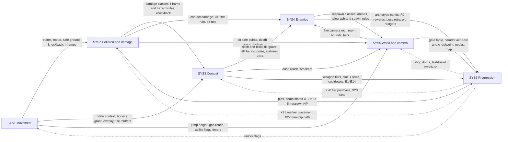
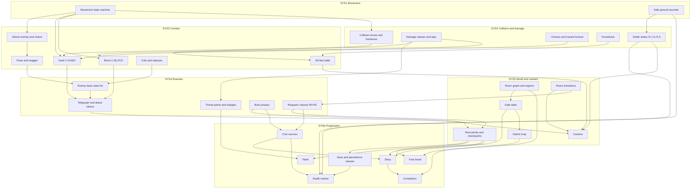

# Bastion Zero spec — Dependency graph

> Part of the Bastion Zero clean-room mechanics spec v3.2 (14 Nov 2026). Build order and what flows between systems. Use it to decide implementation order and where interfaces live.
> Rule text owner: All six system files.
> Precedence: user decisions (file 01) > owning system > later system. Tags: [sourced], [community-measured], [estimated] (file 01).

---

## 1. Dependency graph

### 1.1 System level

Solid arrows: values or rules consumed. Dotted arrows: a later system refining or feeding back into an earlier one (logged as an X difference; no source file edited).

| From | To | What flows | Where defined |
|---|---|---|---|
| SYS1 | SYS2 | Movement states, kinematic motor, safe-ground recorder (MV/CD-S52), knockback timing (CD-S49, CD-S50), post-hit i-frames (CD-S48), H-WARP | SYS1 §2, §6, §9 |
| SYS1 | SYS3 | S1 state as attack context (AIR1, WALL1, GLIDE-DOWN, CROUCH1), bounce-attack grant, overlay rule (attacks never block movement), jump buffer | SYS1 §3, §9 rows 20–28 |
| SYS1 | SYS5 | Jump height and gap reach → gate dimensions; ability flags → gate types; coyote, buffer, stored air-jump frozen across transitions (X15) | SYS1 §9; SYS5 §5.1, §9.2 |
| SYS2 | SYS3 | Damage classes, i-frame ownership, hazards ignore i-frames, knockback rules, no self-recoil | SYS2 §5–§8 |
| SYS2 | SYS4 | Contact damage on (D2-6), damage classes, kill removes contact first, pits during combat | SYS2 §5, §6, §9 |
| SYS2 | SYS5 | Pit damage + warp → pit safe-point rule; hazard lockout cleared on room change; D-2 → camera C-HOLD | SYS2 §9; SYS5 §9.3–§9.4, §10.1 |
| SYS2 | SYS6 | Pips 5 [estimated] (basis: S4) → 10 [estimated], death states D-1–D-5, full respawn health, damage-reduction rule | SYS2 §5, §9 |
| SYS3 | SYS4 | Dash (i-frames f3–f10, enemy only), block (guard points, chip) and parry (poise, reflect) → dash/block-fit rule; enemy HP bands; poise and stagger; statuses; crit windows | SYS3 §5–§7, §9 |
| SYS3 | SYS5 | Ground dash adds no gap reach (no jump after a ledge dash); air-dash unlock → GT17 and the ≥ 12-tile rule for later gates; GLIDE-DOWN / heavy → GT8–GT9 | SYS3 §3–§5 |
| SYS3 | SYS6 | Weapon tiers T1–T5, slot B items, ranged charges, charged strike, cooldown classes, exclusions E1–E14 | SYS3 §2–§4, §9 |
| SYS4 | SYS5 | Respawn classes R0–R3, B-GATE/arena lock, off-screen telegraph rule, spawn and rest-point safety distances | SYS4 §3, §10–§11 |
| SYS4 | SYS6 | Archetype bands → coin values, R0 one-time rewards, boss retry and marker placement, pip-loss budgets | SYS4 §9–§13 |
| SYS5 | SYS4 | Live camera rect (W14) for off-screen checks and R3; room boundaries; region progression tier | SYS5 §10, §4 |
| SYS5 | SYS6 | Gate table → unlock order; corridor act; rest point vs checkpoint; fast-travel nodes; map for completion | SYS5 §4–§5, §11–§12 |
| SYS6 | SYS2 | Penalty fixed at D-1, marker placement rules (X21); max-pip growth path (X22) | SYS6 §4, §7 |
| SYS6 | SYS3 | Weapon tiers bought for coin (X20); fixed-charge flask (X23) | SYS6 §5, §8 |
| SYS6 | SYS5 | Shop doors at rest points; fast travel switches on at WP-OPENING | SYS6 §5, §9 |
| SYS6 | SYS1 | Unlock flags and order (wall-cling, glide, grapple, projectile bounce, glide down-strike, recovery jump) | SYS6 §3 |

### 1.2 Key subsystems

| From | To | What flows | Source section |
|---|---|---|---|
| Movement state machine | Attack overlay | Current S1 state picks the attack (G1/AIR1/WALL1/CROUCH1/GLIDE-DOWN); attacks never interrupt movement | SYS3 §3.2, §11 |
| Movement state machine | Dash | Legal entry states G-*, C-BLOCK, attack startup and recovery; A-*, A-GLIDE and W-CLING only after the air-dash unlock; blocked from X-GRAPPLE, H-KNOCK, H-WARP, D-states; no coyote jump after a ledge dash (X28) | SYS3 §5.2 |
| Movement state machine | Block | Ground states only (G-IDLE, G-RUN, G-CROUCH) and attack recovery; walk at 0.35× [estimated] run | SYS3 §5.3 |
| Movement state machine | Collision boxes | Standing vs crouch heights | SYS2 §1, CD-02–CD-06 |
| Safe-ground recorder | Death states / marker | Warp target and marker position (last safe ground, 0.2 [estimated] s dwell) | SYS1 row 52; SYS2 §9; SYS6 §7.3 |
| Collision boxes | Dash | Standing hurtbox and collision kept; no 1-tile passages (X26; DB-4) | SYS3 §5.2, §12 |
| Damage classes | Hit-feel table | H11–H15 per class | SYS3 §8 |
| Damage classes | Threat budgets | Expected pip loss = Σ attacks × hit chance × class pips | SYS4 §13 |
| I-frames and lockout | Dash | I-frames f3–f10, enemy sources only (DB-1; X27); never hazards, pits, lethal | SYS3 §10, §12 |
| Damage classes | Block | D-Light 0 pips; D-Heavy chip 1 [estimated]; hazards, pits and lethal never blocked (X25) | SYS3 §5.3, §10 |
| Knockback | Hit-feel table | ≈ 1.31 [estimated] tiles inherited | SYS3 §8 H11 |
| Death states | Marker | Penalty fixed at D-1, applied at D-3 | SYS6 §7.2 |
| Death states | Camera | D-2 → C-HOLD; respawn → C-CUT | SYS5 §10.1 |
| Attack overlay | Poise | Poise damage per hit; ×2 [estimated] during enemy startup | SYS3 §6 |
| Dash / block / parry | Telegraph | Dash/block-fit rule: attacks blockable and parryable from the front unless marked unblockable (0.70 [estimated] s telegraph); unblockable attacks must pass jump-fit, dash-out fit or dash-through fit (overlap ≤ 6 [estimated] f); parry-stagger cap 3.0 [estimated] s | SYS4 §3.5 |
| Poise / statuses | Enemy state list | E-FLINCH, E-STAGGER, E-STATUS interrupts | SYS4 §3.1 |
| Hit-feel | Camera | Shake values; camera ignores time scale during hit-stop | SYS5 W13 |
| Telegraph | Camera | Off-screen rule uses the live camera rect (W14) | SYS5 §10.2 |
| Respawn classes | Rest points | R1 respawn on rest or death; rest-point safety 8 [estimated] tiles | SYS4 §11; SYS5 §12 |
| Respawn classes | Coin | R0 pays once; R1/R2 farming capped at 50% [estimated] of exploration income | SYS6 §4.3 |
| Boss | Rest points | Rest point ≤ 1 [estimated] room before B-GATE | SYS5 §12.3; SYS4 §13 rule 8 |
| Boss | Coin | 300 [estimated] base coin, R0 | SYS6 §4.2 |
| Threat budgets | Flask | Budgets assumed no healing; may rise ≤ 3 [estimated] pips per charge carried | SYS6 §8 rule 3 |
| Gate table | Shop | Only GT7 may be opened by a bought item; affordability rule | SYS6 §3.1, §4.3 rule 4 |
| Gate table | Map | Seen gates auto-marked by type (decision o) | SYS5 §11.3 |
| Room graph | Gate table | One gate per link; tease before key | SYS5 §5.3 |
| Room graph | Fast travel | Node per region; backtrack-distance targets | SYS5 §3.3; SYS6 §9.3 |
| Transitions | Camera | C-CUT during black | SYS5 §9.2, §10.1 |
| Transitions | Respawn classes | R2/R3 respawn at T-PLACE | SYS5 §9.2 |
| Rest points | Save | Full save write; checkpoint partial write | SYS6 §6.2–§6.3 |
| Rest points | Flask | Refill at rest only (also death and reload) | SYS6 §8 |
| Rest points | Fast travel | Nodes sit at rest points | SYS6 §9.1 |
| Rest points | Shop | Shop doors are rest points | SYS6 §5.1 |
| Map | Completion | Rooms inked weight 0.17 [estimated] | SYS6 §11 |
| Coin | Shop / marker | Wallet spent at the shop; 50% [estimated] of unspent coin to the marker on death | SYS6 §5, §7 |
| Shop | Completion | Catalogue share weight 0.05 [estimated] | SYS6 §11 |
| Save | Marker | Marker state saved at creation and recovery | SYS6 §6.3 |

---

