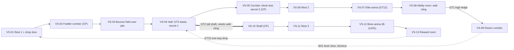

# Bastion Zero spec — Vertical-slice plan

> Part of the Bastion Zero clean-room mechanics spec v3.2 (14 Nov 2026). The minimum build that proves explore, fight, gate, unlock, backtrack. Implement THIS first; everything else is deferred.
> Precedence: user decisions (file 01) > owning system > later system. Tags: [sourced], [community-measured], [estimated] (file 01).

---

## 5. Vertical-slice recommendation
**Recommendation.** Everything in this section is a consolidation recommendation, not a decision. All counts and targets are [estimated]. It uses only mechanics already specified in SYS1–SYS6, the user's decisions (a)–(e), DB-1–DB-4 and FD-1–FD-10 (§5.8). Three slice choices are now user decisions, not recommendations: no air dash (FD-7), death marker on (FD-9) and a fodder-based elite (FD-10).

Goal: prove **explore → fight → gate → unlock → backtrack** in one corridor-style region at progression tier T1, with the coin, death-marker and flask loops live.

### 5.1 Minimum player states
| Layer | Included | Owner | Deferred |
|---|---|---|---|
| Movement | G-IDLE, G-RUN, A-RISE-HELD, A-RISE-FREE, A-APEX, A-FALL, W-CLING, W-JUMP, H-KNOCK, H-WARP (10 [estimated] states) | SYS1 §2 | G-CROUCH, A-FASTFALL, A-GLIDE, X-GRAPPLE |
| Death | D-1, D-2, D-3, D-4, D-5 (replace D-DEAD, X4) | SYS2 §9 | |
| Attack overlay | K-IDLE, G1, G2, G3, AIR1, WALL1 (6 [estimated]) | SYS3 §3, §11 | CROUCH1, GLIDE-DOWN, SEC-*, SK-CAST/SK-CD |
| Defence | C-DASH, ground only, i-frames f3–f10 (DB-1); C-BLOCK (BK-RAISE, BK-HOLD, BK-PARRY, BK-STUN, BK-RELEASE, BK-BREAK), ground only (DB-2) | SYS3 §5 | Air dash (DB-3: later unlock, not in the slice) |
| Progression overlay | DP-ALIVE, DP-DYING, DP-MARKED, DP-ALIVE-OWED, DP-RECOVERED | SYS6 §7.2 | |

Bounce-attack, stored air-jump, coyote, buffers, hit-pause and safe-ground recording come with these states (MV-19–MV-27, MV-D1–MV-D3).

### 5.2 Enemies
| Unit | Count | Threat points (EN-Q1) | Respawn | Purpose | Owner |
|---|---|---|---|---|---|
| Fodder patroller (P-F) | 5 [estimated] | 1 each | R2 | Teaching; bounce targets | SYS4 §4 |
| Soldier patroller (P-S) | 3 [estimated] | 2 each | R1 | Poise and stagger | SYS4 §4 |
| Shooter (R-S) | 2 [estimated] | 3 each | R1 | Ranged pressure, block and guard check, E-REPOSITION | SYS4 §5 |
| Drifter anchor (F-A) | 3 [estimated] | 0.5 each (non-attacking) | R3 | Bounce field GT6; R3 off-camera respawn | SYS4 §7 |
| Elite (fodder-patroller base (**Decided (user, 14 Nov 2026)**, FD-10), modifier M1 crystal ward) | 1 [estimated] | 1 × 3 + 2 = 5 [estimated] | R0 | Guards the ability room (GT12); intro and enrage pulses (X13) | SYS4 §9 |
| Small boss | 1 [estimated] | arena | R0 | 600 [estimated] HP, 2 phases at 50% [estimated], 3 attacks + 1 in phase 2; weighted random with no-repeat rules (decision i) | SYS4 §10 |

Enemy states needed: E-DORMANT, E-SPAWN, E-IDLE/E-PATROL, E-NOTICE, E-ENGAGE, E-REPOSITION, E-TELEGRAPH, E-ATTACK, E-RECOVER, E-COOLDOWN, E-FLINCH, E-STAGGER, E-SEARCH, E-RETURN, E-DEAD; elite E-INTRO-PULSE, E-MOD-ACT, E-ENRAGE-PULSE; boss B-GATE, B-INTRO, B-SELECT, B-TELEGRAPH, B-ATTACK, B-RECOVER, B-GAP, B-STAGGER, B-TRANSITION, B-DEFEAT. E-STATUS for stun only (decision e; others after the slice). Why M1: it is the one modifier with no hazard and no waves, and a fodder base keeps the room at 5 [estimated] points, inside the T1 room budget of 3–6 [estimated] (EN-Q3).

### 5.3 Rooms
| Room | Type (WC-Z) | Contents | Threat points | Gates and features | Tag |
|---|---|---|---|---|---|
| VS-01 | Junction | **Rest point 1** + **shop door** (decision t); start | 0 | Door (interact) transition | [estimated] |
| VS-02 | Corridor 2 × 1 | 3 fodder; checkpoint at exit | 3 | Teaching room: one new idea (EN-Q7) | [estimated] |
| VS-03 | Gauntlet 3 × 1 | 3 drifter anchors over a **pit field** (2 pits, each with a safe point, WC-T10) | 1.5 | GT6 bounce field (SB2), GT16 pit field (SB2) | [estimated] |
| VS-04 | Hall 2 × 2 | 1 soldier + 1 fodder; **gate tease**: GT2 tall shaft > 8 tiles, no anchors (SB0); **secret 1** (SC1 breakable wall → small cache 25) | 3 | GT2 auto-marked on the map (decision o); shortcut far side (SH1) | [estimated] |
| VS-05 | Corridor 2 × 1 | 1 soldier + 1 shooter; checkpoint; **secret 2** (SC2 false wall → large cache 150) behind the shooter's ledge, no traversal gate (no gap wider than 6 [estimated] tiles, MV-D2) | 5 | First block, parry and dash test: parry the soldier, reflect the shots (2 reflects kill the shooter) or dash through them; no 1-tile tunnels (DB-4) | [estimated] |
| VS-06 | Junction | **Rest point 2** | 0 | Rest before the elite | [estimated] |
| VS-07 | Arena 1.5 × 1 | **Elite** (M1) | 5 | GT12 enemy gate (SB0); C-ARENA | [estimated] |
| VS-08 | Junction | **Ability room: wall-cling** (PE-U1) | 0 | Lock-and-key: exit only via GT1 high ledge, 5–8 tiles (WC-K16) | [estimated] |
| VS-09 | Corridor 2 × 1 | Return route; ends at a lever door | 0 | **Shortcut** SH1 / GT14 opens into VS-04 (cuts the return from 4 [estimated] rooms to 1 [estimated]) | [estimated] |
| VS-10 | Shaft 1 × 3 | Climbed from VS-04 through GT2; 1 soldier + 1 shooter + 1 fodder; checkpoint | 6 | Top-opening transition with lift (X18); C-ZONE framing; WALL1 use | [estimated] |
| VS-11 | Junction | **Rest point 3**, ≤ 1 room before B-GATE (WC-P5) | 0 | Room before B-GATE has 0 points (EN-Q7 rule 8) | [estimated] |
| VS-12 | Arena 2 × 1.5 | **Small boss** | arena | B-GATE seals; C-ARENA | [estimated] |
| VS-13 | Corridor 2 × 1 | Boss reward room | 0 | **Drop ledge** GT15 (one-way) into VS-01: rest point and shop within 1 [estimated] room (WC-K18) | [estimated] |

**Counts:** 13 [estimated] rooms (3 junctions with rest points, 1 ability junction, 4 corridors, 1 gauntlet, 1 hall, 1 shaft, 2 arenas); 3 [estimated] rest points, 3 [estimated] checkpoints, 1 [estimated] shop door, 1 [estimated] pit field with 2 [estimated] pits, 2 [estimated] secrets, 1 [estimated] shortcut, 1 [estimated] one-way drop, 1 [estimated] ability gate (GT2) plus its lock-and-key gate (GT1), 1 [estimated] elite, 1 [estimated] boss. Rest spacing VS-01 → VS-06 is 5 [estimated] rooms with 3 [estimated] combat rooms, inside both WC-P2 and EN-Q7 (CR28).

Solid: normal links. Thick: the ability gate. Dotted: shortcut and one-way drop. CP = checkpoint.

### 5.4 Progression pieces
| Piece | Slice setting | Tag | Owner |
|---|---|---|---|
| Coin | Fixed values PE-C1–PE-C8 at T1 (×1). First-clear income ≈ 5 fodder + 3 anchors (1 each) + 3 soldiers and 2 shooters (3 each) + elite 60 + boss 300 + caches 175 = 558 | [estimated] (arithmetic) | SYS6 §4.2 |
| Shop | ST1 subset of 2 items: max pip A 300 and weapon tier T2 300 | [estimated] | SYS6 §5.3 |
| Death marker | **Decided (user, 14 Nov 2026)**, FD-9: P-C live: 50% of the wallet to a marker at last safe ground; 1 marker at a time. The slice runs with the world-phase flag set to WP-OPEN so the corridor-act exemption (PE-D3) doesn't hide it | [estimated] | SYS6 §7 |
| Flask | 1 charge, 3 pips, 0.5 s channel, refilled at rest | [estimated] | SYS6 §8 |
| Ability unlock | Wall-cling (PE-U1), behind the R0 elite, opens GT2 (SB0) and GT1 | [estimated] | SYS6 §3.2; SYS5 §5.2 |
| Save | Rest = full write; checkpoint = position, wallet, flags; pickups within 1 s; 1 slot | [estimated] | SYS6 §6 |
| Map | Hybrid map; GT2 icon auto-marked and highlighted on unlock | n/a | SYS5 §11 |

### 5.5 Camera and transitions
| Feature | Included | Owner |
|---|---|---|
| Camera states | C-FOLLOW, C-ZONE (VS-10 shaft), C-ARENA (VS-07, VS-12), C-CUT, C-HOLD | SYS5 §10.1 |
| Camera values | WC-W1–WC-W11, WC-W13, WC-W14 (W5 for bounce chains in VS-03; W11 for wall-cling) | SYS5 §10.2 |
| Transitions | Side opening, top opening with lift (VS-04 → VS-10), bottom opening (VS-13 → VS-01), door (shop) | SYS5 §9 |
| Transition states | T-TRIGGER, T-FADE-OUT, T-LOAD, T-PLACE, T-FADE-IN, T-ENTRY-GRACE, T-RELOCK; total ≤ 0.70 [estimated] s | SYS5 §9.2 |

### 5.6 Success criteria (prove the loop)
| # | Criterion | Target | Tag |
|---|---|---|---|
| VS-S1 | Explore: testers see the GT2 tease before the unlock | ≥ 90% of first-time testers | [estimated] |
| VS-S2 | Fight: the elite is beaten and wall-cling collected | median ≤ 4 attempts | [estimated] |
| VS-S3 | Gate → unlock: testers return to GT2 without a prompt | ≥ 80% within 5 minutes of the unlock | [estimated] |
| VS-S4 | Backtrack: the SH1 shortcut is opened and used | ≥ 80%; VS-08 → VS-04 in ≤ 2 rooms and ≤ 60 s | [estimated] |
| VS-S5 | Slice length | median 20–35 minutes for a first clear | [estimated] |
| VS-S6 | Death loop: deaths respawn at the later of checkpoint and rest point; marker recovered | marker recovered in ≥ 70% of deaths | [estimated] |
| VS-S7 | Damage budget: pips lost between rest points (flask on) | median ≤ 4 of 10 (EN-Q3) | [estimated] |
| VS-S8 | Coin loop: an item is bought on the return to VS-01 | ≥ 70% of testers | [estimated] |
| VS-S9 | Technical: transitions ≤ 0.70 s; every pit has a reachable safe point; no softlock from any room (graph check) | 100% | [estimated] |
| VS-S10 | Readability: no hit taken from an attack that started its telegraph off-screen | 0 reports | [estimated] |
| VS-S11 | Defence: testers use the block, the parry and the dash against the soldier and shooter without a prompt; guard breaks only on purpose-built strings | ≥ 80% use block and dash by VS-07; ≥ 50% land a parry by VS-07; 0 guard breaks from VS-02–VS-05 enemies | [estimated] |

### 5.7 Deferred (not in the slice)
- **Movement:** air dash (DB-3 later unlock; GT17), glide, grapple, fast-fall, crouch, one-way drop-through, collapsing and moving platforms, slopes (not in v1 anyway).
- **Combat:** slot B weapons, skills C/D, CROUCH1, GLIDE-DOWN, slow/burn/bleed statuses (decided, built after stun). Parry is in the slice (DB-2).
- **Enemies:** chargers, swoopers, flying shooters, volley shooters, shielded, M2–M6, B-ADDS, mid and final-type bosses, lock-in waves.
- **World:** gates GT3–GT5, GT7–GT9, GT11, GT17 (GT10 and GT13 removed); region map pickup and player markers; region and world views; lifts; multiple regions.
- **Progression:** fast travel, ST2–ST4, weapon tiers T3–T5, pip fragments, challenge rooms, completion %, the opening event, extra save slots.
- **Already deferred by decision:** trinkets and notches (x).

### 5.8 Dash and block decisions in the slice
Decisions (a)–(e) and DB-1–DB-4 are settled; the former branch table is removed.

| Decision | Slice effect |
|---|---|
| (a) | VS-03 hazards need timing |
| (b) | No slot B, no GT13 |
| (c) | Ground dash only in the slice (see DB-3) |
| (d), (e) | All three crit triggers on; stun only on the boss stagger follow-up |
| DB-1 | Dash i-frames f3–f10, enemy sources only; EN-K3 rechecked: soldier strike and shots fit the dash-through |
| DB-2 | Parry in the slice; the small boss's blockable attacks are parryable, and its phase 2 adds ≥ 1 unblockable attack (EN-K4) |
| DB-3 | **The air dash is not in the slice.** The slice's ability is wall-cling; the air dash arrives at 5.5–7.0 [estimated] h (PE-U11), so base reach is ≤ 6 [estimated] tiles and no slice room needs or tests it. **Decided (user, 14 Nov 2026)**, FD-7. |
| DB-4 | No 1-tile tunnels; secret 2 is a false wall with no traversal gate |
| DB-5, DB-6 | Reflected shots in VS-05 are not bounce targets; parries give no guard refund |
| FD-9, FD-10 | Death marker on (WP-OPEN flag); elite on a fodder base |

---

