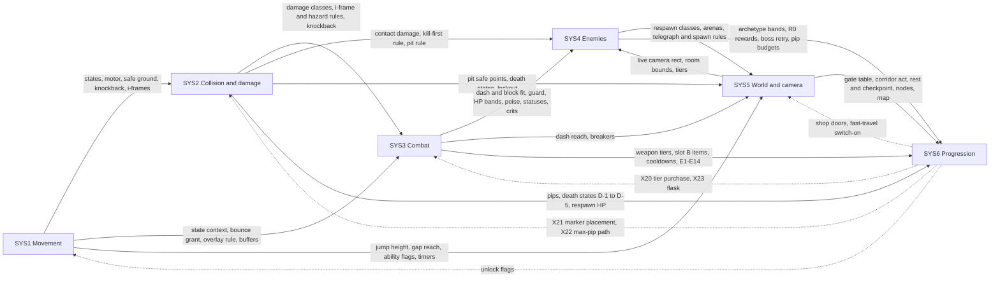
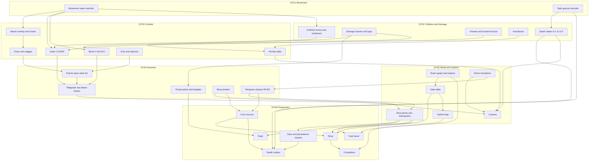
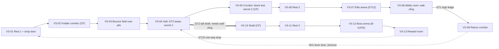

# Bastion Zero: Consolidated Mechanics Spec, Systems 1–6 (clean-room)

Version 3.2 · 14 Nov 2026 (UTC+8). Version 3.2 records the user's confirmation of decision (g) and resolves CR37; Version 3.1 is backed up as `bastion-zero-consolidated-spec.md.pre-g`. Version 3.1 applies the final decisions FD-1–FD-10 (§0.1), including the CR34 tag policy, and leaves no open user decisions; Version 3 is backed up as `bastion-zero-consolidated-spec.md.pre-final`. Consolidates the latest versions of the six system specs. Version 2 applied System 3 decisions (a)–(e) (no roll; dash and block); Version 3 applies DB-1–DB-4 (dash i-frames, parry, air-dash unlock, no 1-tile tunnels). Backups: `bastion-zero-consolidated-spec.md.v1` (Version 1), `bastion-zero-consolidated-spec.md.pre-db` (Version 2). SYS1 and SYS2 are unchanged:

| System | File | Version used |
|---|---|---|
| SYS1 Player movement | `system-1-player-movement.md` | Version 1, 13 Nov 2026 |
| SYS2 Collision and damage | `system-2-collision-damage.md` | Version 2.1, 14 Nov 2026 |
| SYS3 Combat | `system-3-combat.md` | Version 3.1, 14 Nov 2026 |
| SYS4 Enemy AI and encounters | `system-4-enemy-ai.md` | Version 2.4, 14 Nov 2026 |
| SYS5 World and exploration | `system-5-world-exploration.md` | Version 2.3, 14 Nov 2026 |
| SYS6 Progression and persistence | `system-6-progression-persistence.md` | Version 2.3, 14 Nov 2026 |

References: The Messenger (TM), Hollow Knight (HK), Dead Cells (DC).

**Consolidation rules used here**
- Consolidation only: no new mechanics and no new research. Every value, tag and citation is carried over from the system that owns it, except where the CR34 tag policy (FD-8) retags a copied default.
- Anything new in this document (vertical-slice counts, suggested defaults, success targets) is tagged [estimated] and labelled **Recommendation**.
- User decisions win; otherwise the later or owning system governs. Each conflict row says **RESOLVED (rule)** or **FLAGGED**.
- No names of characters, items, areas, currencies or abilities. URLs may contain names, by precedent.

### Tags and markers
- **[sourced]**: stated in a public source (named by code in §0.2).
- **[community-measured]**: counted, timed or polled by third parties.
- **[estimated]**: a Bastion Zero value, a user design decision, or arithmetic on other values.
- **"provenance unclear"**: a wiki number that may come from game data. Datamined, decompiled and game-file values are excluded throughout.
- **Copied defaults (CR34 policy, FD-8, decided 14 Nov 2026):** a Bastion Zero default copied from a reference is tagged [estimated] with the reference as basis, e.g. "[estimated] (basis: S4)"; the reference value itself (Source column) stays [sourced]. This overrides the "carry every tag over" rule above. SYS1 is not edited, so its copied defaults keep [sourced] in that file (X29); the SYS1-mirrored rows here use the new policy.
- User-decided defaults are never tagged [sourced]. In tables with a Tag column, the tag applies to every number in that row unless a number carries its own tag.
- **Units:** 60 [estimated] fps; 1 tile = 16 [estimated] px; hero height H = 2 [estimated] tiles.

### Code prefixes used in this document
- **SYS1–SYS6**: the six system specs (the source files call them "S1-doc" … "S6-doc").
- **S1–S93**: public sources (§0.2). These codes were already globally unique across the six files.
- **X1–X29**: known cross-system differences; **CR24+**: further conflicts found during consolidation (§3.7).
- **MV / CD / CF / EN / WC / PE**: merged parameter IDs (§3). CF-DA* = dash, CF-BK* = block and parry (Versions 2–3).
- **DB-1–DB-6**: dash/block follow-on decisions, all decided 14 Nov 2026 (§0.1). **FD-1–FD-10**: final decisions on the remaining open items, 14 Nov 2026 (§0.1).
- **OQ-B / OQ-H / OQ-M / OQ-L**: combined Open Questions by rank (§4).
- **VS-**: vertical-slice items (§5).

---

## 0. Overview

### 0.1 User decisions (all systems)
| ID | Date | System | Decision | Governs |
|---|---|---|---|---|
| D2-1 | 14 Nov 2026 | SYS2 | Bottomless pits in exploration areas: damage plus a warp to the last safe ground, not instant death | CD-31, CD-32, X3 |
| D2-2 | 14 Nov 2026 | SYS2 | Per-hazard re-hit lockout adopted at 0.5 [estimated] s | CD-25, X2 |
| D2-3 | 14 Nov 2026 | SYS2 | Respawn health: full | CD-33, X4 |
| D2-4 | 14 Nov 2026 | SYS2 | Max health: 10 [estimated] pips | CD-18, X1 |
| D2-5 | 14 Nov 2026 | SYS2 | Collapsing platforms come back | CD-16 |
| D2-6 | 14 Nov 2026 | SYS2 | Contact damage on by default | SYS2 §6; EN contact rows |
| D2-7 | 14 Nov 2026 | SYS2 | Leave System 1 as is: all six proposed System 1 edits declined | All X rows ("no SYS1 edit") |
| (f) | 14 Nov 2026 | SYS4 | All four respawn classes approved, including R3 (off-screen respawn for traversal anchors) | EN-RS1 |
| (g) | 14 Nov 2026 | SYS4 | Universal attack warning sign **on by default** (confirmed by the user; CR37 resolved) | EN-T1 |
| (h) | 14 Nov 2026 | SYS4 | Enemies that give up the chase keep their damage (no healing on return) | EN-A10 |
| (i) | 14 Nov 2026 | SYS4 | Bosses use weighted random attack choice with no-repeat rules; no scripted-cycle mode | EN boss rows |
| (j) | 14 Nov 2026 | SYS4 | No bounce from hitting a shield in the air; X12 declined | X12 |
| (k) | 14 Nov 2026 | SYS4 | Elite clone modifier reinstated as a designer-placed option (M6), never rolled | EN-M6 rows |
| (l) | 14 Nov 2026 | SYS5 | Map model hybrid: dotted sketch on entry, inked at the next rest | WC-M1, WC-M2 |
| (m) | 14 Nov 2026 | SYS5 | World shape: linear corridor act, then the world opens (15–25% [estimated] of rooms) | WC-N2 |
| (n) | 14 Nov 2026 | SYS5 | Camera: small look-ahead in the direction of travel (X16 decided) | WC-W4, X16 |
| (o) | 14 Nov 2026 | SYS5 | Seen gates auto-marked on the map by gate type | WC-M1, WC-M2 |
| (p) | 14 Nov 2026 | SYS5 | World size approved: 180–260 [estimated] rooms, 8–12 [estimated] regions, 8–12 [estimated] hours | WC-G1, WC-G2, WC-P1 |
| (q) | 14 Nov 2026 | SYS5 | No late-game region transformation | WC-P10 |
| (r) | 14 Nov 2026 | SYS6 | One persistent coin with set, fixed values per source | PE-C rows |
| (s) | 14 Nov 2026 | SYS6 | Death penalty P-C: half of unspent coin drops into a recoverable marker | PE-D rows, X19, X21 |
| (t) | 14 Nov 2026 | SYS6 | One shop reached through doors at rest points | PE-S rows |
| (u) | 14 Nov 2026 | SYS6 | Fixed-charge healing flask (partly reinstates SYS3 E8 and E14) | PE-F rows, X23 |
| (v) | 14 Nov 2026 | SYS6 | Coin fee only for weapon tiers T2–T5 (no tier materials) | PE-S rows, X20 |
| (w) | 14 Nov 2026 | SYS6 | Cooldown reduction stays excluded (SYS3 E6) | CF-K5 |
| (x) | 14 Nov 2026 | SYS6 | Trinkets and notches: optional, add later (deferred post-v1) | PE-T rows |
| (y) | 14 Nov 2026 | SYS6 | Map, toll and fast-travel prices stay excluded (SYS5 WE10) | PE-V rows |
| (z) | 14 Nov 2026 | SYS6 | Stat growth stays excluded (SYS3 E5) | PE rows |
| (a) | 14 Nov 2026 | SYS3 | No: nothing dodges traps; hazards ignore invulnerability (SYS2 §8 rule 2 stands) | CR26, WC-K11, EN-M2, EN-M3 |
| (b) | 14 Nov 2026 | SYS3 | No roll, only dash and block: the shield slot B archetype is removed; the block is a core action | CF-BK rows, CF-L2, X25, WC-K13 |
| (c) | 14 Nov 2026 | SYS3 | No roll, only dash and block: roll and air roll removed; the dash works on the ground and in the air | CF-DA rows, X9, X11, X24, X26, MV-D2, MV-D3 |
| (d) | 14 Nov 2026 | SYS3 | Three deterministic crit triggers approved at 2× | CF-X6, CF-D4 |
| (e) | 14 Nov 2026 | SYS3 | Four enemy-only statuses approved; no player statuses | CF-S1–CF-S6, EN-T7 |
| DB-1 | 14 Nov 2026 | SYS3 | Dash i-frames: 8 f, enemy sources only, never hazards (placed on f3–f10 [estimated]) | CF-DA8, CF-DA10, EN-K3, X27 |
| DB-2 | 14 Nov 2026 | SYS3 | Parry on: perfect-timing window in the first 8 f after the guard is raised | CF-BK12–CF-BK18, CF-H17, EN-K4, EN-X4 |
| DB-3 | 14 Nov 2026 | SYS3 | Air dash is a later unlock; ground dash stays base kit; no jump right after a ledge dash | CF-DA1, CF-DA6, CF-DA11, MV-D2, MV-D3, WC-K3, WC-K5, WC-K19–WC-K21, PE-U11, X24, X28 |
| DB-4 | 14 Nov 2026 | SYS3 | 1-tile tunnels dropped entirely | CF-DA9, X26; GT10 removed |
| FD-1 (DB-5) | 14 Nov 2026 | SYS3 | Reflected (parried) shots are not bounce targets | CF-BK15; OQ-L15 resolved |
| FD-2 (DB-6) | 14 Nov 2026 | SYS3 | No guard refund on a parry (confirmed) | CF-BK13; OQ-L16 resolved |
| FD-3 | 14 Nov 2026 | SYS4 | Parry-stagger cap kept at 3.0 [estimated] s. The user wrote "No Stat lock"; reading it as "no stun lock" (keep the cap that prevents parry locks) is the parent agent's **interpretation** of the user's words | EN-K4; OQ-M15 (cap part) |
| FD-4 | 14 Nov 2026 | SYS4 | At least 1 [estimated] unblockable attack per boss phase from phase 2 (confirmed) | EN-K4; OQ-M18 resolved |
| FD-5 | 14 Nov 2026 | SYS5 | GT17 is the low-ceiling gap as written, 6–8 tiles wide (confirmed) | WC-K19; OQ-H10 (shape part) |
| FD-6 | 14 Nov 2026 | SYS6 | The air dash comes from an ability room behind an elite (confirmed) | PE-U11; OQ-M17 (source part) |
| FD-7 | 14 Nov 2026 | Slice | Air dash excluded from the vertical slice (confirmed) | §5.1, §5.7, §5.8 |
| FD-8 | 14 Nov 2026 | All | CR34 tag policy: Bastion Zero defaults copied from a reference are tagged [estimated], basis cited; SYS1 left untouched (X29) | Tags and markers; CR34; X29 |
| FD-9 | 14 Nov 2026 | Slice | Death marker on in the vertical slice (world-phase flag WP-OPEN) (confirmed) | §5.4 |
| FD-10 | 14 Nov 2026 | Slice | The slice elite is built on a regular (fodder) enemy (confirmed) | §5.2, VS-07 |

SYS1 (13 Nov 2026) contains no user decisions. The owner's words for (a)–(e) were "A no / B no roll, only dash and block / C no roll, only dash and block / D approve / E approve"; the dash and block values that follow from them are SYS3 proposals tagged [estimated], with four follow-on choices DB-1–DB-4, which the owner answered "DB-3 later unlock / DB-1 8 frames / DB-2 perfect timing / DB-4 drop". Frame placements, parry effects and gate geometry are SYS3–SYS6 proposals tagged [estimated]. FD-1–FD-10 are recorded as relayed by the parent agent; only FD-3 quotes the user's own words ("No Stat lock"), and its reading is an interpretation. Values set by decisions are tagged [estimated], never [sourced].

### 0.2 Unified source list (de-duplicated)
One row per source code. Where several system files described the same code differently, the longest description is kept and the merge is noted; all URLs given for a code in any file are kept. "Cited by" lists the systems whose source keys include the code.

| Code | Source | URL(s) | Cited by |
|---|---|---|---|
| S1 | Game Developer, "Game Design Deep Dive: Re-imagining the double-jump in The Messenger" (T. Boulanger, 2019) | https://www.gamedeveloper.com/design/game-design-deep-dive-re-imagining-the-double-jump-in-i-the-messenger-i- | SYS1 |
| S2 | The Geekly Grind, "Perfecting The Ninja Way" (dev interview, 2018) | https://www.thegeeklygrind.com/all-posts/perfecting-the-ninja-way-a-conversation-with-the-messenger-development-team | SYS1 |
| S3 | Kotaku dev interview (TM): attacking never slows running; jumping is never delayed by an attack (merged 3 descriptions; longest kept) | https://kotaku.com/tight-controls-define-this-retro-homage-to-ninja-gaiden-1822282879 | SYS1, SYS2, SYS3 |
| S4 | The Messenger Wiki, Shop Upgrades page (catalogue, prices shown in the in-game shop, HP 5→8, charge pool, checkpoint-heal upgrade, penalty upgrade) (merged 4 descriptions; longest kept) | https://the-messenger.fandom.com/wiki/Cloudstep · /wiki/Climbing_Claws · /wiki/Rope_Dart · /wiki/Wingsuit · /wiki/Shop_Upgrades · https://the-messenger.fandom.com/wiki/Shop_Upgrades | SYS1, SYS2, SYS3, SYS6 |
| S5 | TheMessengerRTA Wiki (speedrun community): General Info, Out-of-Bounds Techniques (merged 2 descriptions; longest kept) | https://themessengerrta.fandom.com/wiki/General_Info · https://themessengerrta.fandom.com/wiki/Out-of-Bounds_Techniques | SYS1, SYS2 |
| S6 | Steam Community guide, "100% Completion Guide & Walkthrough" (merged 3 descriptions; longest kept) | https://steamcommunity.com/sharedfiles/filedetails/?id=1643339519 | SYS1, SYS2, SYS3, SYS6 |
| S7 | GameFAQs TM guide by KumihoStar (first-boss HP and pattern thresholds) (merged 3 descriptions; longest kept) | https://gamefaqs.gamespot.com/pc/230087-the-messenger/faqs/77725/general-information | SYS1, SYS2, SYS3, SYS4 |
| S8 | The Messenger official FAQ | https://themessengergame.com/faq/ | SYS1 |
| S9 | Neoseeker walkthrough (glide input and updrafts) | https://www.neoseeker.com/the-messenger-2018/walkthrough/Howling_Grotto | SYS1 |
| S10 | aigamedev.ai, "Measured movement: Celeste, Hollow Knight, Shovel Knight" (frame tracking of 60 fps footage) (merged 3 descriptions; longest kept) | https://aigamedev.ai/skills/platformer-feel/references/measured-movement.md | SYS1, SYS3, SYS5 |
| S11 | Hollow Knight Wiki: dash page, wall-cling page, double-jump page, damage-recovery charm page, weapon page (pogo) (merged 4 descriptions; longest kept) | https://hollowknight.wiki/w/Mothwing_Cloak · /w/Mantis_Claw · /w/Monarch_Wings · /w/Stalwart_Shell · /w/Nail · https://hollowknight.wiki/w/Mantis_Claw · https://hollowknight.wiki/w/Nail | SYS1, SYS2, SYS3, SYS6 |
| S12 | Gaming StackExchange, "How does the invincibility frame system work in Hollow Knight?" (merged 2 descriptions; longest kept) | https://gaming.stackexchange.com/questions/413676 | SYS1, SYS2 |
| S13 | Hollow Knight Speedrunning Wiki, "Hazard warp" (merged 2 descriptions; longest kept) | https://hollow-knight-speedrunning.fandom.com/wiki/Hazard_warp | SYS1, SYS2 |
| S14 | Official Dead Cells Wiki: Mechanics (rolling, climbing, falling, air stall, dive attack) (merged 3 descriptions; longest kept) | https://deadcells.wiki.gg/wiki/Mechanics | SYS1, SYS2, SYS3, SYS4 |
| S15 | Official Dead Cells Wiki: Controls (advanced maneuvers) (merged 2 descriptions; longest kept) | https://deadcells.wiki.gg/wiki/Controls | SYS1, SYS2, SYS3 |
| S16 | Speedrun.com, Dead Cells "List of Current Tech" | https://www.speedrun.com/deadcells/guides/oo8vv | SYS1 |
| S17 | r/deadcells thread on ledge-grab invulnerability (merged 2 descriptions; longest kept) | https://www.reddit.com/r/deadcells/comments/somwau/ | SYS1, SYS2 |
| S18 | Rogue Ranker, HK wall-cling explainer (restates the wiki) | https://rogueranker.com/how-to-get-mantis-claw-hollow-knight/ | SYS1 |
| S19 | Official DC Wiki: Hazards (incl. version history) | https://deadcells.wiki.gg/wiki/Hazards | SYS2 |
| S20 | Official DC Wiki: Shields | https://deadcells.wiki.gg/wiki/Shields | SYS2, SYS3 |
| S21 | Official DC Wiki: Stats | https://deadcells.wiki.gg/wiki/Stats | SYS2, SYS3 |
| S22 | Official DC Wiki: Permadeath | https://deadcells.wiki.gg/wiki/Permadeath | SYS2, SYS6 |
| S23 | Official DC Wiki: Biomes (scaling section) | https://deadcells.wiki.gg/wiki/Biomes | SYS2 |
| S24 | Hollow Knight Wiki: protagonist page (health section) | https://hollowknight.wiki/w/The_Knight | SYS2, SYS6 |
| S25 | Hollow Knight Wiki: death-remnant enemy page | https://hollowknight.wiki/w/Shade | SYS2, SYS6 |
| S26 | Hollow Knight Wiki: a late boss page (2-unit contact damage) | https://hollowknight.wiki/w/Failed_Champion | SYS2 |
| S27 | Ludonauta devlog, "The Hidden Genius Behind Hollow Knight's Terrain Design" | https://ludonauta.itch.io/platformer-essentials/devlog/1084669/the-hidden-genius-behind-hollow-knights-terrain-design | SYS2 |
| S28 | ResetEra forum thread, HK terrain geometry | https://www.resetera.com/threads/how-to-enjoy-hollow-knight.124973/page-3 | SYS2 |
| S29 | Atomic Bob-Omb blog, "Hollow Knight & Knockback" | https://atomicbobomb.home.blog/2019/02/05/hollow-knight-knockback/ | SYS2, SYS3 |
| S30 | Stack Overflow, frame-by-frame observations of HK melee (merged 2 descriptions; longest kept) | https://stackoverflow.com/questions/58929965/cloning-melee-combat-from-hollow-knight | SYS2, SYS3 |
| S31 | Game Developer, "How does 'The Messenger' make you a master?" | https://www.gamedeveloper.com/design/how-does-the-messenger-make-you-a-master- | SYS2 |
| S32 | Neoseeker TM walkthroughs (two levels with crushers, moving and collapsing platforms) | https://www.neoseeker.com/the-messenger-2018/walkthrough/Catacombs · /walkthrough/Underworld | SYS2 |
| S33 | Speedrun.com TM guide (includes "spike seeding") | https://www.speedrun.com/the_messenger/guides/1sjxb | SYS2 |
| S34 | Steam DC discussion, "Collision detection (Enemy bumps)" | https://steamcommunity.com/app/588650/discussions/0/1457328392105850726/ | SYS2 |
| S35 | r/deadcells, "needs temporary invulnerability after being hit" | https://www.reddit.com/r/deadcells/comments/6n5trx/ | SYS2 |
| S36 | kosmender.com, DC final-boss guide (body contact on charge and slam) | https://www.kosmender.com/hand-of-the-king | SYS2 |
| S37 | 80.lv, "Interview With the Developers of Dead Cells" (hit-stop on crits) | https://80.lv/articles/interview-with-the-developers-of-dead-cells | SYS3 |
| S38 | teemo.dev, DC "Game Feel & Juice". Used only for its summary of the 2019 GDC talk by DC's designer and the accessibility toggles; no game-file values. (merged 2 descriptions; longest kept) | https://teemo.dev/game-design/dead-cells/systems/game-feel-and-juice/ | SYS3, SYS5 |
| S39 | Ars Technica "War Stories" video with DC's designer (input leniency) | https://www.youtube.com/watch?v=Uv5NwboDDhk | SYS3 |
| S40 | Official DC Wiki: Status effects | https://deadcells.wiki.gg/wiki/Status_effects | SYS3 |
| S41 | Official DC Wiki: Gear (slots, melee/ranged/shield mechanics, skill tables) | https://deadcells.wiki.gg/wiki/Weapons | SYS3 |
| S42 | Official DC Wiki: starter-sword page (combo rate; provenance unclear) | https://deadcells.wiki.gg/wiki/Rusty_Sword | SYS3 |
| S43 | Nestor's Long Stuff, "Dead Cells: Movement" (critique: cancels and roll) | https://nestorslongstuff.home.blog/2018/12/14/dead-cells-movement/ | SYS3 |
| S44 | HK Wiki: rest-point page (what resting does; count; tolls) (merged 3 descriptions; longest kept) | https://hollowknight.wiki/w/Bench_(Hollow_Knight) | SYS4, SYS5, SYS6 |
| S45 | HK Wiki: Combat (boss stagger rules) | https://hollowknight.wiki/w/Combat_(Hollow_Knight) | SYS4 |
| S46 | HK Wiki: final-boss page (phase thresholds, stagger and combo values; provenance unclear) | https://hollowknight.wiki/w/The_Hollow_Knight | SYS4 |
| S47 | HK Wiki: armoured-boss page (armour-pool stagger) | https://hollowknight.wiki/w/False_Knight | SYS4 |
| S48 | Steam Community, HK discussion "stop enemies respawn" (weak enemies respawn on room re-entry) | https://steamcommunity.com/app/367520/discussions/0/1693795812301576401/ | SYS4 |
| S49 | Official DC Wiki: Enemies (elite rules, behaviours) | https://deadcells.wiki.gg/wiki/Enemies | SYS4 |
| S50 | Official DC Wiki: Bosses (status resistance) | https://deadcells.wiki.gg/wiki/Bosses | SYS4 |
| S51 | Official DC Wiki: a boss page (phases at 75% and 50% with a push-back roar) | https://deadcells.wiki.gg/wiki/The_Giant | SYS4 |
| S52 | Official DC Wiki: a boss page (summon phase, invulnerability, charge into pits, timed fuses) | https://deadcells.wiki.gg/wiki/The_Hand_of_the_King | SYS4 |
| S53 | Official DC Wiki: a boss page (speed-up at 50%) | https://deadcells.wiki.gg/wiki/The_Scarecrow | SYS4 |
| S54 | Reddit r/deadcells, parry-tips thread (attack sign; variable sign-to-hit delay) | https://www.reddit.com/r/deadcells/comments/vur0g8/can_someone_give_me_tips_on_parrying/ | SYS4 |
| S55 | Reddit r/gamedesign, "What draws your attention" (attack sign; off-screen edge indicator) | https://www.reddit.com/r/gamedesign/comments/wyfh5l/what_draws_your_attention/ | SYS4 |
| S56 | teemo.dev DC "UX, UI & Accessibility". Used only for its list of options menus (attack-sign size, assist sliders); no game-file values. | https://teemo.dev/game-design/dead-cells/systems/ux-ui-and-accessibility/ | SYS4 |
| S57 | GameSpew, The Messenger review (off-screen respawn) (merged 2 descriptions; longest kept) | https://www.gamespew.com/2018/08/the-messenger-review/ | SYS4, SYS5 |
| S58 | Chris Davis, "The Messenger (Switch)" blog review (respawn tied to an off-screen spawn point) (merged 2 descriptions; longest kept) | https://cdavisgames.wordpress.com/2018/12/03/the-messenger-switch/ | SYS4, SYS5 |
| S59 | Neoseeker TM walkthrough (lock-in rooms with waves; a boss knock-down stun window) | https://www.neoseeker.com/the-messenger-2018/walkthrough/Catacombs | SYS4 |
| S60 | The Centurion Report, DC boss guide (phase change at about 70% and 50%) | https://thecenturionreport.com/dead-cells-the-time-keeper-boss-guide-kill-the-clock/ | SYS4 |
| S61 | PC Gamer, "How to design a great Metroidvania map" (Team Cherry interview, 2017) | https://www.pcgamer.com/how-to-design-a-great-metroidvania-map/ | SYS5 |
| S62 | Game Informer, "The Making Of Hollow Knight" (2018) | https://gameinformer.com/2018/10/15/the-making-of-hollow-knight | SYS5 |
| S63 | Kotaku Splitscreen interview with Team Cherry (2018, video) | https://www.youtube.com/watch?v=6bQP2rmNBpI | SYS5 |
| S64 | Power Up Gaming, Hollow Knight developer interview (2015) | https://powerupgaming.co.uk/2015/11/20/developer-interview-hollow-knight-promising-platformer-with-lots-to-hide/ | SYS5 |
| S65 | HK Wiki: map and mapping-tool page | https://hollowknight.wiki/w/Map_and_Quill_(Hollow_Knight) | SYS5, SYS6 |
| S66 | HK Wiki: fast-travel page (station tolls, call bell, trams) (merged 2 descriptions; longest kept) | https://hollowknight.wiki/w/Stag_Station · https://hollowknight.wiki/w/Fast_Travel_(Hollow_Knight) (redirect target of /w/Stag_Station) | SYS5, SYS6 |
| S67 | Hollow Knight Interactive Map, fan guide to the map system | https://hollowknightinteractivemap.com/guides/map-and-quill | SYS5 |
| S68 | Reddit r/HollowKnight, room count thread (hand count, corrected) | https://www.reddit.com/r/HollowKnight/comments/1f7ki9x/how_many_rooms_are_there_in_hollow_knight/ | SYS5 |
| S69 | Reddit r/HollowKnight, "How many rooms?" (separate hand count) | https://www.reddit.com/r/HollowKnight/comments/vma064/how_many_rooms/ | SYS5 |
| S70 | HK Wiki: world overview page (used only to count named areas) | https://hollowknight.wiki/w/Hallownest | SYS5 |
| S71 | HollowKnight.LoadNormalizer README (load-phase timings measured on players' machines with a race mod) | https://github.com/homothetyhk/HollowKnight.LoadNormalizer | SYS5 |
| S72 | ComicBook.com, interview with Sabotage Studio (TM structure, screen-by-screen design) | https://comicbook.com/gaming/news/the-messenger-interview-sabotage-studios-nintendo-switch-pc/ | SYS5 |
| S73 | The Young Folks, PAX East 2019 interview with TM's creative director (portals in the open-world phase) (merged 2 descriptions; longest kept) | https://www.theyoungfolks.com/video-games/131649/the-messengers-thierry-boulanger-on-dlc-update-picnic-panic-pax-east-2019/ | SYS5, SYS6 |
| S74 | GamesBeat, TM hands-on interview (shift point; revisiting levels) | https://gamesbeat.com/ninja-gaiden-throwback-the-messenger-is-great-and-makes-me-feel-guilty/ | SYS5 |
| S75 | Destructoid, interview with TM's creator (campaign length) | https://www.destructoid.com/we-talk-ninja-flips-metroidvanias-and-the-25-year-journey-of-the-messenger-with-creator-thierry-boulanger/ | SYS5, SYS6 |
| S76 | Official DC Wiki: Biomes (biome counts, exits, map views) (merged 2 descriptions; longest kept) | https://deadcells.wiki.gg/wiki/Biomes | SYS5, SYS6 |
| S77 | Official DC Wiki: Runes and upgrades (permanent path unlocks; permanent upgrades bought with the meta currency, with prices; gold kept on death) (merged 2 descriptions; longest kept) | https://deadcells.wiki.gg/wiki/Runes | SYS5, SYS6 |
| S78 | Itay Keren, "Scroll Back: The Theory and Practice of Cameras in Side-Scrollers" (GDC 2015 talk, article version) | https://www.gamedeveloper.com/design/scroll-back-the-theory-and-practice-of-cameras-in-side-scrollers | SYS5 |
| S79 | The Messenger Wiki: currency page (sources, sinks, farming by reload) | https://the-messenger.fandom.com/wiki/Time_Shards | SYS6 |
| S80 | The Messenger Wiki: death-penalty follower character page | https://the-messenger.fandom.com/wiki/Quarble | SYS6 |
| S81 | The Messenger Wiki: shop location page (reached from shop checkpoints) | https://the-messenger.fandom.com/wiki/The_Shop | SYS6 |
| S82 | The Messenger Wiki: challenge-room collectible page (45 collectibles; reward) | https://the-messenger.fandom.com/wiki/Power_Seals | SYS6 |
| S83 | Hollow Knight Wiki: currency page (denominations, tolls, merchant totals, sources) | https://hollowknight.wiki/w/Geo | SYS6 |
| S84 | Hollow Knight Wiki: charms page (notches, equip only at rest points, overcharm) | https://hollowknight.wiki/w/Charms | SYS6 |
| S85 | Hollow Knight Wiki: completion page (percentage weights) | https://hollowknight.wiki/w/Completion_(Hollow_Knight) | SYS6 |
| S86 | Hollow Knight Wiki: max-health fragment page (4 per unit; shop prices) | https://hollowknight.wiki/w/Mask_Shard_(Hollow_Knight) | SYS6 |
| S87 | Hollow Knight Wiki: soul meter page (healing spends a third of the meter) | https://hollowknight.wiki/w/Soul | SYS6 |
| S88 | Official DC Wiki: Pickups (meta currency, gold, food; lost on death). Its drop-chance rows are excluded. | https://deadcells.wiki.gg/wiki/Cells | SYS6 |
| S90 | Official DC Wiki: the forge NPC page (permanent investment of meta currency) | https://deadcells.wiki.gg/wiki/Forge | SYS6 |
| S91 | Official DC Wiki: the meta-currency NPC page (located in passages between biomes; purchases carry over) | https://deadcells.wiki.gg/wiki/The_Collector | SYS6 |
| S92 | Game Rant, "How Long it Takes to Beat Hollow Knight…" (HowLongToBeat player polls) | https://gamerant.com/hollow-knight-how-long-to-beat-all-dlc-collectibles-silksong/ | SYS6 |
| S93 | MoonCellar, The Messenger page (HowLongToBeat figures) | https://mooncellar.space/games/the-messenger | SYS6 |

**Citations kept from reference comparisons only.** These codes support comparison rows or design reasons in the system files but no merged value in §3. They are kept here so each original citation still has a home.

| Code | Claim as cited in the system file | Cited in |
|---|---|---|
| S17 | DC players report short invulnerability during a ledge climb, shorter than a roll's; unmeasured | SYS1 §5; SYS2 §8 |
| S18 | HK: holding both directions while sliding drops at normal fall speed (with S11) | SYS1 §5 |
| S22 | DC permadeath: gold kept up to 2,500 [sourced] with meta upgrades; basis of exclusion PE1 | SYS2 §9; SYS6 §1 |
| S23 | DC enemy damage and HP scale by biome tier and difficulty; constants excluded (E7) | SYS2 §5; SYS3 §1 |
| S27 | HK has no one-way platforms; all terrain solid; absence is the gate | SYS2 §2 |
| S28 | HK geometry is right-angled rectangles (forum observation); basis of OQ-L3 | SYS2 §3, OQ1 |
| S29 | HK pushes hero and enemy apart on each connect (with S30); not used (CF-X5) | SYS2 §7; SYS3 §6 |
| S30 | HK hit/recoil separation on every connect, observed frame by frame | SYS2 §1, §7; SYS3 §6 |
| S31 | TM has one-way platforms and uses a forced drop-through as a gate; crushers arrive mid-game | SYS2 §2, §4 |
| S32 | TM rideable moving platforms over spikes, collapsing platforms, duckable spike balls | SYS2 §4, §10 |
| S34 | DC enemy bodies shove the hero, including off ledges; reason actor-to-actor collision is off | SYS2 §1, §6 |
| S39 | Listed in SYS3's source key (DC designer on input leniency); no body citation in SYS3 either | SYS3 §0 |
| S43 | DC roll cancels the player's own attack recovery (with S38) | SYS3 §3 |
| S64 | HK built as one continuous interconnected world (with S61) | SYS5 §2.1 |
| S87 | HK heals by spending a third of a meter; considered for the flask and not used | SYS6 §2.1, §8 |
| S90 | DC forge investment in random item quality; basis of exclusion PE4 | SYS6 §0, §1 |
| S91 | DC meta-currency NPC sits in passages between biomes; basis of exclusion PE2 | SYS6 §1, §2.1 |

**De-duplication notes**
- 92 codes are in use: S1–S88 and S90–S93. **S89 is retired**: SYS6 v2 merged it into S88 and no longer lists it.
- 21 codes appear in more than one system's source key with different wording; they are merged above, longest description kept.
- Two pages appear under two codes each, because different sections were used: https://deadcells.wiki.gg/wiki/Biomes (S23 scaling section, S76 counts and map views) and the Neoseeker TM walkthrough page (S32, S59). Both codes are kept so every original citation still resolves.
- Multi-page codes: S4 (TM wiki: several pages), S5 (two speedrun pages), S11 (HK wiki: several pages), S66 (fast-travel page plus its redirect target).

### 0.3 Mapping from old codes
| Old code (in the system files) | New code here | Mapping |
|---|---|---|
| "S1-doc" … "S6-doc" | SYS1 … SYS6 | Renamed to avoid clashing with source codes S1–S93 |
| Source codes S1–S93 | S1–S93 | Identity (codes were globally unique); S89 retired → S88 |
| SYS1 §9 tuning rows 1–44 | MV-01 … MV-44 | Row *n* → MV-*nn* |
| SYS1 §9 rows 45–52 | CD-S45 … CD-S52 | Kept with a superseded/governing note (§3.2) |
| SYS1 §9 row 53 | PE-D0 | Superseded by P-C (X19) |
| SYS2 C1–C42 | CD-01 … CD-42 | C*n* → CD-*nn* |
| SYS2 user decisions 1–7 | D2-1 … D2-7 | §0.1 |
| SYS3 attack states, buffers, slot B, skills, dash, block, feel H1–H20, crits, statuses, damage model | CF-A*, CF-B*, CF-K*, CF-DA*, CF-BK* (CF-R* retired in Version 2), CF-H1–CF-H21, CF-X*, CF-S*, CF-D* | §3.3 |
| SYS3 E1–E14 | E1–E14 | Identity |
| SYS4 telegraph, aggro, token, archetype, elite, boss, respawn, budget tables | EN-T*, EN-A*, EN-K*, EN-P/R/C/F/S*, EN-E*, EN-M*, EN-B*, EN-R*, EN-Q* | §3.4 |
| SYS4 AE1–AE12, decisions (f)–(k) | AE1–AE12, (f)–(k) | Identity |
| SYS5 graph, room, region, corridor, gate-dimension, secret, shortcut, transition, camera W1–W14, spacing, pacing rows | WC-G*, WC-Z*, WC-N*, WC-K*, WC-D*, WC-SC*, WC-SH*, WC-T*, WC-W1–WC-W14, WC-P* | §3.5 |
| SYS5 GT1–GT16, SC1–SC6, SH1–SH5, MR-*, RG-*, WE1–WE11, decisions (l)–(q) | Identity | |
| SYS6 unlock, coin, economy, shop, save, death, flask, travel, deferred, completion rows | PE-U*, PE-C*, PE-E*, PE-S*, PE-W*, PE-D*, PE-F*, PE-V*, PE-T*, PE-Q* | §3.6 |
| SYS6 P0–P3, ST1–ST4, PE1–PE12, decisions (r)–(z) | Identity | |
| X1–X23 | X1–X23 | Identity; resolutions in §3.7 |

---

## 1. Dependency graph

### 1.1 System level

Solid arrows: values or rules consumed. Dotted arrows: a later system refining or feeding back into an earlier one (logged as an X difference; no source file edited).

| From | To | What flows | Where defined |
|---|---|---|---|
| SYS1 | SYS2 | Movement states, kinematic motor, safe-ground recorder (MV/CD-S52), knockback timing (CD-S49, CD-S50), post-hit i-frames (CD-S48), H-WARP | SYS1 §2, §6, §9 |
| SYS1 | SYS3 | S1 state as attack context (AIR1, WALL1, GLIDE-DOWN, CROUCH1), bounce-attack grant, overlay rule (attacks never block movement), jump buffer | SYS1 §3, §9 rows 20–28 |
| SYS1 | SYS5 | Jump height and gap reach → gate dimensions; ability flags → gate types; coyote, buffer, stored air-jump frozen across transitions (X15) | SYS1 §9; SYS5 §5.1, §9.2 |
| SYS2 | SYS3 | Damage classes, i-frame ownership, hazards ignore i-frames, knockback rules, no self-recoil | SYS2 §5–§8 |
| SYS2 | SYS4 | Contact damage on (D2-6), damage classes, kill removes contact first, pits during combat | SYS2 §5, §6, §9 |
| SYS2 | SYS5 | Pit damage + warp → pit safe-point rule; hazard lockout cleared on room change; D-2 → camera C-HOLD | SYS2 §9; SYS5 §9.3–§9.4, §10.1 |
| SYS2 | SYS6 | Pips 5 [estimated] (basis: S4) → 10 [estimated], death states D-1–D-5, full respawn health, damage-reduction rule | SYS2 §5, §9 |
| SYS3 | SYS4 | Dash (i-frames f3–f10, enemy only), block (guard points, chip) and parry (poise, reflect) → dash/block-fit rule; enemy HP bands; poise and stagger; statuses; crit windows | SYS3 §5–§7, §9 |
| SYS3 | SYS5 | Ground dash adds no gap reach (no jump after a ledge dash); air-dash unlock → GT17 and the ≥ 12-tile rule for later gates; GLIDE-DOWN / heavy → GT8–GT9 | SYS3 §3–§5 |
| SYS3 | SYS6 | Weapon tiers T1–T5, slot B items, ranged charges, charged strike, cooldown classes, exclusions E1–E14 | SYS3 §2–§4, §9 |
| SYS4 | SYS5 | Respawn classes R0–R3, B-GATE/arena lock, off-screen telegraph rule, spawn and rest-point safety distances | SYS4 §3, §10–§11 |
| SYS4 | SYS6 | Archetype bands → coin values, R0 one-time rewards, boss retry and marker placement, pip-loss budgets | SYS4 §9–§13 |
| SYS5 | SYS4 | Live camera rect (W14) for off-screen checks and R3; room boundaries; region progression tier | SYS5 §10, §4 |
| SYS5 | SYS6 | Gate table → unlock order; corridor act; rest point vs checkpoint; fast-travel nodes; map for completion | SYS5 §4–§5, §11–§12 |
| SYS6 | SYS2 | Penalty fixed at D-1, marker placement rules (X21); max-pip growth path (X22) | SYS6 §4, §7 |
| SYS6 | SYS3 | Weapon tiers bought for coin (X20); fixed-charge flask (X23) | SYS6 §5, §8 |
| SYS6 | SYS5 | Shop doors at rest points; fast travel switches on at WP-OPENING | SYS6 §5, §9 |
| SYS6 | SYS1 | Unlock flags and order (wall-cling, glide, grapple, projectile bounce, glide down-strike, recovery jump) | SYS6 §3 |

### 1.2 Key subsystems

| From | To | What flows | Source section |
|---|---|---|---|
| Movement state machine | Attack overlay | Current S1 state picks the attack (G1/AIR1/WALL1/CROUCH1/GLIDE-DOWN); attacks never interrupt movement | SYS3 §3.2, §11 |
| Movement state machine | Dash | Legal entry states G-*, C-BLOCK, attack startup and recovery; A-*, A-GLIDE and W-CLING only after the air-dash unlock; blocked from X-GRAPPLE, H-KNOCK, H-WARP, D-states; no coyote jump after a ledge dash (X28) | SYS3 §5.2 |
| Movement state machine | Block | Ground states only (G-IDLE, G-RUN, G-CROUCH) and attack recovery; walk at 0.35× [estimated] run | SYS3 §5.3 |
| Movement state machine | Collision boxes | Standing vs crouch heights | SYS2 §1, CD-02–CD-06 |
| Safe-ground recorder | Death states / marker | Warp target and marker position (last safe ground, 0.2 [estimated] s dwell) | SYS1 row 52; SYS2 §9; SYS6 §7.3 |
| Collision boxes | Dash | Standing hurtbox and collision kept; no 1-tile passages (X26; DB-4) | SYS3 §5.2, §12 |
| Damage classes | Hit-feel table | H11–H15 per class | SYS3 §8 |
| Damage classes | Threat budgets | Expected pip loss = Σ attacks × hit chance × class pips | SYS4 §13 |
| I-frames and lockout | Dash | I-frames f3–f10, enemy sources only (DB-1; X27); never hazards, pits, lethal | SYS3 §10, §12 |
| Damage classes | Block | D-Light 0 pips; D-Heavy chip 1 [estimated]; hazards, pits and lethal never blocked (X25) | SYS3 §5.3, §10 |
| Knockback | Hit-feel table | ≈ 1.31 [estimated] tiles inherited | SYS3 §8 H11 |
| Death states | Marker | Penalty fixed at D-1, applied at D-3 | SYS6 §7.2 |
| Death states | Camera | D-2 → C-HOLD; respawn → C-CUT | SYS5 §10.1 |
| Attack overlay | Poise | Poise damage per hit; ×2 [estimated] during enemy startup | SYS3 §6 |
| Dash / block / parry | Telegraph | Dash/block-fit rule: attacks blockable and parryable from the front unless marked unblockable (0.70 [estimated] s telegraph); unblockable attacks must pass jump-fit, dash-out fit or dash-through fit (overlap ≤ 6 [estimated] f); parry-stagger cap 3.0 [estimated] s | SYS4 §3.5 |
| Poise / statuses | Enemy state list | E-FLINCH, E-STAGGER, E-STATUS interrupts | SYS4 §3.1 |
| Hit-feel | Camera | Shake values; camera ignores time scale during hit-stop | SYS5 W13 |
| Telegraph | Camera | Off-screen rule uses the live camera rect (W14) | SYS5 §10.2 |
| Respawn classes | Rest points | R1 respawn on rest or death; rest-point safety 8 [estimated] tiles | SYS4 §11; SYS5 §12 |
| Respawn classes | Coin | R0 pays once; R1/R2 farming capped at 50% [estimated] of exploration income | SYS6 §4.3 |
| Boss | Rest points | Rest point ≤ 1 [estimated] room before B-GATE | SYS5 §12.3; SYS4 §13 rule 8 |
| Boss | Coin | 300 [estimated] base coin, R0 | SYS6 §4.2 |
| Threat budgets | Flask | Budgets assumed no healing; may rise ≤ 3 [estimated] pips per charge carried | SYS6 §8 rule 3 |
| Gate table | Shop | Only GT7 may be opened by a bought item; affordability rule | SYS6 §3.1, §4.3 rule 4 |
| Gate table | Map | Seen gates auto-marked by type (decision o) | SYS5 §11.3 |
| Room graph | Gate table | One gate per link; tease before key | SYS5 §5.3 |
| Room graph | Fast travel | Node per region; backtrack-distance targets | SYS5 §3.3; SYS6 §9.3 |
| Transitions | Camera | C-CUT during black | SYS5 §9.2, §10.1 |
| Transitions | Respawn classes | R2/R3 respawn at T-PLACE | SYS5 §9.2 |
| Rest points | Save | Full save write; checkpoint partial write | SYS6 §6.2–§6.3 |
| Rest points | Flask | Refill at rest only (also death and reload) | SYS6 §8 |
| Rest points | Fast travel | Nodes sit at rest points | SYS6 §9.1 |
| Rest points | Shop | Shop doors are rest points | SYS6 §5.1 |
| Map | Completion | Rooms inked weight 0.17 [estimated] | SYS6 §11 |
| Coin | Shop / marker | Wallet spent at the shop; 50% [estimated] of unspent coin to the marker on death | SYS6 §5, §7 |
| Shop | Completion | Catalogue share weight 0.05 [estimated] | SYS6 §11 |
| Save | Marker | Marker state saved at creation and recovery | SYS6 §6.3 |

---

## 2. Master glossary (generic terms)
One definition per term. "Defined in" names the system that owns the term; later systems use it unchanged unless an X or CR row says otherwise.

| Term | Definition | Defined in |
|---|---|---|
| Tile | Grid unit of the world; 16 [estimated] px | SYS1 |
| H | Hero height unit; 2 [estimated] tiles | SYS1 |
| Hero | The player character | SYS1 |
| Movement state | One node of the player movement state machine (G-*, A-*, W-*, X-*, H-*, D-*) | SYS1 |
| Attack overlay | Attack layer that runs on top of movement states and never blocks movement | SYS1 (rule), SYS3 (states) |
| Held rise | Upward phase while jump is held, at constant speed up to a max hold time | SYS1 |
| Apex band | Speed band near the top of a jump where gravity is reduced | SYS1 |
| Coyote time | Grace period to jump after leaving a ledge | SYS1 |
| Jump buffer | Grace period in which an early jump press still fires on landing | SYS1 |
| Bounce-attack | Airborne attack that grants an air-jump when it hits a qualifying target | SYS1 |
| Qualifying target | Something whose airborne hit grants an air-jump: an enemy damaged by the hit, an anchor, a projectile after its unlock, a falling ceiling hazard (X7); never a shield-blocked hit or terrain | SYS1, refined SYS2 (X7), SYS4 (decision j), SYS5 §7.2 |
| Stored air-jump | The single air-jump held after a bounce grant | SYS1 |
| Bounce anchor | Placed, usually harmless target used to chain bounce-attacks | SYS1 (concept), SYS4 (F-A, R3) |
| Glide | Slow-fall traversal state with horizontal control | SYS1 |
| Updraft | Vertical force volume that lifts a gliding hero | SYS1 |
| Grapple | Horizontal hook-and-pull traversal to hook points | SYS1 |
| Wall-cling | Holding onto a cling-able wall without stamina | SYS1 |
| Fast-fall | Optional faster fall cap; off by default | SYS1 |
| Safe ground | Last solid, non-hazard ground the hero stood on for the dwell time; warp and marker target | SYS1 (recorder), SYS2 (use) |
| Collision box | Box used for movement against the world | SYS2 |
| Hurtbox | Box that receives damage | SYS2 |
| Hitbox | Box that deals damage | SYS2 |
| One-way platform | Platform passable from below and droppable through | SYS2 |
| Collapsing platform | Platform that shakes, falls and comes back (D2-5) | SYS2 |
| Pip | One unit of player health | SYS2 |
| Damage class | Fixed pip amount per hit: D-Light, D-Heavy, D-Hazard, D-Pit, D-Lethal | SYS2 |
| Kill plane | Out-of-bounds volume that warps the hero | SYS2 |
| Contact damage | Damage from touching an enemy body; on by default (D2-6) | SYS2 |
| Knockback | Deterministic push away from the damage source; state H-KNOCK | SYS1 (state), SYS2 (rules) |
| Post-hit i-frames | Invulnerability after taking damage; hazards ignore it | SYS1, SYS2 |
| Hazard re-hit lockout | Short window in which the same hazard instance can't hit again (D2-2) | SYS2 |
| Warp | Fade and teleport to safe ground after a pit or warp hazard | SYS1 (H-WARP), SYS2 |
| Death sub-states | D-1 freeze, D-2 animation, D-3 fade, D-4 respawn, D-5 grace | SYS2 |
| Lethal-hit guard | Assist-only option that survives a hit that would kill from a high pip count | SYS2 |
| Slot | Loadout position: A primary blade, B secondary weapon, C/D active skills | SYS3 |
| Ground chain | Three-hit primary combo G1–G3 | SYS3 |
| Startup / active / recovery | Frames before, during and after a hitbox is live | SYS3 |
| Combo memory | Time after a chain hit during which the chain can continue | SYS3 |
| Dash | Core defensive and traversal burst C-DASH: facing direction, standing hurtbox, enemy-only i-frames on f3–f10 (DB-1); on the ground from the start | SYS3 |
| Air dash | The dash used in the air; a later traversal unlock (DB-3) that opens GT17; refreshed by landing, W-CLING/W-JUMP or a bounce grant (X11) | SYS3, SYS5, SYS6 |
| Ledge dash | A ground dash that runs off a ledge; no jump may follow it (DB-3; X28) | SYS3 |
| Block | Core held guard C-BLOCK: front 180°, ground only; costs guard points; never stops hazards | SYS3 |
| Guard points | Block meter; a blocked D-Light costs 1, D-Heavy 2; 0 → guard break | SYS3 |
| Chip damage | The 1 [estimated] pip a blocked D-Heavy still deals; never takes the last pip | SYS3 |
| Guard break | BK-BREAK: a short helpless state when guard points reach 0 | SYS3 |
| Unblockable attack | Enemy attack marked with a distinct sign colour that the block and the parry don't stop | SYS4 |
| Secondary weapon archetype | Slot B type: heavy or ranged (shield removed, decision b) | SYS3 |
| Parry | Perfect-timing block (BK-PARRY): a hit inside the first 8 f after the raise is negated at no guard cost, gives poise damage, and reflects projectiles (DB-2) | SYS3 |
| Skill | Slot C/D action on its own cooldown timer | SYS3 |
| Cooldown class | Short, medium or long skill cooldown | SYS3 |
| Hit-stop | Brief local freeze of attacker and target on a hit | SYS3 |
| Screen shake | Camera displacement feedback, with on/off and intensity options | SYS3 |
| Poise | Per-enemy stagger meter that rises with hits and decays over time | SYS3 |
| Stagger | Poise-break interruption; enemy contact off | SYS3, SYS4 |
| Flinch | Light enemies' interruption on every hit | SYS3 |
| Critical hit (crit) | Deterministic ×2 [estimated] hit from a listed trigger; no random crits | SYS3 |
| Status | Enemy-side effect: stun, slow, burn, bleed (decision e) | SYS3 |
| Weapon tier | Fixed damage multiplier step T1–T5 | SYS3 (values), SYS6 (bought for coin, X20) |
| HP band | Enemy health class: fodder, soldier, brute, elite, boss | SYS3 |
| Archetype | Enemy behaviour family: patroller, ranged, charger, flyer, shielded | SYS4 |
| Elite | Modifier on any archetype: tougher, larger, one authored modifier | SYS4 |
| Elite modifier | One authored special behaviour per elite (M1–M6) | SYS4 |
| Telegraph | Wind-up before an attack, with the universal attack sign | SYS4 |
| Attack sign | Universal warning symbol shown at telegraph start; on by default (decision g) | SYS4 |
| Attack token | Shared cap on enemies telegraphing or attacking at once | SYS4 |
| Leash | Distance from home after which an enemy gives up | SYS4 |
| Dash/block-fit rule | Rule that every enemy attack is blockable and parryable from the front, or marked unblockable and avoidable by a jump, a dash out of reach, or a dash through on the i-frames | SYS4 |
| Respawn class | R0 persistent, R1 rest/death, R2 re-entry, R3 off-camera anchor | SYS4 |
| Threat points | Encounter cost unit per enemy, with surcharges | SYS4 |
| Progression tier | T1–T4 difficulty band of a room or region | SYS4 |
| Boss phase | HP-threshold section of a boss fight | SYS4 |
| Room | One loaded space with camera bounds; graph node | SYS5 |
| Link | Door, opening or drop between rooms; graph edge | SYS5 |
| Region | Cluster of rooms with one theme and hazard family | SYS5 |
| Hub | Room with degree ≥ 4 [estimated] | SYS5 |
| Gate | Link that needs an ability, key, switch or cleared fight | SYS5 |
| Sequence-break tolerance | SB0 must hold, SB1 skill skip allowed, SB2 open | SYS5 |
| Corridor act | Opening linear world phase (WP-CORRIDOR) before the world opens (WP-OPENING → WP-OPEN) | SYS5 |
| Opening event | The trigger that ends the corridor act (still open, OQ-H1) | SYS5, SYS6 |
| Secret | Hidden pocket or room behind a breakable or false wall, or a hidden route | SYS5 |
| Shortcut | Link opened from the far side that shortens a return route | SYS5 |
| Transition | Fade-out, load, place, fade-in sequence between rooms | SYS5 |
| Transition lift | Small upward boost so upward exits reach a ledge (X18) | SYS5 |
| Look-ahead | Camera offset toward the travel direction (decision n) | SYS5 |
| Dead zone | Camera window in which hero movement doesn't move the camera | SYS5 |
| Hybrid map | Dotted sketch on entry, inked at the next rest (decision l) | SYS5 |
| Rest point | Save point that heals, refills, respawns R1, inks the map, refreshes cooldowns | SYS5, extended SYS6 |
| Checkpoint | Save point that sets respawn only (plus a partial save write) | SYS5, extended SYS6 |
| Fast-travel node | Rest point from which the hero can travel to any found node | SYS5, SYS6 |
| Coin | The single persistent currency (decision r) | SYS6 |
| Wallet | Unspent coin, the only thing at risk on death | SYS6 |
| Cache | One-time coin container, small or large | SYS6 |
| Challenge room | Optional hard traversal room with a fixed reward | SYS5 (SC6), SYS6 |
| Shop / shop door | The one shop, entered through doors at rest points (decision t) | SYS6 |
| Stock tier | ST1–ST4 sets of shop items unlocked by world progress | SYS6 |
| Death marker | Recoverable object holding the dropped coin (decision s) | SYS6 |
| Flask | Fixed-charge healing item refilled at rest (decision u) | SYS6 |
| Pip fragment | Quarter of a max pip; 4 [estimated] make one (basis: HK model, S86) | SYS6 |
| Persistence class | P0 permanent, P0-W wallet, P1 rest-scoped, P2 room-scoped, P3 death-scoped | SYS6 |
| Technique | Non-gate-critical move that may be bought | SYS6 |
| Trinket / notch | Deferred post-v1 passive items and their capacity slots (decision x) | SYS6 |
| Completion % | Weighted sum of collected categories, capped at 100 [estimated] | SYS6 |

---

## 3. Merged numeric tables
One row per parameter. Columns:
- **Value**: the governing Bastion Zero value;
- **Tag**: the tag carried from the owning system;
- **Source**: reference values and source codes, with their own tags, as in the owning system;
- **Owner**: the system and row or section that defines the value;
- **Notes**: reasoning carried over, plus conflict status (**RESOLVED (rule)** / **FLAGGED**) where systems disagree. Full register in §3.7.

Superseded SYS1 values are kept as rows with **SUPERSEDED** and the governing value, so nothing silently disappears (SYS1 is unedited, D2-7).

### 3.1 Movement (SYS1 owns; SYS3 dash in §3.3)
| ID | Parameter | Value | Tag | Source | Owner | Notes |
|---|---|---|---|---|---|---|
| MV-01 | Run speed | 8.5 tiles/s | [estimated] | 3.32–5.3 H/s = 6.6–10.6 tiles/s [community-measured] (S10) | SYS1 row 1 | Mid-high in the range; TM reads fast and "frictionless" (S2) |
| MV-02 | Ground accel time to full speed | 0.05 s | [estimated] | 0–0.33 s [community-measured] (S10) | SYS1 row 2 | Precision platformer end of the range |
| MV-03 | Ground stop time | 0.04 s | [estimated] | 1 frame–0.13 s [community-measured] (S10) | SYS1 row 3 | Near-instant like HK; slight ease avoids jitter |
| MV-04 | Turnaround time | 0.05 s | [estimated] | 0.05–0.13 s [community-measured] (S10) | SYS1 row 4 | Matches HK |
| MV-05 | Air accel multiplier | 0.85 × ground | [estimated] | 0.65× [community-measured] (Celeste) to total control (HK) (S10) | SYS1 row 5 | Bounce chains need fine mid-air correction |
| MV-06 | Air turn multiplier | 1.0 × ground turn | [estimated] | Reverse in ≤ 0.3 s recommended; HK ~0.05 s [community-measured] (S10) | SYS1 row 6 | Never punish a reversal in the air |
| MV-07 | Held-rise speed v | 13.8 tiles/s | [estimated] | 6.1–9.1 H/s = 12.2–18.2 tiles/s [community-measured] (S10) | SYS1 row 7 | Solved for h = 4 tiles, T = 0.40 s |
| MV-08 | Max hold time t_hold | 0.18 s | [estimated] | 0.17–0.22 s [community-measured] (S10) | SYS1 row 8 | Middle of range |
| MV-09 | Gravity g (rise and fall) | 62.7 tiles/s² | [estimated] | HK ≈ 35 H/s² = 70 tiles/s² [community-measured] (S10) | SYS1 row 9 | From g = v²/(2(h − v·t)) |
| MV-10 | Full jump height | 4.0 tiles (2.0 H) | [estimated] | 1.63–2.95 H [community-measured] (S10) | SYS1 row 10 | Leaves headroom for chained air-jumps in 11–12-tile-tall screens. CR24 RESOLVED (owning system): the viewport is 13.5 [estimated] tiles tall (WC-W1, SYS5); jump height unchanged. |
| MV-11 | Time to apex | 0.40 s | [estimated] | 0.34–0.46 s [community-measured] (S10) | SYS1 row 11 | Middle of range |
| MV-12 | Release cut c | 0.5 × vy | [estimated] | Shortest hop 0.25–0.5 of full is the target range (S10 recommendation) | SYS1 row 12 | A 0.05 s tap gives about 1.07 tiles ≈ 0.27 of full |
| MV-13 | Minimum hold before release counts | 0.05 s | [estimated] | none published | SYS1 row 13 | Guarantees a readable minimum hop |
| MV-14 | Apex band v_hang | 2.0 tiles/s | [estimated] | Hang 0.16–0.25 s [community-measured] (S10) | SYS1 row 14 | Targets about 0.2 s of hang with row 15 |
| MV-15 | Apex gravity multiplier k_hang | 0.5 × g | [estimated] | Measured games show a hang but no published multiplier (S10) | SYS1 row 15 | TM "the game takes over at the top" (S3) |
| MV-16 | Fall gravity multiplier | 1.0 × g | [estimated] | Fall/rise ratio 0.9–1.0 [community-measured] (S10) | SYS1 row 16 | Feel comes from the held rise, not a heavy fall |
| MV-17 | Fall cap | 19 tiles/s (9.5 H/s) | [estimated] | 9.3–11.1 H/s [community-measured]; 1.2–1.5× rise [community-measured] (S10) | SYS1 row 17 | 1.38× rise speed |
| MV-18 | Fast-fall cap (optional) | 26 tiles/s | [estimated] | none for TM; DC dive exists, unmeasured (S14) | SYS1 row 18 | About 1.4× normal cap; off by default |
| MV-19 | Coyote time | 0.10 s | [estimated] | TM/HK/DC not published (HK value excluded on clean-room grounds) | SYS1 row 19 | Common modern practice; verify in playtest |
| MV-20 | Jump buffer | 0.10 s | [estimated] | not published | SYS1 row 20 | Same |
| MV-21 | Head-bump coyote suppression | 0.06 s | [estimated] | none | SYS1 row 21 | Stops ceiling-clip free jumps |
| MV-22 | Stored air-jumps max | 1 count | [estimated] | TM grants "an additional jump" (S4); a cap of 1 is inferred from the same-target technique (S5) | SYS1 row 22 | Matches TM |
| MV-23 | Air-jump impulse | same as rows 7–8 | [estimated] | not published | SYS1 row 23 | Predictable arcs for level design |
| MV-24 | Bounce-chain limit | none | [sourced] behaviour, no number (S2, S4) | none | SYS1 row 24 | TM rule |
| MV-25 | Same-target regrant | once per swing | [estimated] | S5 shows the same target can grant twice | SYS1 row 25 | Prevents multi-frame double grants |
| MV-26 | Hit-pause on airborne qualifying hit | 0.05 s | [estimated] | none for TM | SYS1 row 26 | Short enough not to break rhythm |
| MV-27 | Air stall on hit | 0.06 s, vy held at ≥ 0 | [estimated] | DC has an air stall, unmeasured (S14) | SYS1 row 27 | Helps chain timing; tunable to 0 |
| MV-28 | Attack active window (hitbox) | 0.10 s | [estimated] | TM "a few frames", moves with the hero (S6) | SYS1 row 28 | Combat system owns the final value |
| MV-29 | Glide fall speed | 2.5 tiles/s | [estimated] | not published | SYS1 row 29 | ~13% of fall cap; slow enough to cross a 10-tile gap from 2 tiles up |
| MV-30 | Glide horizontal speed | 1.0 × run speed | [estimated] | not published | SYS1 row 30 | Keeps air control consistent |
| MV-31 | Glide duration limit | none | [sourced] behaviour (S2) | none | SYS1 row 31 | TM rule |
| MV-32 | Quick-glide (flip) slow-fall | 0.15 s at glide fall speed | [estimated] | Behaviour exists (S5), length unmeasured | SYS1 row 32 |  |
| MV-33 | Updraft lift speed | 6 tiles/s up | [estimated] | Behaviour exists (S4, S9), unmeasured | SYS1 row 33 | Clearly faster than the glide fall |
| MV-34 | Grapple max range | 7 tiles (horizontal) | [estimated] | Horizontal hook (S1); range not published | SYS1 row 34 | Less than half of a 24-tile-wide screen |
| MV-35 | Grapple pull speed | 30 tiles/s | [estimated] | not published | SYS1 row 35 | About 3.5× run speed so it reads as a burst |
| MV-36 | Grapple carry-through exit speed | 1.5 × run speed, decays to run cap | [estimated] | Behaviour (S4, S6) | SYS1 row 36 |  |
| MV-37 | Grapple bounce-back (no input) | 1.0 tile | [estimated] | "small distance" (S4) | SYS1 row 37 |  |
| MV-38 | Grapple i-frames | whole pull + 0.1 s | [estimated] | Behaviour (S4) | SYS1 row 38 | Never covers instant-death volumes |
| MV-39 | Wall climb speed | 4 tiles/s | [estimated] | Unlimited climbing (S4, S7); speed not published | SYS1 row 39 | Slower than a wall-jump climb, matching S6 |
| MV-40 | Wall slide speed (if slide mode) | 4 tiles/s | [estimated] | HK slides; speed unmeasured (S11) | SYS1 row 40 | Default mode is hold, not slide |
| MV-41 | Wall-jump horizontal push | 6 tiles/s | [estimated] | not published | SYS1 row 41 | Decays into normal air control |
| MV-42 | Re-cling lockout after wall-jump | 0.12 s | [estimated] | none | SYS1 row 42 | Stops instant re-stick |
| MV-43 | Hold-away release delay | 0.08 s | [estimated] | none | SYS1 row 43 | Fixes eager-cling complaint (S4) |
| MV-44 | Wall stamina | none | [sourced] behaviour (S4, S7, S11) | none | SYS1 row 44 |  |

**Movement derived reach (used for gates; owner SYS5 §5.1)**
| ID | Parameter | Value | Tag | Source | Owner | Notes |
|---|---|---|---|---|---|---|
| MV-D1 | Reachable ledge height, base kit | ≤ 3.5 tiles (full jump 4.0 minus margin) | [estimated] | MV-10 | SYS5 §5.1 | Wall-cling: unlimited. Bounce air-jump: about 7.5 tiles if an anchor is in reach. |
| MV-D2 | Crossable flat gap, base kit | ≤ 6 tiles (running jump about 6.4–7); a ledge dash adds nothing (no jump may follow it). After the air-dash unlock: ≈ 10–10.5 tiles | [estimated] | MV-01, MV-11, CF-DA4, CF-DA11 | SYS5 §5.1 | DB-3. Glide about 3.4 tiles across per tile dropped; grapple up to 7 tiles to a hook; bounce chains unlimited while targets last (MV-24) |
| MV-D3 | Hard gate thresholds | Ledges ≥ 5 tiles with no anchor within 6 tiles; gaps ≥ 9 tiles with no anchors or hooks for gates whose key comes before the air-dash unlock; ≥ 12 tiles for gates whose key comes after it | [estimated] | MV-D1, MV-D2 | SYS5 §5.1, §5.3 rule 7 | **Decided (user, 14 Nov 2026)**, DB-3. A gate only has to hold against abilities owned before its key. |

### 3.2 Collision and damage (SYS2 owns; SYS1 rows 45–52 shown with their governing status)
| ID | Parameter | Value | Tag | Source | Owner | Notes |
|---|---|---|---|---|---|---|
| CD-S45 | Starting HP | 5 HP | [estimated] (basis: S4) | max 8 [sourced] (S4) | SYS1 row 45 | **SUPERSEDED (X1).** Start 5 stands; max 8 [sourced] is superseded by CD-18: governing max = 10 [estimated] pips (D2-4). Copy the TM scale for hazard math |
| CD-S46 | Spike damage | 3 HP | [estimated] (basis: S6) | HK per-hit amount unconfirmed | SYS1 row 46 | Same value as CD-21 (D-Hazard). Consistent. 3 of 5 starting HP: a spike hit is frightening but survivable once |
| CD-S47 | Enemy contact damage | 1 HP | [estimated] (basis: S6, S7) | none | SYS1 row 47 | Same as CD-19 (D-Light). Consistent.  |
| CD-S48 | Post-hit i-frames | 1.0 s | [estimated] | HK 1.3 s [sourced] (S11, provenance unverified); TM not published | SYS1 row 48 | Same as CD-24. SYS1 says "provenance unverified"; SYS2 says "provenance unclear" for the same HK value: treated as provenance unclear (CR38). Slightly shorter than HK, given TM's faster pace |
| CD-S49 | Knockback duration (no cancel) | 0.25 s | [estimated] | HK no-input recoil 0.2 s [sourced] (S11) | SYS1 row 49 | Governing; SYS2 C27 adds the hold fraction. Cancellable (S3) |
| CD-S50 | Knockback speed | 7 horizontal, 9 up tiles/s | [estimated] | none | SYS1 row 50 | Governing. Horizontal distance ≈ 1.31 [estimated] tiles (SYS3 H11). Clears a 1-tile spike strip |
| CD-S51 | Hazard warp fade | 0.4 s | [estimated] | Behaviour (S13), unmeasured | SYS1 row 51 | Reused by CD-32 and CD-42.  |
| CD-S52 | Safe-ground dwell time | 0.2 s | [estimated] | none | SYS1 row 52 | Runtime source for the pit safe-point rule (SYS5 §9.4) and the marker (SYS6 §7.3). Prevents saving a safe point mid-hazard |
| CD-01 | Player collision box width | 0.75 tiles | [estimated] | none published | SYS2 C1 | Fits 1-tile gaps with margin |
| CD-02 | Player collision box height (standing) | 1.75 tiles | [estimated] | H = 2 tiles (SYS1) | SYS2 C2 | Slightly under the drawn height so the hero fits 2-tile corridors |
| CD-03 | Player collision box height (crouch) | 1.0 tiles | [estimated] | DC roll shrinks to 1 [sourced] tile (S14) | SYS2 C3 | Matches DC's 1-tile-gap convention |
| CD-04 | Player hurtbox width | 0.5 tiles | [estimated] | Not measured in any opened source | SYS2 C4 | Forgiving sideways |
| CD-05 | Player hurtbox height (standing) | 1.375 tiles | [estimated] | none | SYS2 C5 | Excludes the top of the head and the feet |
| CD-06 | Player hurtbox height (crouch) | 0.75 tiles | [estimated] | TM crouch dodges projectiles (S6) | SYS2 C6 | Clears floor-anchored ball hazards set at 1 tile |
| CD-07 | Hazard hitbox inset per exposed side | 0.125 tiles (2 px) | [estimated] | Community notes on hitboxes larger than art in DC (S36) | SYS2 C7 | Bias toward the player |
| CD-08 | Enemy contact hitbox inset vs enemy hurtbox | 0.125 tiles | [estimated] | none | SYS2 C8 | Hero can graze an enemy without damage |
| CD-09 | One-way land tolerance | 0.125 tiles | [estimated] | none | SYS2 C9 | Catches fast falls at the fall cap ↳S1 row 17 (19 tiles/s ≈ 0.32 tiles per frame [estimated]) |
| CD-10 | Drop-through ignore window | 0.20 s | [estimated] | none | SYS2 C10 | Long enough to clear a 1-tile-thick platform at the start of a fall |
| CD-11 | Slope snap distance (if slopes added) | 0.25 tiles | [estimated] | n/a in v1 | SYS2 C11 |  |
| CD-12 | Platform vertical-velocity inheritance | 0.5 × upward platform speed | [estimated] | none | SYS2 C12 | Gives a lift without breaking S1 jump heights |
| CD-13 | Platform horizontal-velocity inheritance | 1.0 × | [estimated] | none | SYS2 C13 | Matches player expectation |
| CD-14 | Crush tolerance (overlap before death) | 0.25 tiles | [estimated] | TM: crush = death (S6) | SYS2 C14 | Smaller overlaps get pushed out |
| CD-15 | Collapsing platform shake time | 0.5 s | [estimated] | DC "slight delay" (S19) | SYS2 C15 | Readable warning |
| CD-16 | Collapsing platform respawn | 3.0 s | [estimated] | DC: never regenerates (S19); TM not documented | SYS2 C16 | Backtracking world. Decided (user): platforms come back Decided (D2-5). |
| CD-17 | Start HP | 5 pips | [estimated] (basis: S4, S24) | TM 5 [sourced] (S4); HK 5 [sourced] (S24) | SYS2 C17 | Same as S1 row 45 Same as SYS1 row 45 start value. |
| CD-18 | Max HP | 10 pips | [estimated] | TM 8 [sourced] (S4); HK 9 [sourced] (S24) | SYS2 C18 | Decided (user): 10 pips, design decision. Known difference: S1 row 45 says 8; this value governs System 2 **Governs X1** (D2-4): supersedes SYS1 row 45 max 8. |
| CD-19 | D-Light | 1 pips | [estimated] (basis: S6) | TM 1 [sourced] (S6) | SYS2 C19 |  |
| CD-20 | D-Heavy | 2 pips | [estimated] | HK 2 [sourced] for some late attacks (S26) | SYS2 C20 |  |
| CD-21 | D-Hazard | 3 pips | [estimated] (basis: S6) | TM spikes 3 [sourced] (S6) | SYS2 C21 | Same as S1 row 46 |
| CD-22 | Damage reduction (upgrade) | 1 pip, on hits ≥ 2 | [estimated] (basis: S4) | TM rule (S4) | SYS2 C22 |  |
| CD-23 | Minimum damage per hit | 1 pip | [estimated] | none | SYS2 C23 | X25 RESOLVED (owning system SYS3, decision b): a blocked D-Light deals 0 pips; outside the block the floor stands. |
| CD-24 | Post-hit i-frames | 1.0 s | [estimated] | Same as S1 row 48; HK 1.3 [sourced] s (S11, provenance unclear); DC none (community statement, S35; no measured number) | SYS2 C24 | Unchanged |
| CD-25 | Hazard re-hit lockout (same instance) | 0.5 s | [estimated] | HK hazards ignore i-frames (S12); TM damage-boost implies some grace (S33) | SYS2 C25 | Decided (user): adopted (§8.3) **RESOLVED X2** (D2-2). |
| CD-26 | Contact re-arm (overlap absent) | 1 frame (≈ 0.017 s) | [estimated] | none | SYS2 C26 | §6 rule 4 |
| CD-27 | Knockback hold fraction | 0.5 × duration | [estimated] | none | SYS2 C27 | Then linear decay; ↳S1 row 49 |
| CD-28 | Knockback same-x tie zone | 0.25 tiles | [estimated] | Fixes TM seeded direction (S33) | SYS2 C28 | §7 rule 1 |
| CD-29 | Hazard warp arrival i-frames (all damage) | 1.0 s | [estimated] | none | SYS2 C29 | Prevents warp loops |
| CD-30 | Death D-1 freeze | 0.15 s | [estimated] | none | SYS2 C30 | Readable lethal hit |
| CD-31 | Death D-2 animation | 0.8 s | [estimated] | none | SYS2 C31 | Short; TM-style quick retry (S8 in SYS1) |
| CD-32 | Death D-3 fade | 0.4 s | [estimated] | Same as the warp fade in S1 row 51 | SYS2 C32 |  |
| CD-33 | Respawn HP | full (= max HP, 10 [estimated]) pips | [estimated] | TM 3 [sourced] (S7); TM upgrade 5 [sourced] (S4); HK full at rest point (S24) | SYS2 C33 | Decided (user): full, design decision **RESOLVED X4** (D2-3). Respawn location: later of checkpoint and rest point (X17). |
| CD-34 | Respawn grace i-frames (all damage) | 1.5 s | [estimated] | none | SYS2 C34 |  |
| CD-35 | Lethal-hit guard threshold (assist only) | 3 pips or more before the hit | [estimated] | DC 25% [sourced] of max (S14) | SYS2 C35 | Off by default |
| CD-36 | Lethal-hit guard recharge (assist only) | 45 s | [estimated] (basis: S14) | DC 45 [sourced] s (S14) | SYS2 C36 | Copies DC. CR34 RESOLVED (FD-8): retagged [estimated], DC value kept as basis. |
| CD-37 | I-frame flicker rate | 15 Hz | [estimated] | none | SYS2 C37 | Readable at 60 fps (every 4 [estimated] frames) |
| CD-38 | Low-health signal at | 1 pip | [estimated] (basis: S24) | HK 1 [sourced] (S24) | SYS2 C38 |  |
| CD-39 | Retracting spike warning window | 0.4 s | [estimated] | DC shows a warning shine (S19), unmeasured | SYS2 C39 |  |
| CD-40 | Grapple i-frames cover D-Hazard | yes | [estimated] | TM grapple i-frames (S4) | SYS2 C40 | Never D-Lethal (SYS1), D-Pit or kill plane |
| CD-41 | D-Pit damage | 2 pips | [estimated] | HK: damage + warp (S13); DC: 30 [sourced] base, capped at 30% [sourced] of max HP, + teleport (S14, S19) | SYS2 C41 | Decision 1 sets the behaviour; the amount is my choice: 20% of 10 pips, close to DC's 30% cap, below a spike's 3 **RESOLVED X3** (D2-1). |
| CD-42 | D-Pit warp fade | 0.4 s | [estimated] | Same as the warp fade in S1 row 51 | SYS2 C42 | Reuses the existing warp |

**Death states (SYS2 §9; replaces SYS1 single D-DEAD, X4 RESOLVED (user decision D2-3 + owning system))**
| State | Duration | Tag | Behaviour | Owner |
|---|---|---|---|---|
| D-1 Freeze | 0.15 s (CD-30) | [estimated] | Lethal hit read; SYS6 fixes the coin penalty here (X21) | SYS2, SYS6 |
| D-2 Animation | 0.8 s (CD-31) | [estimated] | Camera C-HOLD | SYS2, SYS5 |
| D-3 Fade | 0.4 s (CD-32) | [estimated] | Penalty applied, marker placed at last safe ground (SYS6 §7.3 rules) | SYS2, SYS6 |
| D-4 Respawn | load | n/a | Full HP (D2-3); at the later of checkpoint and rest point (X17); R0 cleared slots never reset (X14) | SYS2, SYS4, SYS5 |
| D-5 Grace | 1.5 s (CD-34) | [estimated] | I-frames against all damage | SYS2 |

**Damage classes (SYS2 §5; restated by SYS3 §9 and SYS6 §0)**
| Class | Pips | Tag | Notes |
|---|---|---|---|
| D-Light | 1 | [estimated] (basis: S6) | Enemy attacks, projectiles, contact |
| D-Heavy | 2 | [estimated] | HK 2 [sourced] for some late attacks (S26) |
| D-Hazard | 3 | [estimated] (basis: S6) | Hazards ignore i-frames; 0.5 [estimated] s re-hit lockout |
| D-Pit | 2 | [estimated] | Plus warp (D2-1) |
| D-Lethal | all | n/a | Kill volumes |
| Damage reduction | −1 pip on hits ≥ 2 | [estimated] (basis: S4) | Shop item (PE-S rows); minimum damage per hit 1 [estimated] (CD-23) |

### 3.3 Combat and feel (SYS3 owns)
**Loadout and attacks**
| ID | Parameter | Value | Tag | Source | Owner | Notes |
|---|---|---|---|---|---|---|
| CF-L1 | Slot A primary blade | 1, fixed (always the sword; bounce-attack source) | [estimated] | DC 2 [sourced] weapon slots, 2 [sourced] skill slots, 1 [sourced] amulet slot, total 5 [sourced] (S41); HK 1 fixed weapon, 5 [sourced] tiers (S11); TM 1 fixed sword (S4) | SYS3 §2 | |
| CF-L2 | Slot B secondary weapon | 1 (heavy or ranged) | [estimated] | S41 | SYS3 §2 | Swappable at checkpoints (SYS3) and at rest points (SYS6 §6.2): CR31 RESOLVED (later system, superset). Found at fixed locations (E1). Shield removed (decision b). |
| CF-L3 | Slots C/D active skills | 2 | [estimated] | S41 | SYS3 §2 | Same swap rule as CF-L2 |
| CF-A1 | G1 opener startup / active / recovery | 3 / 6 / 9 f; next-hit cancel from recovery f4; damage ×1.0 | [estimated] | Window definitions (S38, S14, S41) | SYS3 §3.1 | Dash cancel in startup and recovery, not active; block cancel in recovery only |
| CF-A2 | G2 | 3 / 6 / 9 f; cancel from recovery f4; ×1.0 | [estimated] | | SYS3 §3.1 | |
| CF-A3 | G3 finisher | 5 / 6 / 16 f; chain ends; ×2.0 | [estimated] | | SYS3 §3.1 | |
| CF-A4 | Fastest full chain | 13 + 13 + 27 = 53 f ≈ 0.88 s | [estimated] | DC starter combo 0.69 [sourced] s (S42, provenance unclear) | SYS3 §3.1 | |
| CF-A5 | Attack active window | 6 f = 0.10 s | [estimated] | MV-28 | SYS3 §3.1 | **X10 RESOLVED (consistent):** equals SYS1 row 28 |
| CF-A6 | Combo memory | 0.35 s after a hit's recovery ends | [estimated] | DC rule (S14) | SYS3 §3.1 | Dash, jump and landing don't reset; a hit taken does |
| CF-A7 | AIR1 | 2 / 6 / 10 f; no chain | [estimated] | SYS1 §3 | SYS3 §3.2 | Each connect may grant an air-jump; hit-pause and air stall per MV-26–MV-27 |
| CF-A8 | WALL1 | 2 / 6 / 10 f; no chain | [estimated] | TM (S6) | SYS3 §3.2 | Hits away from the wall only |
| CF-A9 | GLIDE-DOWN | 3 / 8 / 8 f; no chain | [estimated] | SYS1 §3 | SYS3 §3.2 | Unlock; bounces up on a qualifying hit |
| CF-A10 | CROUCH1 | 3 / 6 / 9 f; advances the ground chain as G1 | [estimated] | TM crouch attack (S6) | SYS3 §3.2 | |
| CF-B1 | Attack buffer | 6 f (0.10 s) | [estimated] | | SYS3 §3.3 | |
| CF-B2 | Dash buffer | 6 f | [estimated] | | SYS3 §3.3 | Highest priority |
| CF-B6 | Block buffer | 6 f on press; then held | [estimated] | | SYS3 §3.3 | |
| CF-B3 | Skill buffer | 6 f | [estimated] | | SYS3 §3.3 | |
| CF-B4 | Jump buffer | 0.10 s (= MV-20) | [estimated] | | SYS3 §3.3 | Never blocked by attacks (TM, S3) |
| CF-B5 | Same-frame input priority | dash > jump > attack > block > skill | [estimated] | | SYS3 §3.5 | Decided with (b)–(c). A dash on the same frame as an attack drops the attack. |
| CF-W1 | Heavy secondary | 10 / 6 / 24 f; ×3.0; +2 poise damage multiplier; no chain | [estimated] | S41 | SYS3 §3.4 | Opens GT9; alternative for GT8 |
| CF-W2 | Ranged secondary | 4 f startup / projectile / 12 f; ×0.6; charge pool 3; each charge refills in 2.0 s | [estimated] | TM charge pool of 3 [sourced] (S4) | SYS3 §3.4 | +1 charge purchasable (PE-S rows) |
| CF-W3 | *Retired:* shield secondary | n/a | n/a | DC raise 0.37 [sourced] s, auto-parry 0.2 [sourced] s, lockout 0.6 [sourced] s, absorbs 75% [sourced] (S20), kept as reference for CF-BK | SYS3 §3.4 | Removed by decision (b); the guard moved to the core block (CF-BK rows) |
| CF-K1 | Skill cooldown, short | 4 s | [estimated] | DC low end 4 [sourced] s (S41, provenance unclear) | SYS3 §4 | |
| CF-K2 | Skill cooldown, medium | 8 s | [estimated] | | SYS3 §4 | |
| CF-K3 | Skill cooldown, long | 15 s | [estimated] | DC high end 20 [sourced] s (S41, provenance unclear) | SYS3 §4 | |
| CF-K4 | Skill cast | startup 6 f, active per skill, recovery 8 f | [estimated] | | SYS3 §4 | Usable in all ground and air states, W-CLING, A-GLIDE |
| CF-K5 | Cooldown reduction | none in v1 | n/a | DC mutations (E6, excluded) | SYS3 §4; SYS6 decision (w) | SYS3 OQ7 RESOLVED (user decision w) |

**Dash (C-DASH; decisions (b)–(c), X9 RESOLVED (user decision))** — SYS3 §5.2. CF-R1–CF-R10 (roll) are retired; the former values are in the Version 1 backup.
| ID | Parameter | Value | Tag | Source | Owner | Notes |
|---|---|---|---|---|---|---|
| CF-DA1 | Availability | Ground dash: base kit. Air dash: later unlock (PE-U11) using SYS1's dash flag | [estimated] | HK acquires its dash as an ability (S11) | SYS3 §5.2 | **Decided (user, 14 Nov 2026)**, DB-3; X24 narrowed to the ground dash |
| CF-DA2 | Direction | Facing direction only; no down-dash | [estimated] | HK (S11) | SYS3 §5.2 | |
| CF-DA3 | Duration | 12 f (0.20 s), constant speed | [estimated] | HK duration only in excluded sources (OQ-L10) | SYS3 §5.2 | |
| CF-DA4 | Distance | 3.5 tiles (17.5 tiles/s) | [estimated] | Faster than MV-01 (8.5 [estimated] tiles/s) | SYS3 §5.2 | Sets MV-D2, MV-D3 |
| CF-DA5 | Cooldown | 0.40 s after the dash ends (0.60 s start to start) | [estimated] | HK 0.6 [sourced] s between dashes (S11, provenance unclear) | SYS3 §5.2 | |
| CF-DA6 | Air dash (after the unlock) | 1 per airtime; vertical speed held at 0; a ledge dash uses it up; before the unlock, air DASH input is dropped | [estimated] | HK mid-air dash (S11) | SYS3 §5.2 | DB-3 |
| CF-DA7 | Air-dash refresh | Landing, W-CLING or W-JUMP, bounce grant | [estimated] | HK (S11); SYS1 §7 | SYS3 §5.2 | X11 RESOLVED |
| CF-DA8 | I-frames | f3–f10 of 12 f (8 f ≈ 0.13 s; ≈ 2.3 tiles of travel); enemy attacks, projectiles and contact only | [estimated] | HK base dash has none (S12); SYS2 §8 rule 7 (flag, default off) | SYS3 §5.2 | **Decided (user, 14 Nov 2026)**, DB-1; X27 |
| CF-DA9 | Hurtbox and collision | Standing size; no 1-tile passages | [estimated] | HK: no hitbox change (SYS1 §7) | SYS3 §5.2 | DB-4; X26 |
| CF-DA10 | Bodies and hazards | Passes through bodies; contact that starts on f3–f10 is ignored until the overlap clears, otherwise D-Light; hazards, pits and lethal never avoided | [estimated] | SYS2 §1 rule 4, §6, §8 rule 2, C26 | SYS3 §5.2, §10 | Decision (a), DB-1 |
| CF-DA11 | Ledge dash | No coyote time and no buffered jump after a ground dash leaves a ledge; a jump during a ground dash fires at dash end only if still grounded, with no speed carry | [estimated] | | SYS3 §5.2 | **Decided (user, 14 Nov 2026)**, DB-3; X28 vs MV-19 |

**Block and parry (C-BLOCK; decision (b), DB-2)** — SYS3 §5.3–§5.4. States BK-RAISE → BK-HOLD (first 8 f = parry window) ⇄ BK-STUN → BK-RELEASE; hit in window → BK-PARRY → BK-HOLD; guard 0 → BK-BREAK.
| ID | Parameter | Value | Tag | Source | Owner | Notes |
|---|---|---|---|---|---|---|
| CF-BK1 | Input; where usable | Hold; ground states only (G-IDLE, G-RUN, G-CROUCH) and attack recovery | [estimated] | | SYS3 §5.3 | |
| CF-BK2 | Raise / release | 4 f (≈ 0.07 s) / 4 f | [estimated] | DC shield raise 0.37 [sourced] s (S20) | SYS3 §5.3 | |
| CF-BK3 | Coverage | Front 180° | [estimated] | | SYS3 §5.3 | |
| CF-BK4 | Movement | Walk at 0.35× run (≈ 3.0 tiles/s), facing locked; jump or dash cancels | [estimated] | | SYS3 §5.3 | |
| CF-BK5 | Blocked D-Light | 0 pips; 1 guard point | [estimated] | DC absorbs 75% [sourced] (S20) | SYS3 §5.3 | X25 vs CD-23 |
| CF-BK6 | Blocked D-Heavy | Chip 1 pip; 2 guard points; never takes the last pip; post-hit i-frames start | [estimated] | | SYS3 §5.3 | OQ-M14 |
| CF-BK7 | Never blocked | D-Hazard, D-Pit, D-Lethal, kill plane, attacks marked unblockable | n/a | SYS2 §8 rule 2 | SYS3 §5.3 | Decision (a) |
| CF-BK8 | Guard points | 4 | [estimated] | | SYS3 §5.3 | OQ-M4 |
| CF-BK9 | Guard regeneration | 1 point per 0.5 s after 0.75 s with no blocked hit | [estimated] | | SYS3 §5.3 | |
| CF-BK10 | Guard break | 0.8 s with no actions, no i-frames; guard refills | [estimated] | | SYS3 §5.3 | |
| CF-BK11 | Blockstun and push | D-Light 0.10 s, 0.25 tiles; D-Heavy 0.20 s, 0.75 tiles; no H-KNOCK | [estimated] | | SYS3 §5.3 | Push counts toward the pit and hazard reach rule (EN-Q7) |
| CF-BK12 | Parry window | First 8 f of BK-HOLD after the 4 f raise (frames 5–12 after the press, ≈ 0.13 s); front 180°; ground only | [estimated] | DC auto-parry 0.2 [sourced] s (S20) | SYS3 §5.4 | **Decided (user, 14 Nov 2026)**, DB-2 |
| CF-BK13 | Parry cost | 0 guard points; doesn't restart the regen delay | [estimated] | | SYS3 §5.4 | FD-2 (DB-6): no refund, **Decided (user, 14 Nov 2026)** |
| CF-BK14 | Parried D-Light melee / D-Heavy melee | Negated, 0 pips; 25 / 50 poise to the attacker; a parried charge ends at once | [estimated] | | SYS3 §5.4 | Fodder and soldiers stagger on 25 |
| CF-BK15 | Parried projectile | Reflected along its line at the same speed; 10 damage units and 10 poise to the first enemy hit | [estimated] | DC parry reflects ranged attacks (S20) | SYS3 §5.4 | FD-1 (DB-5): not a bounce target, **Decided (user, 14 Nov 2026)** |
| CF-BK16 | Parried contact | Negated, no poise reward | [estimated] | | SYS3 §5.4 | |
| CF-BK17 | Not parryable | Unblockable attacks, D-Hazard, D-Pit, D-Lethal, kill plane | n/a | DC unparryable labels (S52) | SYS3 §5.4 | |
| CF-BK18 | Whiff | Held through the window: normal block, no penalty. Released during the raise or window: 0.6 s parry lockout (next raise has no window) | [estimated] | DC failed-parry lockout 0.6 [sourced] s (S20) | SYS3 §5.4 | |

**Hit-stop, hit-stun, crits and statuses**
| ID | Parameter | Value | Tag | Source | Owner | Notes |
|---|---|---|---|---|---|---|
| CF-X1 | Crit freeze | 1 frame global, then 0.2 s at 0.5× time | [estimated] (basis for the 1 f: S37) | "a few tenths of a second" (S37) | SYS3 §6 | |
| CF-X2 | Light-enemy flinch | 0.15 s on every hit | [estimated] | | SYS3 §6 | |
| CF-X3 | Stagger duration | 1.0 s | [estimated] | DC interrupt stun 1.4 [sourced] s; meter > 100 [sourced]; decay 20 [sourced] per s (S14, provenance unclear) | SYS3 §6 | Also SYS4 E-STAGGER, B-STAGGER |
| CF-X4 | Poise damage during enemy startup | ×2 | [estimated] | DC meter favours interrupts (S14) | SYS3 §6 | |
| CF-X5 | Player self-recoil | none | n/a | HK ≈ 0.23 [community-measured] H (S10), not used | SYS3 §6; SYS2 §7 rule 2 | |
| CF-X6 | Crit multiplier | 2.0; triggers: staggered enemy; 3rd+ consecutive bounce-grant hit; from behind during startup; no stacking | [estimated] | DC ~1.5× [sourced] to 3× [sourced] (S41, provenance unclear); TM charged strike triple [sourced] (S4) | SYS3 §7 | **Decided (user, 14 Nov 2026)**, decision (d) |
| CF-S1 | Stun (decision e) | 1.0 s; refresh, no stack | [estimated] | DC (S40) | SYS3 §7 | |
| CF-S2 | Slow (decision e) | −20% move and attack speed per stack, up to 5 stacks; 5th freezes 1.5 s and resets; 3.0 s | [estimated] | DC 5 [sourced] stacks (S40) | SYS3 §7 | SYS4: each stack lengthens telegraph and recovery by 20% [estimated] |
| CF-S3 | Burn (decision e) | 1 damage unit per 0.5 s; refreshes; 3.0 s | [estimated] | S40 | SYS3 §7 | |
| CF-S4 | Bleed (decision e) | 1 damage unit per 0.5 s; stacks to 3; 4.0 s | [estimated] | S40 | SYS3 §7 | |
| CF-S5 | Elite/boss status modifier | Durations −20%; stun and freeze 50% shorter on each re-application within 5 s | [estimated] | DC 20% [sourced] (S40, S49) | SYS3 §7; SYS4 §9 | |
| CF-S6 | Player statuses | none in v1 | [estimated] | SYS2 §10 | SYS3 §7 | |

**Combat feel table (H1–H20; hit-stop attacker / target; shake amplitude / duration; knockback player; knockback enemy)**
| ID | Hit type | Value | Tag | Source | Owner | Notes |
|---|---|---|---|---|---|---|
| CF-H1 | Ground chain hit (G1/G2) | 2 f / 2 f; 0 px / 0 s; player 0; enemy 0.25 tiles (light enemies only) | [estimated] | Hit-stop 1–4 f; HK self-recoil ≈ 0.23 [community-measured] H ≈ 0.46 [estimated] tiles (S10), not used | SYS3 §8 | |
| CF-H2 | Chain finisher (G3) | 4 f / 4 f; 1 px / 0.10 s; 0; 1.0 tiles | [estimated] | Hit-stop 3–6 f; shake 0–2 px | SYS3 §8 | |
| CF-H3 | Critical hit | 1 f global freeze, then 0.2 s at 0.5× time; 2 px / 0.15 s; 0; 1.0 tiles | [estimated] (basis for the 1 f: S37) | Slow-down 0.1–0.4 s (S37) | SYS3 §8 | |
| CF-H4 | Airborne bounce-grant hit (AIR1) | 3 f / 3 f (= MV-26, 0.05 s); 0 px; 0 (air stall MV-27); 0.25 tiles | [estimated] | | SYS3 §8 | Keep ≤ 4 f |
| CF-H5 | Glide down-strike | 3 f / 3 f; 1 px / 0.08 s; upward bounce; 0.5 tiles downward | [estimated] | SYS1 §3 | SYS3 §8 | |
| CF-H6 | Projectile destroyed | 2 f / n/a; 0 px / 0 s; 0; n/a | [estimated] | | SYS3 §8 | Counts as H4 if airborne |
| CF-H7 | Kill (adds) | +2 f; +1 px / +0.10 s; 0; body flung 1.5 tiles | [estimated] | Kill bonus 0–4 f | SYS3 §8 | |
| CF-H8 | Heavy secondary hit | 5 f / 5 f; 2 px / 0.15 s; 0; 1.5 tiles | [estimated] | Hit-stop 4–8 f | SYS3 §8 | |
| CF-H9 | Enemy stagger | 4 f / 6 f; 2 px / 0.20 s; 0; 0.5 tiles | [estimated] | | SYS3 §8 | |
| CF-H10 | Skill hit | 2 f / 2 f; 1 px / 0.10 s; 0; 0.5 tiles | [estimated] | | SYS3 §8 | Per-skill override |
| CF-H11 | Player takes D-Light | 4 f global; 2 px / 0.15 s; ≈ 1.31 tiles horizontal, ≈ 0.65 tiles rise; enemy 0 | [estimated] | From MV/CD-S49–CD-S50 and CD-27 | SYS3 §8 | Inherited, not new |
| CF-H12 | Player takes D-Heavy | 6 f global; 3 px / 0.20 s; ≈ 1.31 tiles | [estimated] | | SYS3 §8 | OQ-H5: bigger heavy knockback? |
| CF-H13 | Player takes D-Hazard | 6 f global; 3 px / 0.20 s; ≈ 1.31 tiles along the hazard normal | [estimated] | SYS2 §7 | SYS3 §8 | Re-hit lockout 0.5 [estimated] s (CD-25) |
| CF-H14 | Player takes D-Pit | 0 f; 0 px; warp, fade 0.4 [estimated] s (CD-42) | [estimated] | SYS2 §9 | SYS3 §8 | |
| CF-H15 | Lethal hit | 9 f global (= CD-30, 0.15 s); 4 px / 0.30 s | [estimated] | | SYS3 §8 | |
| CF-H16 | Hit blocked (D-Light, front) | 2 f / 2 f; 1 px / 0.06 s; player 0.25 tiles back; enemy 0 | [estimated] | | SYS3 §8 | Replaces the roll-dodge row |
| CF-H17 | Parry (BK-PARRY) | 4 f / 4 f; 2 px / 0.10 s; 0; 0.5 tiles | [estimated] | | SYS3 §8 | DB-2 |
| CF-H18 | Hit blocked (D-Heavy, chip) | 4 f / 4 f; 2 px / 0.12 s; player 0.75 tiles back; enemy 0 | [estimated] | | SYS3 §8 | |
| CF-H19 | Guard break | 6 f global; 3 px / 0.20 s; player 0.5 tiles back; enemy 0 | [estimated] | | SYS3 §8 | |
| CF-H20 | Dash start | 0 f; 0 px | [estimated] | | SYS3 §8 | |
| CF-H21 | Shake falloff and options | Linear to 0; on/off plus intensity 0%–100% | [estimated] | DC ships on/off only (S38) | SYS3 §8 | |

**Damage model (player → enemy)**
| ID | Parameter | Value | Tag | Source | Owner | Notes |
|---|---|---|---|---|---|---|
| CF-D1 | Formula | dmg = W_base × T[tier] × C × M_hit | [estimated] | DC shape 1.15^(s−1), 1.15 [sourced] (S21, provenance unclear), excluded as a model (E5) | SYS3 §9 | |
| CF-D2 | W_base (slot A) | 10 units | [estimated] | | SYS3 §9 | |
| CF-D3 | Weapon tiers T1–T5 | 1.0, 1.4, 1.8, 2.2, 2.6 | [estimated] | HK 5, 9, 13, 17, 21 [sourced], +4 [sourced] per tier (S11); HK ladder 21/5 = 4.2× [sourced arithmetic] | SYS3 §9 | **X20 RESOLVED (user decision v):** bought for coin only (PE-S rows), not found at fixed locations |
| CF-D4 | Crit factor C | 2.0 on a crit, else 1.0 | [estimated] | | SYS3 §9 | Decision (d) |
| CF-D5 | Chain multiplier M_hit | 1.0, 1.0, 2.0; heavy 3.0; ranged 0.6 | [estimated] | | SYS3 §9 | |
| CF-D6 | Charged strike (shop) | ×3 next slot A hit | [estimated] (basis: S4) | TM | SYS6 §5.3 | Bought at ST4 |
| CF-D7 | HP band fodder | 10 units; 1 hit at T1 | [estimated] | TM one-hit enemies (S7) | SYS3 §9 | |
| CF-D8 | HP band soldier | 30; 3 hits | [estimated] | | SYS3 §9 | |
| CF-D9 | HP band brute | 80; 6–8 hits | [estimated] | | SYS3 §9 | |
| CF-D10 | HP band elite | 150; 10–15 hits | [estimated] | | SYS3 §9 | |
| CF-D11 | HP band boss | 600–1,200 | [estimated] | | SYS3 §9 | |
| CF-D12 | Enemy → player | Damage classes only (§3.2); no tier or difficulty scaling | n/a | SYS2 §5 | SYS2 | E7 excluded |

### 3.4 Enemies (SYS4 owns; HP bands from SYS3)
Values with several variants list them in the order given in the parameter name.

**Telegraph, aggro and tokens**
| ID | Parameter | Value | Tag | Source | Owner | Notes |
|---|---|---|---|---|---|---|
| EN-T1 | Universal attack sign | On by default; can be turned off; size slider 10%–200% | [estimated] (DC range 10% [sourced] to 200% [sourced], S56) | DC precedent (S54, S55) | SYS4 §3.2, §14 | **Decided (user, 14 Nov 2026), decision (g).** CR37 RESOLVED (user confirmed) |
| EN-T2 | Minimum telegraph, D-Light melee | 0.35 s (21 f) | [estimated] | ~0.25 [estimated] s visual reaction (commonly cited; not sourced) + 6 f buffer | SYS4 §3.2 | |
| EN-T3 | Minimum telegraph, D-Heavy | 0.50 s (30 f) | [estimated] | | SYS4 §3.2 | |
| EN-T4 | Minimum telegraph, unblockable | 0.70 s (42 f), distinct sign colour | [estimated] | DC labels attacks that can't be blocked or parried but can be jumped (S52) | SYS4 §3.2 | |
| EN-T5 | Direction lock | 0.15 s (9 f) before E-ATTACK | [estimated] | | SYS4 §3.2 | |
| EN-T6 | Off-screen start limit | Telegraphs ≤ 2 tiles outside the camera; ranged fire ≤ 4 tiles outside, with edge indicator | [estimated] | DC edge indicator (S55) | SYS4 §3.2 | Uses the live camera rect incl. look-ahead (WC-W14) |
| EN-T7 | Slow-status telegraph stretch | +20% telegraph and recovery per slow stack | [estimated] | SYS3 slow | SYS4 §3.2 | Decision (e) |
| EN-A1 | Detection box forward | 8 tiles × ±2 tiles | [estimated] | | SYS4 §3.3 | Archetypes override |
| EN-A2 | Detection behind | 50% of forward | [estimated] | | SYS4 §3.3 | |
| EN-A3 | Noise alert radius | 6 tiles | [estimated] | | SYS4 §3.3 | |
| EN-A4 | Group alert | 6 tiles after 0.3 s; one cascade step | [estimated] | | SYS4 §3.3 | |
| EN-A5 | E-NOTICE duration | 0.3 s | [estimated] | | SYS4 §3.3 | |
| EN-A6 | Lost line of sight → E-SEARCH | 3.0 s | [estimated] | | SYS4 §3.3 | |
| EN-A7 | E-SEARCH duration | 2.0 s | [estimated] | | SYS4 §3.3 | |
| EN-A8 | Default leash | 14 tiles from home, or the player leaves the room | [estimated] | | SYS4 §3.3 | Enemies never cross room transitions |
| EN-A9 | Re-aggro lockout after E-RETURN | 1.0 s | [estimated] | | SYS4 §3.3 | |
| EN-A10 | On E-RETURN | HP kept, poise reset to 0 | [estimated] | | SYS4 §3.3 | **Decided (user, 14 Nov 2026), decision (h)** |
| EN-K1 | Melee attack tokens | 2 (early tiers), 3 (late tiers) | [estimated] | | SYS4 §3.4 | Released on E-RECOVER |
| EN-K2 | Ranged volleys in flight | 2 | [estimated] | | SYS4 §3.4 | |
| EN-K3 | Dash/block-fit rule | Blockable and parryable from the front by default (D-Light 1 guard point; D-Heavy 2 + chip 1); unblockable attacks use EN-T4 and must pass jump-fit (≤ 1.5 tiles tall), dash-out fit (reach + 0.5 ≤ 3.5 tiles) or dash-through fit (overlap ≤ 6 f inside the 8 i-frames); aerial threats need a non-air-dash answer; hazards never blocked, parried or dodged; guard pressure ≤ 4 guard points per 2.0 s | [estimated] | CF-DA4, CF-DA8, CF-BK5–CF-BK8 | SYS4 §3.5 | Dash-through overlaps: projectile ≈ 2.3 f, C-1 ≈ 4.1 f, C-2 ≈ 5.5 f, swoop ≈ 3.3 f, shield thrust ≈ 8.6–9 f (no fit) |
| EN-K4 | Parry-stagger cap | An enemy staggered by a parry can't be parry-staggered again for 3.0 s; bosses use EN-B9 immunity; from boss phase 2, ≥ 1 unblockable attack per phase | [estimated] | | SYS4 §3.5, §10 | DB-2; FD-3 (cap kept, interpretation of "No Stat lock"), FD-4 (≥ 1 unblockable per phase), **Decided (user, 14 Nov 2026)** |

**Archetypes**
| ID | Parameter | Value | Tag | Source | Owner | Notes |
|---|---|---|---|---|---|---|
| EN-P1 | Patroller HP: fodder / soldier / crawler | 10 / 30 / 10 | [estimated] | SYS3 bands | SYS4 §4 | |
| EN-P2 | Patroller patrol speed | 2.5 / 2.0 / 1.5 tiles/s (crawler along the surface) | [estimated] | | SYS4 §4 | |
| EN-P3 | Patroller chase speed | 4.0 / 4.5 tiles/s / n/a | [estimated] | | SYS4 §4 | |
| EN-P4 | Patroller detection | 6 × ±2 / 8 × ±2 tiles / none | [estimated] | | SYS4 §4 | |
| EN-P5 | Patroller attack range | 1.25 / 1.5 tiles / contact only | [estimated] | | SYS4 §4 | |
| EN-P6 | Patroller telegraph | 0.40 s (24 f) / 0.45 s (27 f) | [estimated] | | SYS4 §4 | ≥ EN-T2 |
| EN-P7 | Patroller active and lunge | 0.10 s (6 f), 0.5 tile / 0.12 s (7 f), 1.0 tile | [estimated] | | SYS4 §4 | |
| EN-P8 | Patroller recovery / cooldown | 0.50 / 0.60 s; 0.80 / 1.00 s | [estimated] | | SYS4 §4 | |
| EN-P9 | Patroller poise | flinch every hit (0.15 s) / 25, decay 10 per s / flinch | [estimated] | | SYS4 §4 | |
| EN-P10 | Patroller leash | 10 / 14 tiles / n/a | [estimated] | | SYS4 §4 | |
| EN-P11 | Patroller respawn class | R2 (R3 if an anchor) / R1 / R2 | [estimated] | | SYS4 §4 | |
| EN-R1 | Ranged HP: shooter / volley | 20 / 30 | [estimated] | | SYS4 §5 | |
| EN-R2 | Ranged detection | 12 × ±4 / 14 × ±5 tiles, line of sight | [estimated] | | SYS4 §5 | |
| EN-R3 | Ranged preferred band; panic range | 6–9 / 7–10 tiles; < 3 / < 4 tiles | [estimated] | DC shooters keep distance (S49) | SYS4 §5 | Hop back 3 [estimated] tiles or blink ≥ 6 [estimated] tiles with 0.3 [estimated] s fade |
| EN-R4 | Ranged reposition cooldown | 4.0 / 3.0 s | [estimated] | | SYS4 §5 | |
| EN-R5 | Ranged telegraph | 0.60 s (locks 0.15 s before) / 0.70 s | [estimated] | | SYS4 §5 | |
| EN-R6 | Shots per volley | 1 / 3 spaced 0.20 s | [estimated] | | SYS4 §5 | |
| EN-R7 | Projectile speed / size / range | 9 / 8 tiles/s; 0.5 tiles; 14 tiles | [estimated] | | SYS4 §5 | |
| EN-R8 | Ranged recovery / cooldown | 0.60 / 0.80 s; 1.50 / 2.00 s | [estimated] | | SYS4 §5 | |
| EN-R9 | Ranged poise / leash / respawn | 15 / 25, decay 10 per s; 18 tiles; R1 | [estimated] | | SYS4 §5 | |
| EN-C1 | Charger HP: light / heavy | 30 / 80 | [estimated] | | SYS4 §6 | |
| EN-C2 | Charger detection; start distance | 10 / 12 × ±1.5 tiles; 5–10 / 6–12 tiles | [estimated] | | SYS4 §6 | |
| EN-C3 | Charger telegraph | 0.60 / 0.75 s | [estimated] | | SYS4 §6 | C-1 blockable (chip 1) and parryable (ends the charge); heavy C-2 is unblockable: jump it (1.5 tiles tall) or dash through (≈ 5.5 f) |
| EN-C4 | Charge speed / max distance / hitbox | 12 / 10 tiles/s; 10 / 12 tiles; 1.5 / 2.0 tiles | [estimated] | DC chargers (S52) | SYS4 §6 | |
| EN-C5 | Charger recovery / wall-stun / cooldown | 0.80 / 1.00 s; 1.5 / 2.0 s; 2.0 / 2.5 s | [estimated] | | SYS4 §6 | Wall-stun counts as staggered for crits |
| EN-C6 | Charger poise / leash / respawn | 30, decay 10 per s / 60, decay 15 per s; 16 tiles; R1 | [estimated] | | SYS4 §6 | |
| EN-F1 | Flyer HP: swooper / flying shooter / drifter anchor | 10 / 20 / 10 | [estimated] | | SYS4 §7 | |
| EN-F2 | Flyer detection | 9 / 11-tile radius / none | [estimated] | | SYS4 §7 | Blocked path 2.0 [estimated] s → E-SEARCH |
| EN-F3 | Flyer hover offset / speed | 3 up, 2 side / 5 away / fixed path; 3.5 / 3.0 / 1.5 tiles/s | [estimated] | | SYS4 §7 | |
| EN-F4 | Flyer telegraph | 0.50 s (pull back 0.5 tile) / 0.60 s / n/a | [estimated] | | SYS4 §7 | |
| EN-F5 | Flyer attack | Swoop 10 tiles/s up to 6 tiles / projectile 8 tiles/s / contact | [estimated] | HK flyers (S48), DC (S49) | SYS4 §7 | |
| EN-F6 | Flyer recovery / cooldown | 0.60 / 0.60 s; 1.2 / 1.8 s | [estimated] | | SYS4 §7 | |
| EN-F7 | Flyer knockback taken | ×1.5 / ×1.0 / ×1.5 | [estimated] | SYS3 §8 | SYS4 §7 | |
| EN-F8 | Flyer leash / respawn | 15-tile radius, returns at 3 tiles/s / 15 / path; R2 / R1 / R3 | [estimated] | | SYS4 §7 | |
| EN-S1 | Shielded HP: soldier / tower | 30 / 80 | [estimated] | DC shield-bearer (S49) | SYS4 §8 | |
| EN-S2 | Frontal shield arc | 120° | [estimated] | | SYS4 §8 | Blocked hit: no HP damage, adds shield poise; 3 [estimated] f hit-stop; **no bounce (decision j, X12)** |
| EN-S3 | Shield poise / guard-break | 40, decay 8 per s / 80, decay 10 per s; 2.0 / 2.5 s | [estimated] | | SYS4 §8 | |
| EN-S4 | Body poise | 25, decay 10 per s / 60, decay 15 per s | [estimated] | | SYS4 §8 | |
| EN-S5 | Shielded detection / advance | 8 × ±2 tiles; 2.0 / 1.5 tiles/s | [estimated] | | SYS4 §8 | |
| EN-S6 | Thrust telegraph / active / reach / recovery | 0.50 / 0.60 s; 0.15 s (9 f); 2.0 / 2.5 tiles; 0.70 / 0.90 s | [estimated] | | SYS4 §8 | |
| EN-S7 | Bash telegraph / active | 0.40 / 0.45 s; 0.10 s; D-Light / D-Heavy | [estimated] | | SYS4 §8 | Entered after 0.6 [estimated] s within 1 tile |
| EN-S8 | Turn delay / cooldown / leash / respawn | 0.40 / 0.60 s; 1.2 / 1.5 s; 12 / 10 tiles; R1 | [estimated] | | SYS4 §8 | |

**Elites and modifiers**
| ID | Parameter | Value | Tag | Source | Owner | Notes |
|---|---|---|---|---|---|---|
| EN-E1 | Elite HP | 150, any base archetype | [estimated] | SYS3 elite band | SYS4 §9 | |
| EN-E2 | Elite poise / size | base × 2.5; base × 1.25 | [estimated] | DC elites larger (S49) | SYS4 §9 | |
| EN-E3 | Elite pulses (intro, enrage at 50% HP) | Radial push 2.0 tiles, no damage; 0.3 s at 0.5× time; invulnerable | [estimated] | DC 50% [sourced] (S49) | SYS4 §9 | **X13 RESOLVED (owning system SYS4):** external force field, not H-KNOCK, no i-frames |
| EN-E4 | Enrage tuning | Telegraph and cooldown −15%, never below EN-T2–EN-T4; gap-close dash with 0.5 s telegraph | [estimated] | DC teleport below 50% [sourced] (S49), replaced | SYS4 §9 | |
| EN-E5 | Elite statuses | −20% durations; CC 50% shorter per re-application within 5 s | [estimated] (DC 20% [sourced], S49) | | SYS4 §9 | = CF-S5 |
| EN-E6 | Elite leash / max per room / respawn | none in arenas, else 20 tiles; 1; R0 | [estimated] | | SYS4 §9 | |
| EN-M1 | Crystal ward | 2 crystals 4 tiles each side, 20 HP; return 6 s | [estimated] | DC 6 [sourced] s (S49) | SYS4 §9 | |
| EN-M2 | Orbiting hazard | 45°/s, radius 4 tiles, D-Hazard | [estimated] | | SYS4 §9 | Decision (a): never dodged or blocked |
| EN-M3 | Floor sweep | Telegraph 0.70 s (hazard; jump it), every 5 s, D-Hazard | [estimated] | | SYS4 §9 | Decision (a): never dodged or blocked |
| EN-M4 | Escort | 2 fodder every 12 s, max 2 alive | [estimated] | | SYS4 §9 | |
| EN-M5 | Volley crystal | 3 shots spaced 0.2 s, every 4 s | [estimated] | | SYS4 §9 | |
| EN-M6 | Clone (decision k) | Split telegraph 0.8 s; copies 55% HP each = 83 units; combined 110%; 6 tiles apart; shared token; min 0.6 s between attacks | [estimated] (DC 55% [sourced], 110% [sourced], S49) | | SYS4 §9 | **Decided (user, 14 Nov 2026), decision (k)**; designer-placed, never rolled (AE3) |

**Bosses**
| ID | Parameter | Value (small / mid / final-type) | Tag | Source | Owner | Notes |
|---|---|---|---|---|---|---|
| EN-B1 | Boss HP | 600 / 900 / 1,200 | [estimated] | SYS3 band 600–1,200; TM boss 20 [sourced] HP (S7, S59) | SYS4 §10 | |
| EN-B2 | Phases | 2 / 3 / 3 plus desperation | [estimated] | | SYS4 §10 | |
| EN-B3 | Thresholds | 50% / 66%, 33% / 70%, 40%, 10% | [estimated] | TM 25% [sourced arithmetic] steps at 15, 10, 5 [sourced] HP (S7, S59); HK 75%, 40% [sourced arithmetic] (S46, provenance unclear); DC 75% [sourced], 50% [sourced] (S51); about 70% [sourced], 50% [sourced] (S60); speed-up 50% [sourced] (S53) | SYS4 §10 | |
| EN-B4 | Attacks in phase 1; added per phase | 3 / 3 / 4; +1 or 2 / +1 or 2 / +2, last phase drops 1–2 | [estimated] | HK (S45, S46) | SYS4 §10 | |
| EN-B5 | B-INTRO; B-TRANSITION | 2.0 s (first attempt only); 1.5 / 1.5 / 2.0 s | [estimated] | | SYS4 §10 | |
| EN-B6 | Push pulse | 2.0 / 2.0 / 3.0 tiles, no damage | [estimated] | DC roar (S51) | SYS4 §10 | X13 |
| EN-B7 | Telegraph range | 0.5–1.0 / 0.45–1.0 / 0.45–1.2 s | [estimated] | | SYS4 §10 | Never below EN-T2–EN-T4 |
| EN-B8 | Recovery; B-GAP | 0.8–1.5 / 0.7–1.2 / 0.6–1.0 s; 0.6–1.0 / 0.5–0.8 / 0.4–0.7 s | [estimated] | | SYS4 §10 | |
| EN-B9 | Poise; stagger immunity | 120, 20 per s / 160, 25 per s / 200, 25 per s, none in desperation; 6 / 6 / 8 s | [estimated] | HK hit-count stagger, combo bonus under 1 [sourced] s (S45, S46); late attacks 2 [sourced] units (S26, S46) | SYS4 §10 | Early stagger end if hit 0.5 [estimated] s in |
| EN-B10 | Optional adds phase | mid boss at 40%: invulnerable up to 12 s | [estimated] | DC add phase about 40% [sourced]; 6 [sourced] s fuse objects (S52) | SYS4 §10 | |
| EN-B11 | Selection rules | No attack 3 times in a row; no 2 in a row from the unblockable set; bands near < 4, mid 4–9, far > 9 tiles; weight halves for each of the last 2 picks; recovery ≥ 0.6 s | [estimated] | | SYS4 §10 | **Decided (user, 14 Nov 2026), decision (i):** weighted random with no-repeat rules |

**Spawning, respawn and encounters**
| ID | Parameter | Value | Tag | Source | Owner | Notes |
|---|---|---|---|---|---|---|
| EN-RS1 | Respawn classes | R0 never; R1 on rest (not current room) or death; R2 room load; R3 4 s after death once ≥ 2 tiles off-camera | [estimated] (R3 timing) | HK rest (S44), HK weak enemies (S48), TM off-screen (S57, S58) | SYS4 §11 | **Decided (user, 14 Nov 2026), decision (f).** **X14 RESOLVED (later system refines):** R0 cleared slots never reset on death; uncleared arenas reset |
| EN-RS2 | Spawn-in telegraph | 0.6 s, harmless | [estimated] | | SYS4 §11 | |
| EN-RS3 | Minimum spawn distance from player | 3 tiles | [estimated] | | SYS4 §11 | SYS5 entry rule: none within 4 [estimated] tiles at room load (WC-T9) |
| EN-RS4 | Attack lockout after spawn | 0.5 s | [estimated] | | SYS4 §11 | |
| EN-RS5 | Lock-in waves | 2–3 waves; next wave 1.0 s after the last dies | [estimated] | TM lock rooms (S59) | SYS4 §11 | |
| EN-RS6 | Rest-point safety | No R1–R3 spawn within 8 tiles | [estimated] | | SYS4 §11; SYS5 §12.3 | |
| EN-Q1 | Threat points | Fodder, crawler, drifter 1 (non-attacking anchors 0.5); soldier, swooper 2; shooter, flying shooter, light charger 3; volley, shield soldier 4; heavy charger, tower 5; elite base × 3 + 2; elite with M6 base × 3 + 5 | [estimated] | | SYS4 §13 | |
| EN-Q2 | Surcharges | +1 per hazard strip or pit edge in reach; shielded + ranged +2; charger + pit or spikes in lane +2; 2+ flyers + ranged +2; 2 chargers in one lane and 3+ ranged on one screen not allowed | [estimated] | | SYS4 §13 | |
| EN-Q3 | Tier T1 budget | Room 3–6; arena 4 × 2 waves; pip loss ≤ 1; between rest points ≤ 4 of 10 | [estimated] | | SYS4 §13 | |
| EN-Q4 | Tier T2 budget | 6–9; 6 × 2; ≤ 2; ≤ 5 | [estimated] | | SYS4 §13 | |
| EN-Q5 | Tier T3 budget | 9–13; 8 × 3; ≤ 2; ≤ 6 | [estimated] | | SYS4 §13 | |
| EN-Q6 | Tier T4 budget | 12–16; 10 × 3; ≤ 3; ≤ 7 | [estimated] | | SYS4 §13 | CR36 FLAGGED: budgets assumed no healing; the flask (decision u) lets boss budgets rise ≤ 3 [estimated] pips per charge; needs playtest |
| EN-Q7 | Mixing rules | Release valve at ≥ 6 points; ≤ 2 attack-capable enemies with reach (≈ 1.31 tiles) touching a pit or hazard; rest after ≤ 4 combat rooms or 30 points; elite rooms clear within 10 tiles; room before B-GATE 0 points | [estimated] | | SYS4 §13 | CR28 RESOLVED (both apply; whichever comes first) vs WC-P2 |
| EN-Q8 | Guard pressure | Blockable hits per encounter ≤ 4 guard points per 2.0 s; elites and bosses exceed it only with a telegraphed string | [estimated] | CF-BK8 | SYS4 §3.5, §13 | Replaces the (a)/(c) density allowances |
| EN-X1 | Assist: telegraph multiplier | 1.0×–1.5× | [estimated] | DC assist (S56) | SYS4 §14 | |
| EN-X2 | Assist: enemy damage | −1 pip per class, minimum 1 | [estimated] | DC down to 20% [sourced] (S56) | SYS4 §14 | |
| EN-X3 | Assist: enemy HP | 50%–100% | [estimated] | DC down to 20% [sourced] in 2.5% [sourced] steps (S56) | SYS4 §14 | |
| EN-X4 | Assist: parry window | 8–12 f (up to +50%) | [estimated] | DC assist easier parry (S56) | SYS4 §14 | DB-2 |

### 3.5 World and camera (SYS5 owns)
**Graph, rooms and regions**
| ID | Parameter | Value | Tag | Source | Owner | Notes |
|---|---|---|---|---|---|---|
| WC-G1 | Total rooms | 180–260 | [estimated] | HK 307–459 [community-measured] (S68, S69); TM 8–10 [sourced] h (S75) | SYS5 §3.2 | **Decided (user, 14 Nov 2026), decision (p)** |
| WC-G2 | Regions | 8–12 | [estimated] | HK about 18 [estimated] areas (S70 count); DC 15 [sourced] base biomes (S76) | SYS5 §3.2 | Decision (p) |
| WC-G3 | Rooms per region | 15–25 | [estimated] | HK about 17–25 [estimated] (307–459 ÷ 18) | SYS5 §3.2 | |
| WC-G4 | Region size | 30–70 screens | [estimated] | none published | SYS5 §3.2 | |
| WC-G5 | Average room degree | 2.3–2.8 (WP-OPEN graph); corridor rooms ≤ 2 [estimated] until the opening | [estimated] | none published | SYS5 §3.2 | k = 2E ÷ N |
| WC-G6 | Hub degree; hubs per region | 4–6; 1–2 | [estimated] | HK central hub (S61) | SYS5 §3.2 | |
| WC-G7 | Dead-end rooms | ≤ 25%, each with a reward, rest point or secret | [estimated] | HK (S61) | SYS5 §3.2 | |
| WC-G8 | Loops per region; world loops | ≥ 2; ≥ number of regions | [estimated] | HK (S61) | SYS5 §3.2 | L = E − N + 1; example 20 [estimated] rooms, 22 [estimated] links → L = 3 [estimated] |
| WC-G9 | Links from each region | 3–4 (≥ 2 open before its own ability) | [estimated] | DC 2–4 exits per biome (count from S76) | SYS5 §3.2 | |
| WC-G10 | Critical-path share | 40–55% | [estimated] | none | SYS5 §3.2 | |
| WC-G11 | One-way links | 5–10%, each paired with a later shortcut or loop | [estimated] | none | SYS5 §3.2 | |
| WC-G12 | Spatial consistency | 100% on a global tile grid | [estimated] | HK about 98% [sourced] (S61) | SYS5 §3.2 | |
| WC-G13 | Backtrack distance target | ≤ 8 rooms from the nearest node to a newly passable gate | [estimated] | | SYS5 §3.3 | |
| WC-G14 | Region diameter | ≤ 10 rooms | [estimated] | | SYS5 §3.3 | |
| WC-Z1 | Junction room | 1 × 1 screens; 24 × 14 tiles | [estimated] | | SYS5 §3.4 | Hubs, rest points, shops |
| WC-Z2 | Corridor room | 2–6 × 1; 48–144 × 14 | [estimated] | | SYS5 §3.4 | |
| WC-Z3 | Shaft | 1 × 2–6; 24 × 27–81 | [estimated] | | SYS5 §3.4 | |
| WC-Z4 | Hall | 2–4 × 2–3; 48–96 × 27–41 | [estimated] | | SYS5 §3.4 | |
| WC-Z5 | Arena | 1.5–2 × 1–1.5; 36–48 × 14–21 | [estimated] | | SYS5 §3.4 | |
| WC-Z6 | Gauntlet | 3–8 × 1–2; 72–192 × 14–27 | [estimated] | TM set pieces (S72) | SYS5 §3.4 | |
| WC-Z7 | Secret pocket | 0.5–1 × 0.5–1; 12–24 × 7–14, inside a host room | [estimated] | | SYS5 §3.4 | |
| WC-Z8 | Door grid | 4 tiles on room edges | [estimated] | | SYS5 §3.4 | |
| WC-N1 | Region template | Entry links 2–4; hubs 1–2; rest points 2–3; node 1; map pickup 1 within the first 3–5 rooms; 0–1 traversal ability and 1–2 combat items; 2–3 foreign gate types; secrets 1 per 4–6 rooms; shortcuts ≥ 2; 1 boss or 1–2 elites; 1 hazard family + 1 borrowed | [estimated] | HK 11 [sourced] stations for about 18 [estimated] areas (S66) | SYS5 §4.1 | |
| WC-N2 | Corridor-act share | 15–25% of rooms (about 27–65 of 180–260) | [estimated] | TM shift around the midpoint (S73); after level 3 of 10 [sourced] (S74) | SYS5 §4.3 | **Decided (user, 14 Nov 2026), decision (m)** |
| WC-N3 | Corridor regions; playtime before the opening | 2–3; 1.5–2.5 h | [estimated] | | SYS5 §4.3 | |
| WC-N4 | Corridor abilities; sealed branches; loops | 1–2; ≥ 1 per corridor region; 0 required, up to 1 optional per region | [estimated] | TM revisits (S74) | SYS5 §4.3 | |
| WC-N5 | Corridor revisit content | ≥ 1 new gate or reward per corridor region | [estimated] | | SYS5 §4.3 | |

**Gates, secrets, shortcuts**
| ID | Parameter | Value | Tag | Source | Owner | Notes |
|---|---|---|---|---|---|---|
| WC-K1 | GT1 high ledge (wall-cling or nearby anchor) | 5–8 tiles high; SB1 | [estimated] | | SYS5 §5.2 | |
| WC-K2 | GT2 tall shaft (wall-cling) | SB0 when > 8 tiles with no anchors; SB1 otherwise | [estimated] | | SYS5 §5.2 | |
| WC-K3 | GT3 wide gap (glide) | ≥ 9 tiles (glide comes before the air dash); SB1 | [estimated] | | SYS5 §5.2 | DB-3 |
| WC-K4 | GT4 updraft (glide) | Lift 6 tiles/s (MV-33); SB0 | [estimated] | | SYS5 §5.2 | |
| WC-K5 | GT5 hook gap (grapple) | Hooks ≤ 7 tiles apart; gap 8–14 tiles; SB1 | [estimated] | | SYS5 §5.2 | DB-3: grapple comes before the air dash, so the pre-unlock reach applies (restored from Version 2's 12–14) |
| WC-K6 | GT6 bounce field | Anchors R2 or R3; SB2 | [estimated] | | SYS5 §5.2 | |
| WC-K7 | GT7 projectile stair | Fed by a ranged enemy or turret; SB1 | [estimated] | | SYS5 §5.2 | Only gate a bought item may open |
| WC-K8 | GT8 breakable floor | 1–2 tiles thick; SB0 | [estimated] | | SYS5 §5.2 | |
| WC-K9 | GT9 cracked heavy wall | SB1 | n/a | | SYS5 §5.2 | |
| WC-K10 | *Removed:* GT10 low tunnel | n/a | n/a | | SYS5 §5.2 | DB-4: 1-tile tunnels dropped; ID not reused |
| WC-K11 | GT11 trap corridor | Re-hit lockout 0.5 s; timing and position only; SB1 | [estimated] | CD-25 | SYS5 §5.2 | Decision (a) |
| WC-K12 | GT12 enemy gate | R0 elite or lock-in waves; SB0 | n/a | | SYS5 §5.2 | |
| WC-K13 | *Removed:* GT13 shield-switch gate | n/a | n/a | | SYS5 §5.2 | Decision (b) |
| WC-K14 | GT14 lever door; GT15 drop ledge; GT16 pit field | SB0; SB2 (rest point or loop within 6 rooms); SB2 | [estimated] | | SYS5 §5.2 | |
| WC-K15 | Tease before key | Each gate type seen 10–40 rooms before its ability | [estimated] | | SYS5 §5.3 | |
| WC-K16 | Lock-and-key show | Ability room exit behind its gate within 1–3 rooms | [estimated] | | SYS5 §5.3; SYS6 §3.1 | |
| WC-K17 | Light gating | ≥ 2 regions reachable in either order (from WP-OPEN); ≥ 1 optional traversal ability | [estimated] | HK (S61, S62) | SYS5 §5.3 | |
| WC-K18 | One-way safety | Rest point or loop within 6 rooms using base kit | [estimated] | | SYS5 §6.3 | |
| WC-K19 | GT17 air-dash gap | Low-ceiling gap: ceiling 3 tiles above the takeoff floor, landing at the same height, 6–8 tiles wide, no anchors or hooks; SB0 | [estimated] | | SYS5 §5.2 | DB-3; FD-5 shape **Decided (user, 14 Nov 2026)**; blockout verification open (OQ-H10) |
| WC-K20 | Gates hold against earlier abilities only | Pre-air-dash gates ≥ 9-tile hard gaps; later gates ≥ 12 | [estimated] | | SYS5 §5.3 rule 7 | DB-3 |
| WC-K21 | Air-dash gate spacing | GT17 teased 10–40 rooms before; ability-room exit via GT17 within 1–3 rooms; first optional GT17 reward within 1–2 rooms of the gate; ≥ 2 earlier-region GT17s pay out on return | [estimated] | | SYS5 §5.3 rule 8 | DB-3 |
| WC-SC1 | Breakable wall hits | 1–3 | [estimated] | HK hit counts not documented in opened sources | SYS5 §7.1 | |
| WC-SC2 | Secret density; tells | 1 per 4–6 rooms; ≥ 1 tell, ≥ 2 for progression rewards | [estimated] | HK (S61) | SYS5 §7.3 | |
| WC-SC3 | Breakable feedback | 3 f hit-stop; no bounce from walls | [estimated] | | SYS5 §7.2 | Consistent with decision (j) |
| WC-SC4 | Optional skill rooms | count authored | [estimated] | TM 45 [sourced] optional hard rooms (S72) | SYS5 §7.1 | |
| WC-SH1 | Shortcuts per region; saving ratio | ≥ 2; cut return route ≥ 50% | [estimated] | | SYS5 §8.2 | |
| WC-SH2 | First shortcut; lift speed | within 10 minutes of entering a region; 6 tiles/s | [estimated] | | SYS5 §8.2 | |

**Transitions**
| ID | Parameter | Value | Tag | Source | Owner | Notes |
|---|---|---|---|---|---|---|
| WC-T1 | Side opening arrival | 1.5 tiles inside the matching edge | [estimated] | | SYS5 §9.1 | |
| WC-T2 | Top opening arrival and lift | 1 tile above the bottom edge; lift so the hero clears ≥ 2.5 tiles to reach a ledge within 2 tiles sideways | [estimated] | | SYS5 §9.1 | **X18 RESOLVED (owning system SYS5)** |
| WC-T3 | T-TRIGGER; T-PLACE | 1 frame each | [estimated] | | SYS5 §9.2 | **X15 RESOLVED (owning system SYS5):** coyote, buffer, stored air-jump and glide frozen and resumed |
| WC-T4 | T-FADE-OUT; T-FADE-IN | 0.20 s each | [estimated] | | SYS5 §9.2 | |
| WC-T5 | T-LOAD budget | ≤ 0.30 s | [estimated] | | SYS5 §9.2 | |
| WC-T6 | Entry grace | 0.5 s from T-FADE-IN start (enemy attacks and contact only) | [estimated] | | SYS5 §9.2 | |
| WC-T7 | T-RELOCK | 0.3 s | [estimated] | | SYS5 §9.2 | |
| WC-T8 | Total transition | ≤ 0.70 s | [estimated] | HK pre-load fade about 0.48 [community-measured] s (S71); room scrolls 0.58 [community-measured] s and 1.0 [community-measured] s (S10) | SYS5 §9.2 | |
| WC-T9 | Entry safety | Hazards ≥ 3 tiles from arrival; no enemies within 4 tiles at room load | [estimated] | | SYS5 §9.3 | Compatible with EN-RS3 (3 tiles) |
| WC-T10 | Pit safe points | ≥ 1 per pit; ≤ 12 tiles from the likely jump edge; ≥ 2 tiles from hazards | [estimated] | | SYS5 §9.4 | Implements D2-1 |

**Camera**
| ID | Parameter | Value | Tag | Source | Owner | Notes |
|---|---|---|---|---|---|---|
| WC-W1 | Viewport | 24 × 13.5 tiles | [estimated] | none | SYS5 W1 | CR24 RESOLVED (owning system): governs over SYS1 row 10's "11–12-tile-tall screens" note. |
| WC-W2 | Horizontal dead zone | 1.5 tiles wide, centred on the framing point | [estimated] | Camera-window technique (S78) | SYS5 W2 |  |
| WC-W3 | Horizontal trailing (time constant) | 0.12 s | [estimated] | HK about 0.15 [community-measured] s (S10) | SYS5 W3 |  |
| WC-W4 | Horizontal look-ahead (**Decided (user, 14 Nov 2026):** small look-ahead in the direction of travel, decision n) | 3 tiles toward facing, after 0.25 s of held input, eased over 0.5 s; dual-forward focus with a turn threshold of 1.5 tiles | [estimated] | Dual-forward focus (S78). HK none [community-measured] (S10); DC some (S38). *Considered:* no look-ahead, as in HK. Not used. | SYS5 W4 | **X16 RESOLVED (user decision n).** SYS1's no-look-ahead note stays as a reference only. |
| WC-W5 | Look-ahead during bounce chains and glide | 4 tiles in travel direction | [estimated] | none | SYS5 W5 |  |
| WC-W6 | Vertical follow on a jump | Wait 0.2 s after take-off, then follow 0.6× the rise | [estimated] | Matches HK 0.2 [community-measured] s and 0.6× [community-measured] (S10) | SYS5 W6 |  |
| WC-W7 | Vertical platform snap | Ease to the new ground height over 0.25 s on landing | [estimated] | Platform snapping (S78) | SYS5 W7 |  |
| WC-W8 | Fall lock and look-down | Lock on after 0.15 s of falling. If falling at ≥ 80% of the fall cap (SYS1 row 17) for 0.2 s, lead 3 tiles downward. | [estimated] | HK locks on in falls (S10) | SYS5 W8 |  |
| WC-W9 | Hero vertical placement (grounded) | Feet 3 tiles below screen centre | [estimated] | HK about 2 H [community-measured] below centre (S10); 2 H = 4 [estimated] tiles here | SYS5 W9 |  |
| WC-W10 | Room-bound clamp | The camera never shows outside room bounds; clamping eases over 0.15 s when look-ahead pushes into a wall | [estimated] | none | SYS5 W10 |  |
| WC-W11 | Wall-cling framing | Horizontal look-ahead flips to face away from the wall (the jump direction) | [estimated] | none | SYS5 W11 |  |
| WC-W12 | Grapple framing | Look-ahead toward the hook target, 4 tiles, while X-GRAPPLE is active | [estimated] | none | SYS5 W12 |  |
| WC-W13 | Shake and hit-stop | Shake per SYS3 §8; the camera ignores time scale during hit-stop | [estimated] | SYS3 | SYS5 W13 |  |
| WC-W14 | Off-screen threat check | S4 telegraph start uses the *current* camera rect, look-ahead included; edge indicators per SYS4 §3.2 | n/a | SYS4 | SYS5 W14 | Feeds EN-T6 and R3 off-camera checks |
| WC-W15 | C-ZONE ease out; C-LOOK hold / pan / ease back | 0.4 s; 0.4 s / 4 tiles / 0.3 s | [estimated] | | SYS5 §10.1 | |

**Map, rest points and pacing**
| ID | Parameter | Value | Tag | Source | Owner | Notes |
|---|---|---|---|---|---|---|
| WC-M1 | Map model | Hybrid: dotted sketch on entry; inked at next rest | n/a | HK (S65, S67), DC (S76) | SYS5 §11.2 | **Decided (user, 14 Nov 2026), decision (l)** |
| WC-M2 | Gate memory | Seen gates auto-marked by type | n/a | | SYS5 §11.3 | **Decided (user, 14 Nov 2026), decision (o)** |
| WC-M3 | Player markers | 6 per category, 4 categories | [estimated] | HK 6 [sourced], 4 [sourced] kinds (S65) | SYS5 §11.3 | |
| WC-M4 | Assist reveal | Secrets revealed at 90% explored | [estimated] | DC reveal at 80% [sourced] (S77) | SYS5 §11.3 | |
| WC-M5 | Region completion | 100 × (0.7 × rooms inked ÷ rooms + 0.3 × secrets found ÷ secrets) | [estimated] | | SYS6 §11.2 | |
| WC-P1 | Campaign length | 8–12 h | [estimated] | TM 8–10 [sourced] h (S75) | SYS5 §12.4 | Decision (p) |
| WC-P2 | Rooms between rest points (critical path) | 6–10 | [estimated] | HK about 7–11 [estimated] (307–459 ÷ 43 [sourced arithmetic] rest points, S44, S68, S69) | SYS5 §12.3 | CR28 RESOLVED: EN-Q7 cap (≤ 4 combat rooms or 30 points) also applies, whichever comes first |
| WC-P3 | Travel between rest points | ≤ 3 minutes | [estimated] | | SYS5 §12.3 | |
| WC-P4 | Rooms between checkpoints | 1–3 | [estimated] | TM 1–5 [sourced] screens (S57); about 4–5 [sourced] (S58) | SYS5 §12.3 | |
| WC-P5 | Rest point before a boss | ≤ 1 room, about 20 s before B-GATE | [estimated] | | SYS5 §12.3 | CR33 RESOLVED (owning system SYS5): SYS4/SYS6 say "checkpoint ≤ 1 room"; a rest point satisfies both |
| WC-P6 | Traversal abilities | 7 (wall-cling, glide, grapple, projectile bounce, glide down-strike, recovery jump, air dash) | [estimated] | HK two-upgrade blueprint (S63) | SYS5 §12.4 | CR40 RESOLVED (later/owning SYS6): projectile bounce and recovery jump are bought techniques. Air dash added by DB-3. |
| WC-P7 | Ability cadence | 1 per 60–100 minutes | [estimated] | | SYS5 §12.4 | CR39 RESOLVED (later/owning SYS6): template gives about 1 per 56 [estimated] (arithmetic) minutes with the air dash added (7 between 0.5 and 7.0 h), accepted for the corridor act's quick start |
| WC-P8 | Gate seen → ability; ability → first use | 20–60 minutes or 10–40 rooms; 1–3 rooms | [estimated] | | SYS5 §12.4 | |
| WC-P9 | Reward spacing; longest stretch without a new room | every 3–5 rooms; ≤ 10 minutes | [estimated] | HK (S61) | SYS5 §12.4 | |
| WC-P10 | Revisit share; late transformation | 20–35%; none | [estimated] | HK did one (S62) | SYS5 §12.4 | **Decided (user, 14 Nov 2026), decision (q)** |
| WC-P11 | Rest point vs checkpoint | Rest: heal, R1 respawn, cooldowns, ink, full save. Checkpoint: respawn (+ partial save) | n/a | HK (S44); TM (S57, S58) | SYS5 §12.1; SYS6 §6.2 | **X17 RESOLVED (later system):** respawn at the later of the two. CR29 RESOLVED (later/owning SYS6): checkpoint writes position, wallet and flags, not position only |
| WC-P12 | Revisit reward | ≥ 1 new gate or reward per revisit trip | [estimated] | HK (S62) | SYS5 §12.5 | |
| WC-P13 | Fast-travel nodes | 1 per region + 0–2 in hub regions; 8–14 total | [estimated] | HK 11 [sourced] stations (S66), about 61% [estimated] (arithmetic) of areas | SYS6 §9.3 | CR30 RESOLVED (later/owning SYS6) over SYS5 "1 per region" |

### 3.6 Progression and economy (SYS6 owns)
**Unlock order (median first completion 10 [estimated] h)**
| ID | Parameter | Value | Tag | Source | Owner | Notes |
|---|---|---|---|---|---|---|
| PE-U0 | Base kit | Run, jump, bounce-attack, ground dash, block with parry (0 h); opens GT6; GT11 by timing | [estimated] | | SYS6 §3.2 | DB-2, DB-3 |
| PE-U1 | Wall-cling | 0.5–1.0 h, ability room after an R0 elite; GT1, GT2 | [estimated] | | SYS6 §3.2 | Gate-critical abilities are found, never bought (HK, DC, S77) |
| PE-U2 | Projectile bounce | 0.75–1.5 h, shop ST1; GT7 | [estimated] | | SYS6 §3.2 | |
| PE-U3 | Glide | 1.5–2.5 h, boss reward; GT3, GT4 | [estimated] | | SYS6 §3.2 | |
| PE-U4 | Opening event | 1.5–2.5 h; fast travel and ST2 switch on | [estimated] | | SYS6 §3.2 | Trigger open: OQ-H1 |
| PE-U5 | Grapple | 2.5–4.0 h, ability room; GT5 | [estimated] | | SYS6 §3.2 | |
| PE-U6 | Heavy secondary | 2.5–4.5 h, fixed location; GT9, alt GT8 | [estimated] | | SYS6 §3.2 | |
| PE-U7 | Glide down-strike | 4.0–6.0 h, found; GT8 | [estimated] | TM sold it (S4); not used because GT8 is SB0 | SYS6 §3.2 | |
| PE-U8 | Recovery jump | from 2.5 h, shop ST2; no gate | [estimated] | | SYS6 §3.2 | |
| PE-U9 | Last traversal ability | by 8.5 h; ≥ 1.5 h before the end | [estimated] | | SYS6 §3.1–§3.2 | |
| PE-U10 | *Retired:* air roll technique | none | n/a | | SYS6 §3.3 | Decision (c) |
| PE-U11 | Air dash | 5.5–7.0 h, ability room after an R0 elite (found, never bought); opens GT17; later gates use ≥ 12-tile gaps | [estimated] | | SYS6 §3.2 row 6A | **Decided (user, 14 Nov 2026)**, DB-3; FD-6 source confirmed |

**Coin sources and economy**
| ID | Parameter | Value | Tag | Source | Owner | Notes |
|---|---|---|---|---|---|---|
| PE-C1 | Fodder (R2, R3) | 1 coin, flat across tiers | [estimated] | TM 1 [sourced] per enemy (S79) | SYS6 §4.2 | **Decided (user, 14 Nov 2026), decision (r)** |
| PE-C2 | Soldier, shooter, charger, shielded (R1) | 3 | [estimated] | | SYS6 §4.2 | |
| PE-C3 | Brute (R1) | 8 | [estimated] | | SYS6 §4.2 | |
| PE-C4 | Elite (R0) | 60 | [estimated] | | SYS6 §4.2 | |
| PE-C5 | Elite with M6 clone | 80, split between copies | [estimated] | | SYS6 §4.2 | |
| PE-C6 | Boss (R0) | 300 | [estimated] | | SYS6 §4.2 | |
| PE-C7 | Tier multiplier T1 / T2 / T3 / T4 (non-fodder) | ×1 / 1.5 / 2 / 2.5 | [estimated] | | SYS6 §4.2 | Reward scale only; AE6 untouched |
| PE-C8 | Small cache; large cache; challenge room | 25; 150; 250 (one-time) | [estimated] | TM lantern 3 [sourced], large crystal 65 [sourced] (S79) | SYS6 §4.2 | |
| PE-E1 | Worked income at T2 | ≈ 1,230 coin per hour (enemy 480 + cache 165 + R0 585) | [estimated] (arithmetic) | 220 [estimated] rooms ÷ 10 [estimated] h ≈ 22 [estimated] new rooms per hour; ≈ 40 [estimated] entered | SYS6 §4.2 | |
| PE-E2 | Curve 0–2 h (T1) | 450–650 coin/h; 900–1,300 cumulative; ST1 1,100 unlocked; ratio 0.8–1.2 | [estimated] | | SYS6 §4.3 | |
| PE-E3 | Curve 2–4 h (T2) | 900–1,250; 2,700–3,800; 3,600; 0.75–1.05 | [estimated] | | SYS6 §4.3 | |
| PE-E4 | Curve 4–7 h (T3) | 1,100–1,450; 6,000–8,150; 6,900; 0.85–1.2 | [estimated] | | SYS6 §4.3 | |
| PE-E5 | Curve 7–10 h (T4) | 1,200–1,600; 9,600–12,950; 10,000; 0.95–1.3 | [estimated] | | SYS6 §4.3 | |
| PE-E6 | Curve rules | Mid ratio 0.75–1.2 between 2–7 h; whole catalogue by about 90% of the campaign; critical-path floor ≥ 60%; required purchases ≤ 25% of guaranteed coin and on sale ≥ 30 minutes before use; marker losses ≤ 5%; farming ≤ 50% of exploration rate; rescale k = total ÷ 10,000 | [estimated] | TM reload farming (S79) | SYS6 §4.3 | |
| PE-E7 | Reference ratios | Catalogue per hour: TM 6,845 ÷ 12 ≈ 570 (S4, S93); HK 69,210 ÷ 41.5 ≈ 1,670 (S83, S92); BZ 10,000 ÷ 10 = 1,000. Top item: TM ≈ 29%, HK ≈ 6% (S11, S83), BZ 16%. Damage reduction: TM ≈ 15%, BZ 15%. Max-pip ladder: TM 30 → 350 (S4), HK 150 → 1,500 (S86), BZ 300 → 900 | [estimated] (arithmetic) on [sourced] and [community-measured] inputs | | SYS6 §4.4 | |

**Shop (decision t) and catalogue (decision v)**
| ID | Parameter | Value | Tag | Source | Owner | Notes |
|---|---|---|---|---|---|---|
| PE-S1 | Stock tiers | ST1 shop found; ST2 opening event; ST3 3 bosses; ST4 6 bosses or 75% of regions entered | [estimated] | HK stock growth (S83, S86) | SYS6 §5.1 | |
| PE-S2 | Shop doors | 1 rest point per region | [estimated] | TM shop checkpoints (S81) | SYS6 §5.1 | **Decided (user, 14 Nov 2026), decision (t)** |
| PE-S3 | ST1 items | Projectile bounce 100; max pip A 300; ranged charge +1 400; weapon tier T2 300 | [estimated] | TM 40 [sourced], 30 [sourced], 250 [sourced] (S4); HK 150 [sourced]; HK 250 [sourced] (S11) | SYS6 §5.3 | Total 1,100 [estimated] (arithmetic) |
| PE-S4 | ST2 items | Recovery jump 300; max pip B 900; flask charge +1 700; weapon tier T3 600 | [estimated] | TM 80 [sourced], 320 [sourced]; HK 500–800 [sourced]; DC 50–300 [sourced] meta currency (S77); HK 800 [sourced] + 1 [sourced] material (S11) | SYS6 §5.3 | Total 2,500 [estimated] (arithmetic) |
| PE-S5 | ST3 items | Ranged charge +1 800; damage reduction 1,500; weapon tier T4 1,000 | [estimated] | TM 350 [sourced], 1,000 [sourced] (S4); HK 2,000 [sourced] + 2 [sourced] materials (S11) | SYS6 §5.3 | Total 3,300 [estimated] (arithmetic) |
| PE-S6 | ST4 items | Charged strike 1,600 (×3 [estimated], basis: S4); weapon tier T5 1,500 | [estimated] | TM 2,000 [sourced]; HK 4,000 [sourced] + 3 [sourced] materials (S11) | SYS6 §5.3 | Total 3,100 [estimated] (arithmetic) |
| PE-S7 | Catalogue total | 5,900 base + 700 flask + 3,400 tier fees = 10,000 | [estimated] (arithmetic) | | SYS6 §5.3 | Tier fees 34% [estimated] (arithmetic); HK about 10% [estimated] (arithmetic, 7,050 ÷ 69,210, S83). **X20 RESOLVED (user decision v)** |

**Save, death penalty, flask, fast travel**
| ID | Parameter | Value | Tag | Source | Owner | Notes |
|---|---|---|---|---|---|---|
| PE-W1 | Persistence classes | P0 permanent; P0-W wallet; P1 rest-scoped (R1, flask charges, cooldowns, healing); P2 room-scoped (R2, collapsing platforms, R3); P3 death-scoped (marker) | n/a | | SYS6 §6.1 | |
| PE-W2 | Pickup save write | within 1 s | [estimated] | | SYS6 §6.3 | Autosave only (HK, TM: S44, S81) |
| PE-W3 | Coin at risk on crash | ≤ one checkpoint gap, 1–3 rooms | [estimated] | | SYS6 §6.3 | |
| PE-W4 | Save slots; failure warning | 3; after 2 failures | [estimated] | | SYS6 §6.3–§6.4 | |
| PE-D0 | Death respawn penalty duration | 60 s | [estimated] (basis: S4) | 30 s [sourced] with upgrade (S4) | SYS1 row 53 | **SUPERSEDED (X19).** Governing model: P-C half-coin marker (PE-D1–PE-D5), decision (s). The follower penalty is not used. SYS1 note: Economy system owns the final value |
| PE-D1 | Share of wallet dropped | 50% (lost = floor(0.5 × wallet)) | [estimated] | HK 100% [sourced] (S25); TM taxes future income (S80) | SYS6 §7 | **Decided (user, 14 Nov 2026), decision (s)**; **X19 RESOLVED (user decision s)** |
| PE-D2 | Markers in the world | 1 at a time | [estimated] | HK 1 [sourced] (S25) | SYS6 §7.4 | |
| PE-D3 | Penalty in the corridor act | none | [estimated] | | SYS6 §7.4 | |
| PE-D4 | Timing and placement | Fixed at D-1, applied at D-3; at last safe ground; arena deaths before B-GATE; never across a one-way link | n/a | HK (S25) | SYS6 §7.2–§7.3 | **X21 RESOLVED (later system refines SYS2)** |
| PE-D5 | Marker loss target | ≤ 5% of campaign coin | [estimated] | | SYS6 §4.3 | OQ-H6 |
| PE-F1 | Flask charges at start; max | 1; 3 (1 found + 1 bought) | [estimated] | DC 1 [sourced] start, 4 [sourced] max (S77) | SYS6 §8 | **Decided (user, 14 Nov 2026), decision (u)**; **X23 RESOLVED (user decision u)** |
| PE-F2 | Heal per use | 3 pips (30% [estimated] of 10) | [estimated] | DC 60% [sourced] (S77) | SYS6 §8 | Fallback 2 [estimated] (OQ-H2) |
| PE-F3 | Use | 0.5 s channel at 50% move speed; damage cancels and keeps the charge | [estimated] | DC heals over a few seconds (S77) | SYS6 §8 | Not in X-GRAPPLE, H-KNOCK, H-WARP, D-states, C-DASH, BK-BREAK; drinking drops the block |
| PE-F4 | Refill | rest points, death, reload | [estimated] | | SYS6 §8 | |
| PE-F5 | Budget allowance | boss budgets may rise ≤ 3 pips per charge carried | [estimated] | | SYS6 §8 rule 3 | CR36 FLAGGED |
| PE-H1 | Max pips growth | 5 → 10 via 3 sets of 4 fragments + 2 shop pips | [estimated] (HK 4 [sourced] fragments per pip, S86) | HK (S86), TM (S4) | SYS6 §4.1 | **X22 RESOLVED (owning system SYS6 fills a gap)** |
| PE-V1 | Fast travel switch-on | at WP-OPENING; free; node to node; only from a node | n/a | HK toll and bell not used (S66) | SYS6 §9.1 | **Decided (user, 14 Nov 2026), decision (y)** (no price) |
| PE-V2 | Travel time | fade 0.4 s + load + fade 0.4 s; ≤ 3 s total | [estimated] | CD-32 | SYS6 §9.1 | |
| PE-V3 | Node distances | rest point → node ≤ 12 rooms and ≤ 4 minutes; node → hub ≤ 4 rooms; boss checkpoint → node ≤ 6 rooms; node → old gate ≤ 3 minutes and ≤ 8 rooms | [estimated] | | SYS6 §9.3 | |

**Deferred (post-v1, decision x) and completion**
| ID | Parameter | Value | Tag | Source | Owner | Notes |
|---|---|---|---|---|---|---|
| PE-T1 | Notches (deferred) | 3 → 6 (3 bought at 200 / 500 / 900) | [estimated] | HK 3 → 11 [sourced]; 120, 500, 900, 1,400 [sourced] (S84) | SYS6 §10 | Not in v1 |
| PE-T2 | Trinkets (deferred) | 12–16; cost 1–3 notches; no overfill; swap at rest points only | [estimated] | HK 45 [sourced] (S84) | SYS6 §10 | If added: trinket completion weight 0.10 [estimated] |
| PE-Q1 | Completion weights | Abilities 0.22; bosses 0.17; max pips 0.12; weapon tiers 0.11; rooms inked 0.17; secrets and caches 0.11; challenge rooms 0.05; shop 0.05 (sum 1.00) | [estimated] | HK 1 [sourced] point per boss (S85); TM 45 [sourced] collectibles (S82) | SYS6 §11.1 | Capped at 100 (HK goes to 112 [sourced], S85); integer, rounded down; no missables |

### 3.7 Conflict register
Rule: user decisions win; otherwise the later or owning system governs. **RESOLVED (rule)** names the rule used; **FLAGGED** means the consolidation can't settle it without the user or a playtest.

| Conflict | Systems | Resolution | Reason | Status |
|---|---|---|---|---|
| X1 Max HP 8 vs 10 | SYS1 row 45; SYS2 C18; SYS3 §12 | 10 [estimated] pips (CD-18); SYS1 max 8 [sourced] superseded | User decision D2-4 | RESOLVED (user decision) |
| X2 Hazard re-hit lockout | SYS1 §6 rule 2; SYS2 C25 | Hazards ignore i-frames, plus 0.5 [estimated] s same-instance lockout | User decision D2-2 | RESOLVED (user decision) |
| X3 Bottomless pits | SYS1 §6 rule 3; SYS2 C41 | D-Pit 2 [estimated] pips + warp; kill plane warps | User decision D2-1 | RESOLVED (user decision) |
| X4 Death state | SYS1 D-DEAD; SYS2 §9 | Sub-states D-1–D-5, full-HP respawn | User decision D2-3; SYS2 owns death | RESOLVED (user decision + owning system) |
| X5 Warp arrival i-frames | SYS1 H-WARP; SYS2 C29 | Arrival i-frames 1.0 [estimated] s cover hazards too | SYS2 owns damage | RESOLVED (owning system) |
| X6 Knockback exits | SYS1; SYS2 §7.3, §7.6 | H-KNOCK → W-CLING / A-GLIDE blocked until knockback ends or is cancelled | SYS2 owns knockback rules | RESOLVED (owning system) |
| X7 Bounce targets and same-frame order | SYS1 §3; SYS2 §1, §6, §10 | Falling ceiling hazards qualify; damage beats grant; kill removes contact first | SYS2 later and owns collision order | RESOLVED (later/owning system) |
| X8 Drop-through timers | SYS1; SYS2 §2.5 | Drop-through clears coyote and jump buffer | SYS2 owns one-way platforms | RESOLVED (owning system) |
| X9 Defensive move | SYS1 §7; SYS3 §5 | C-DASH (CF-DA1–CF-DA10) + C-BLOCK (CF-BK1–CF-BK12); no roll | User decisions (b)–(c) | RESOLVED (user decision) |
| X10 Attack window | SYS1 row 28; SYS3 §3 | 6 f = 0.10 [estimated] s; consistent | Values agree | RESOLVED (consistent) |
| X11 Air-dash refresh (was air-roll refresh) | SYS1 §3, §7; SYS3 §5.2 | The air dash refreshes on landing, W-CLING/W-JUMP or a bounce grant (CF-DA7) | User decision (c) replaced the air roll with the dash; the refresh rule follows SYS1 §7's dash takeaway | RESOLVED (user decision + consistent with SYS1) |
| X12 Shield hits as bounce targets | SYS1 §3; SYS4 §8 | Blocked hits never qualify; no mismatch remains | User decision (j) declined X12 | RESOLVED (user decision) |
| X13 Non-damaging push | SYS1 H-KNOCK; SYS4 §9–§10 | External force field; no H-KNOCK, no i-frames | SYS4 owns elite and boss pulses | RESOLVED (owning system) |
| X14 Death reset scope | SYS2 D-4; SYS4 §11 | R0 cleared slots never reset; uncleared arenas reset | SYS4 later, refines | RESOLVED (later system) |
| X15 Timers across transitions | SYS1; SYS5 §9.2 | Frozen during transition, resumed after; stored air-jump kept | SYS5 owns transitions | RESOLVED (owning system) |
| X16 Camera look-ahead | SYS1 dependency note; SYS5 W4–W5 | Small dual-forward look-ahead, 3–4 [estimated] tiles | User decision (n) | RESOLVED (user decision) |
| X17 Rest point vs checkpoint | SYS2 D-4; SYS5 §12.1; SYS6 §6.2 | Two save-point kinds; respawn at the later of the two | SYS5 later, owns save points; SYS6 extends | RESOLVED (later/owning system) |
| X18 Transition lift | SYS1; SYS5 §9.1 | Small lift on upward exits | SYS5 owns transitions | RESOLVED (owning system) |
| X19 Death penalty | SYS1 row 53; SYS6 §7 | P-C half-coin marker (PE-D1); 60 [sourced] s follower not used | User decision (s) | RESOLVED (user decision) |
| X20 Weapon tier acquisition | SYS3 §9; SYS6 §5.3 | T2–T5 bought for a coin fee only; multipliers unchanged | User decision (v) | RESOLVED (user decision) |
| X21 Marker timing and placement | SYS2 D-3; SYS6 §7.3 | Penalty fixed at D-1, applied at D-3; arena marker before B-GATE; never across a one-way link | SYS6 later, owns death penalty | RESOLVED (later/owning system) |
| X22 Max-health growth path | SYS2 C17–C18; SYS6 §4.1 | 3 [estimated] fragment sets + 2 [estimated] shop pips | SYS6 fills a gap it owns | RESOLVED (owning system) |
| X23 Flask vs E8/E14 | SYS3 E8, E14; SYS2 §5 rule 5; SYS6 §8 | Fixed-charge flask 1→3 [estimated] charges, 3 [estimated] pips each; rally-style recovery and food stay excluded | User decision (u) | RESOLVED (user decision) |
| X24 Dash availability | SYS1 §7 and dependencies (dash as an exploration-gating unlock flag); SYS3 §5.2 | Ground dash is base kit; the air dash is the unlock behind SYS1's dash flag (CF-DA1, PE-U11) | User decisions (b)–(c), DB-3; the remaining mismatch is the ground dash only | RESOLVED (user decision) |
| X25 Block vs damage floor | SYS2 C23 (min 1 [estimated] pip); SYS3 §5.3 | A blocked D-Light deals 0 pips; blocked D-Heavy chips 1 [estimated]; floor applies everywhere else | SYS3 later, owns the block (decision b) | RESOLVED (later/owning system) |
| X26 Dash hurtbox | SYS2 §12 (a dash or roll would use a 1-tile hurtbox); SYS3 §5.2 | Standing hurtbox (CF-DA9); 1-tile tunnels dropped | User decision DB-4 | RESOLVED (user decision) |
| X27 Dash i-frame flag | SYS2 §8 rule 7 (separate flag, default off); SYS1 §7 ("dash without i-frames"); SYS3 §5.2 | Flag on: f3–f10, enemy sources only; hazards still ignore it | User decision DB-1 | RESOLVED (user decision) |
| X28 Coyote time after a ledge dash | SYS1 row 19 / MV-19 (coyote on leaving any ledge); SYS3 §5.2 | No coyote time and no buffered jump after a ledge dash (CF-DA11) | User decision DB-3 | RESOLVED (user decision) |
| X29 Tags on copied defaults | SYS1 rows 45–47 and 53 (start 5, spike 3, contact 1, penalty 60 s, all [sourced]); SYS2 C17, C21, C19; SYS6 PE-D0 | Same values tagged [estimated] with the reference as basis (CD-S45–CD-S47, CD-17, CD-19, CD-21, PE-D0); SYS1 keeps its old tags | User decision FD-8; SYS1 not edited | RESOLVED (user decision) |
| CR24 Screen height | SYS1 row 10 note (11–12 tiles tall); SYS5 W1 (13.5 [estimated]) | 24 × 13.5 [estimated] tiles | SYS5 owns the camera | RESOLVED (owning system) |
| CR25 Block floor (was shield block floor) | SYS2 C23 (min 1 [estimated] pip); SYS3 §5.3 | Superseded by X25: the core block reduces D-Light to 0 [estimated] | SYS3 later, owns the block (decision b) | RESOLVED (later/owning system; see X25) |
| CR26 Defensive moves vs traps (was roll vs traps) | SYS2 §8 rule 2; SYS3 §10; SYS4 M2/M3; SYS5 GT11 | Hazards ignore all invulnerability; neither the dash nor the block avoids them | User decision (a) | RESOLVED (user decision) |
| CR27 Dash unlock flag | SYS1 dependencies list a dash flag; SYS3 §5.2; SYS6 §3.2 | The flag now gates the air dash (PE-U11); the ground dash needs no flag (X24) | User decisions (b)–(c), DB-3 | RESOLVED (user decision) |
| CR28 Rest spacing | SYS5 §12.3 (6–10 [estimated] rooms); SYS4 §13 rule 6 (≤ 4 [estimated] combat rooms or 30 [estimated] points) | Both apply; whichever comes first | SYS5 owns placement; SYS4 cap is compatible | RESOLVED (owning system, compatible) |
| CR29 Checkpoint save content | SYS5 §12.1 (position only); SYS6 §6.2 (position, wallet, flags) | Position, wallet and P0 flags | SYS6 later, owns saving | RESOLVED (later/owning system) |
| CR30 Fast-travel node count | SYS5 §12.4 (1 per region); SYS6 §9.3 (8–14 [estimated]) | 1 per region + 0–2 [estimated] in hub regions | SYS6 later, owns fast travel | RESOLVED (later/owning system) |
| CR31 Loadout swap location | SYS3 §2 (checkpoints); SYS6 §6.2 (rest points and checkpoints) | Swap at both | SYS6 later; superset | RESOLVED (later system) |
| CR32 Reload behaviour | SYS4 §11 event table (no reload row); SYS6 §6.3 rule 3 | Reload = soft death without penalty: later of checkpoint and rest point, full health, R1 respawned, no marker | SYS6 later, fills gap | RESOLVED (later system) |
| CR33 Boss respawn point | SYS4 §13 rule 8 / SYS6 §0 ("checkpoint ≤ 1 room"); SYS5 §12.3 ("rest point ≤ 1 room") | A rest point ≤ 1 [estimated] room before B-GATE (it also sets respawn) | SYS5 owns save-point placement | RESOLVED (owning system) |
| CR34 [sourced] tags on Bastion Zero defaults copied from references | SYS1 rows 45–47, 53; SYS2 C17, C19, C21, C22, C36, C38; also SYS3–SYS6 restatements | Copied defaults retagged [estimated] with the reference as basis in SYS2–SYS6 and here; SYS1 untouched (X29) | User decision FD-8 | RESOLVED (user decision) |
| CR35 Pits outside exploration areas | SYS2 OQ9; SYS4 §15 (arena pushes → D-Pit + warp); SYS5 §9.4 rule 6 (arena safe points) | Same damage + warp rule everywhere | Later systems already apply SYS2's default | RESOLVED (later system); question kept as OQ-M11 |
| CR36 Flask vs pip budgets | SYS4 §13 (budgets assume no healing); SYS6 §8 rule 3 | Boss budgets may rise ≤ 3 [estimated] pips per charge carried | Needs playtest | **FLAGGED** (OQ-H2) |
| CR37 Attack-sign default | SYS4 decision (g) | On by default | User confirmed decision (g) | RESOLVED (user decision) |
| CR38 HK i-frame provenance wording | SYS1 row 48 ("provenance unverified"); SYS2 C24 ("provenance unclear") | Treated as provenance unclear | Same value, same source (S11) | RESOLVED (later system wording) |
| CR39 Ability cadence | SYS5 §12.4 (1 per 60–100 [estimated] min); SYS6 §3.2 (about 1 per 56 [estimated] min with the air dash) | SYS6 template accepted | SYS6 later, owns unlocks; difference explained there | RESOLVED (later/owning system) |
| CR40 Traversal abilities vs techniques | SYS5 §12.4 (7 [estimated] traversal abilities, air dash added); SYS6 §3.1 (projectile bounce and recovery jump bought as techniques) | Seven flags stand; two are shop techniques | SYS6 later, owns acquisition | RESOLVED (later/owning system) |

**Totals:** 46 rows; X1–X29 all present; 45 RESOLVED, 1 FLAGGED (CR36, a playtest check, not an open decision). Version 2 resolved X11 and CR26 (decisions a and c) and added X24–X26; Version 3 added X27–X28 and updated X24, X26, CR27, CR39 and CR40 (DB-1–DB-4); Version 3.1 resolved CR34 and added X29 (FD-8); Version 3.2 resolved CR37 (decision g confirmed).

---

## 4. Combined Open Questions (ranked)
De-duplicated across all six files. Ranks:
- **Blocker**: implementation of a core loop piece can't start without an answer;
- **High**: can start on the default, but the answer changes tuning across systems;
- **Medium**: local tuning or measurement;
- **Low / polish**: reference curiosity or post-v1.

"Suggested default" is a **Recommendation** from the consolidation; numbers in it are [estimated].

### 4.1 Blocker
System 3 decisions (a)–(e) (the former OQ-B1–OQ-B5) and DB-1 and DB-3 (the former OQ-B6–OQ-B7) were **decided (user, 14 Nov 2026)** and are removed (see §0.1). **No blockers remain.**

### 4.2 High
| ID | Question | Systems | Blocks | Suggested default | Merged from |
|---|---|---|---|---|---|
| OQ-H1 | What triggers the corridor-act opening event, and how is it shown? | SYS5, SYS6 | WP-OPENING, fast-travel switch-on, ST2, end of the corridor no-penalty rule | The defeat of the last corridor boss (the glide reward, PE-U3) | SYS5 OQ6; SYS6 OQ9 |
| OQ-H2 | Flask tuning: 3 [estimated] pips × 3 [estimated] charges restores 9 [estimated] between rest points | SYS4, SYS6 | Pip-loss budgets EN-Q3–EN-Q6, boss tuning (CR36) | 3 [estimated] pips per charge; fall back to 2 [estimated] if T3–T4 budgets are trivialised | SYS6 OQ7; CR36 |
| OQ-H3 | TM movement numbers are unmeasured (run, rise, height, gravity, fall cap, glide, grapple, coyote, buffer) | SYS1, SYS5 | Final feel; gate dimensions MV-D1–MV-D3 | Keep MV estimates; frame-track footage only if the user approves | SYS1 OQ1 |
| OQ-H4 | No published telegraph, detection or leash data for any reference | SYS4 | All EN timing rows | Keep estimates; tune in playtest | SYS4 OQ1 |
| OQ-H5 | Knockback per damage class: should D-Heavy knock further? | SYS1, SYS2, SYS3 | CF-H12, pit-edge reach rule EN-Q7 | Same distance (≈ 1.31 [estimated] tiles) | SYS3 OQ4 |
| OQ-H6 | No public income data, total currency or death frequency | SYS6 | PE-C/PE-E rows, marker-loss target | Keep estimates; log coin and deaths in playtests | SYS6 OQ1, OQ2, OQ3 |
| OQ-H10 | GT17 air-dash gap verification: does the 3-tile ceiling, 6–8-tile width (shape decided, FD-5) hold against the capped jump, glide, recovery jump and bounce anchors? | SYS1, SYS5 | WC-K19, every post-unlock gate | Verify on a blockout; widen within 6–8 tiles if a bypass is found | SYS5 OQ5, OQ8 |

### 4.3 Medium
| ID | Question | Systems | Blocks | Suggested default | Merged from |
|---|---|---|---|---|---|
| OQ-M1 | No public metrics for room sizes, degrees, loops, gate spacing | SYS5 | WC-G/WC-Z targets | Check on a blockout graph | SYS5 OQ1 |
| OQ-M2 | HK room count: 307 [community-measured] vs 459 [community-measured] | SYS5 | WC-G1 reference only | Keep 180–260 [estimated] (decided) | SYS5 OQ2 |
| OQ-M3 | Look-ahead tuning W4–W5 with bounce chains and grapple | SYS5 | WC-W4, WC-W5 | 3 / 4 [estimated] tiles | SYS5 OQ7 |
| OQ-M4 | Block and guard tuning: 4 [estimated] guard points, regeneration, 0.8 [estimated] s break, 2.0 [estimated] s guard-pressure window | SYS3, SYS4 | CF-BK8–CF-BK10, EN-Q8 | Keep; playtest against SYS4 pressure tables | SYS3 OQ8; SYS4 OQ2 (guard part) |
| OQ-M5 | Hit-stop and shake values unpublished except DC's crit freeze | SYS3 | CF-H rows | Keep estimates | SYS3 OQ3 |
| OQ-M6 | M6 clone tuning (0.6 [estimated] s gap, 10% [estimated] HP premium) | SYS4 | EN-M6 | Keep | SYS4 OQ5 |
| OQ-M7 | R3 off-screen respawn feel | SYS4 | EN-RS1 R3 | Keep R3 for anchors only (decided f); playtest | SYS4 OQ4 |
| OQ-M8 | Tier pacing by coin with no materials | SYS6 | PE-S rows | Stock tiers cap it; playtest | SYS6 OQ8 |
| OQ-M9 | Wall-cling trigger (automatic vs press-toward) and whether cling refreshes the stored air-jump | SYS1 | W-CLING entry; bounce chain rules | Accept either input; cling ends the chain | SYS1 OQ2, OQ3 |
| OQ-M10 | TM post-hit and grapple i-frame lengths; whether they block hazards | SYS1, SYS2 | Reference only (CD-24 set) | Keep 1.0 [estimated] s | SYS1 OQ4; SYS2 OQ2 |
| OQ-M11 | Pits in boss arenas and challenge rooms: same rule or lethal? | SYS2, SYS4, SYS5 | Arena design | Same damage + warp rule everywhere (CR35) | SYS2 OQ9 |
| OQ-M12 | Pit damage amount 2 [estimated] pips | SYS2 | CD-41 | Keep | SYS2 OQ8 |
| OQ-M13 | Portable warp point | SYS6 | PE-V rows | None in v1 | SYS6 OQ5 |
| OQ-M14 | Can chip damage take the last pip? | SYS2, SYS3 | CF-BK6 | No: chip stops at 1 pip | SYS3 OQ9 |
| OQ-M15 | Parry tuning: 8 [estimated] f window, 25 / 50 [estimated] poise, 0.6 [estimated] s tap lockout, and the length of the 3.0 [estimated] s parry-stagger cap (the cap itself is decided, FD-3); do parry chains trivialise soldiers (25 poise = their threshold)? | SYS3, SYS4 | CF-BK12–CF-BK18, EN-K4 | Keep all values; playtest | SYS3 OQ10; SYS4 OQ2 (parry part) |
| OQ-M16 | Dash i-frame abuse and the dash-through limit: ≈ 22% [estimated] invulnerable uptime when spammed; the soldier strike passes with only 1 [estimated] f of margin | SYS3, SYS4 | CF-DA8, EN-K3 | Keep the 0.40 s cooldown and the ≤ 6 f limit; playtest dense rooms | SYS3 OQ11; SYS4 OQ2 (dash part) |
| OQ-M17 | Air-dash timing (5.5–7.0 [estimated] h; source decided, FD-6): enough GT17 revisits left afterwards? | SYS5, SYS6 | PE-U11, WC-K21 | Keep the timing and playtest | SYS6 OQ10 |

### 4.4 Low / polish
| ID | Question | Systems | Blocks | Suggested default | Merged from |
|---|---|---|---|---|---|
| OQ-L1 | Coin after the catalogue: cosmetic sink or nothing? | SYS6 | Late economy | Nothing in v1 | SYS6 OQ4 |
| OQ-L2 | Permadeath or hard mode | SYS6 | Nothing in v1 | Out of scope (PE11) | SYS6 OQ6 |
| OQ-L3 | Slopes in TM and DC | SYS2 | Slopes are not in v1 | None | SYS2 OQ1 |
| OQ-L4 | TM knockback distance and direction | SYS2 | Reference only | Deterministic Bastion Zero rule | SYS2 OQ3 |
| OQ-L5 | HK hurtbox vs sprite and hit recoil | SYS2 | Reference only (excluded sources) | Keep CD estimates | SYS2 OQ4 |
| OQ-L6 | DC contact damage and post-hit i-frames (community-backed only) | SYS2 | Reference only | Keep | SYS2 OQ5 |
| OQ-L7 | DC health tables (provenance unclear) | SYS2 | Reference only | Shape only | SYS2 OQ6 |
| OQ-L8 | HK moving-platform rules | SYS2 | Reference only | Keep CD-12–CD-13 | SYS2 OQ7 |
| OQ-L9 | TM bounce from hazards; fast-fall; apex behaviour; frame rate | SYS1 | Reference only | Off; absent; hang; not used | SYS1 OQ5–OQ8 |
| OQ-L10 | HK dash distance and duration (excluded sources only) and wiki values that may come from data | SYS1, SYS3 | Reference for CF-DA3–CF-DA4 | Keep estimates; drop if the clean-room line is strict | SYS1 OQ10, OQ11; SYS3 OQ2 |
| OQ-L11 | DC per-hit timings, crit range, interrupt-stun meter (provenance unclear) | SYS3 | Reference only | Keep estimates | SYS3 OQ1, OQ5, OQ6 |
| OQ-L12 | HK boss thresholds and stagger counts (provenance unclear) | SYS4 | Reference only | Ratio shapes only | SYS4 OQ3 |
| OQ-L13 | HK breakable-wall hit counts; TM and DC transition and camera timings | SYS5 | Reference only | 1–3 [estimated] hits; keep WC-T rows | SYS5 OQ3, OQ4 |
| OQ-L14 | DC roll i-frame window and cooldown (0.37 [sourced] s vs 0.75 [community-measured] s start to start) | SYS1 | Reference only: the roll is declined (decisions b–c) | None | SYS1 OQ9 |

**Resolved and removed from the list:** SYS3 (a)–(e) (former OQ-B1–OQ-B5; CR26 and X11 resolved); SYS3 DB-1–DB-4 (former OQ-B6, OQ-B7, OQ-H8, OQ-H9; X24, X26 updated, X27–X28 added; GT10 removed); FD-1–FD-10 (former OQ-M18, OQ-L15, OQ-L16 and the decision parts of OQ-H10, OQ-M15, OQ-M17; CR34 resolved, X29 added; the three consolidation questions below); decision (g) confirmed (former OQ-H7, SYS4 OQ6; CR37 resolved); the former OQ-M4 (DC roll reference, now OQ-L14); SYS3 OQ7 (cooldown reduction: excluded by decision w); SYS2 "resolved by the user" list (D2-1–D2-7); SYS5 (l)–(q); SYS6 (r)–(z), including the TM follower drain rate (no longer needed).

**Count check:** the six files hold 54 numbered questions (SYS1 11, SYS2 9, SYS3 11 including the resolved OQ7, SYS4 5, SYS5 8, SYS6 10) and no open user decisions (all six were decided as FD-1–FD-6). Merges: SYS5 OQ5 + OQ8 → OQ-H10; SYS3 OQ10 + SYS4 OQ2 (parry) → OQ-M15; SYS3 OQ11 + SYS4 OQ2 (dash) → OQ-M16; SYS6 OQ10 → OQ-M17; SYS3 OQ8 + SYS4 OQ2 (guard) → OQ-M4; SYS3 OQ2 + SYS1 OQ10–OQ11 → OQ-L10; SYS1 OQ4 + SYS2 OQ2; SYS5 OQ6 + SYS6 OQ9; SYS6 OQ1–OQ3; SYS1 OQ5–OQ8; SYS3 OQ1, OQ5, OQ6; SYS5 OQ3–OQ4. Result: 38 entries (0 Blocker, 7 High, 17 Medium, 14 Low), plus SYS3 OQ7 resolved. Retired IDs (OQ-B6, OQ-B7, OQ-H7, OQ-H8, OQ-H9, OQ-M18, OQ-L15, OQ-L16) are not reused.

---

## 5. Vertical-slice recommendation
**Recommendation.** Everything in this section is a consolidation recommendation, not a decision. All counts and targets are [estimated]. It uses only mechanics already specified in SYS1–SYS6, the user's decisions (a)–(e), DB-1–DB-4 and FD-1–FD-10 (§5.8). Three slice choices are now user decisions, not recommendations: no air dash (FD-7), death marker on (FD-9) and a fodder-based elite (FD-10).

Goal: prove **explore → fight → gate → unlock → backtrack** in one corridor-style region at progression tier T1, with the coin, death-marker and flask loops live.

### 5.1 Minimum player states
| Layer | Included | Owner | Deferred |
|---|---|---|---|
| Movement | G-IDLE, G-RUN, A-RISE-HELD, A-RISE-FREE, A-APEX, A-FALL, W-CLING, W-JUMP, H-KNOCK, H-WARP (10 [estimated] states) | SYS1 §2 | G-CROUCH, A-FASTFALL, A-GLIDE, X-GRAPPLE |
| Death | D-1, D-2, D-3, D-4, D-5 (replace D-DEAD, X4) | SYS2 §9 | |
| Attack overlay | K-IDLE, G1, G2, G3, AIR1, WALL1 (6 [estimated]) | SYS3 §3, §11 | CROUCH1, GLIDE-DOWN, SEC-*, SK-CAST/SK-CD |
| Defence | C-DASH, ground only, i-frames f3–f10 (DB-1); C-BLOCK (BK-RAISE, BK-HOLD, BK-PARRY, BK-STUN, BK-RELEASE, BK-BREAK), ground only (DB-2) | SYS3 §5 | Air dash (DB-3: later unlock, not in the slice) |
| Progression overlay | DP-ALIVE, DP-DYING, DP-MARKED, DP-ALIVE-OWED, DP-RECOVERED | SYS6 §7.2 | |

Bounce-attack, stored air-jump, coyote, buffers, hit-pause and safe-ground recording come with these states (MV-19–MV-27, MV-D1–MV-D3).

### 5.2 Enemies
| Unit | Count | Threat points (EN-Q1) | Respawn | Purpose | Owner |
|---|---|---|---|---|---|
| Fodder patroller (P-F) | 5 [estimated] | 1 each | R2 | Teaching; bounce targets | SYS4 §4 |
| Soldier patroller (P-S) | 3 [estimated] | 2 each | R1 | Poise and stagger | SYS4 §4 |
| Shooter (R-S) | 2 [estimated] | 3 each | R1 | Ranged pressure, block and guard check, E-REPOSITION | SYS4 §5 |
| Drifter anchor (F-A) | 3 [estimated] | 0.5 each (non-attacking) | R3 | Bounce field GT6; R3 off-camera respawn | SYS4 §7 |
| Elite (fodder-patroller base (**Decided (user, 14 Nov 2026)**, FD-10), modifier M1 crystal ward) | 1 [estimated] | 1 × 3 + 2 = 5 [estimated] | R0 | Guards the ability room (GT12); intro and enrage pulses (X13) | SYS4 §9 |
| Small boss | 1 [estimated] | arena | R0 | 600 [estimated] HP, 2 phases at 50% [estimated], 3 attacks + 1 in phase 2; weighted random with no-repeat rules (decision i) | SYS4 §10 |

Enemy states needed: E-DORMANT, E-SPAWN, E-IDLE/E-PATROL, E-NOTICE, E-ENGAGE, E-REPOSITION, E-TELEGRAPH, E-ATTACK, E-RECOVER, E-COOLDOWN, E-FLINCH, E-STAGGER, E-SEARCH, E-RETURN, E-DEAD; elite E-INTRO-PULSE, E-MOD-ACT, E-ENRAGE-PULSE; boss B-GATE, B-INTRO, B-SELECT, B-TELEGRAPH, B-ATTACK, B-RECOVER, B-GAP, B-STAGGER, B-TRANSITION, B-DEFEAT. E-STATUS for stun only (decision e; others after the slice). Why M1: it is the one modifier with no hazard and no waves, and a fodder base keeps the room at 5 [estimated] points, inside the T1 room budget of 3–6 [estimated] (EN-Q3).

### 5.3 Rooms
| Room | Type (WC-Z) | Contents | Threat points | Gates and features | Tag |
|---|---|---|---|---|---|
| VS-01 | Junction | **Rest point 1** + **shop door** (decision t); start | 0 | Door (interact) transition | [estimated] |
| VS-02 | Corridor 2 × 1 | 3 fodder; checkpoint at exit | 3 | Teaching room: one new idea (EN-Q7) | [estimated] |
| VS-03 | Gauntlet 3 × 1 | 3 drifter anchors over a **pit field** (2 pits, each with a safe point, WC-T10) | 1.5 | GT6 bounce field (SB2), GT16 pit field (SB2) | [estimated] |
| VS-04 | Hall 2 × 2 | 1 soldier + 1 fodder; **gate tease**: GT2 tall shaft > 8 tiles, no anchors (SB0); **secret 1** (SC1 breakable wall → small cache 25) | 3 | GT2 auto-marked on the map (decision o); shortcut far side (SH1) | [estimated] |
| VS-05 | Corridor 2 × 1 | 1 soldier + 1 shooter; checkpoint; **secret 2** (SC2 false wall → large cache 150) behind the shooter's ledge, no traversal gate (no gap wider than 6 [estimated] tiles, MV-D2) | 5 | First block, parry and dash test: parry the soldier, reflect the shots (2 reflects kill the shooter) or dash through them; no 1-tile tunnels (DB-4) | [estimated] |
| VS-06 | Junction | **Rest point 2** | 0 | Rest before the elite | [estimated] |
| VS-07 | Arena 1.5 × 1 | **Elite** (M1) | 5 | GT12 enemy gate (SB0); C-ARENA | [estimated] |
| VS-08 | Junction | **Ability room: wall-cling** (PE-U1) | 0 | Lock-and-key: exit only via GT1 high ledge, 5–8 tiles (WC-K16) | [estimated] |
| VS-09 | Corridor 2 × 1 | Return route; ends at a lever door | 0 | **Shortcut** SH1 / GT14 opens into VS-04 (cuts the return from 4 [estimated] rooms to 1 [estimated]) | [estimated] |
| VS-10 | Shaft 1 × 3 | Climbed from VS-04 through GT2; 1 soldier + 1 shooter + 1 fodder; checkpoint | 6 | Top-opening transition with lift (X18); C-ZONE framing; WALL1 use | [estimated] |
| VS-11 | Junction | **Rest point 3**, ≤ 1 room before B-GATE (WC-P5) | 0 | Room before B-GATE has 0 points (EN-Q7 rule 8) | [estimated] |
| VS-12 | Arena 2 × 1.5 | **Small boss** | arena | B-GATE seals; C-ARENA | [estimated] |
| VS-13 | Corridor 2 × 1 | Boss reward room | 0 | **Drop ledge** GT15 (one-way) into VS-01: rest point and shop within 1 [estimated] room (WC-K18) | [estimated] |

**Counts:** 13 [estimated] rooms (3 junctions with rest points, 1 ability junction, 4 corridors, 1 gauntlet, 1 hall, 1 shaft, 2 arenas); 3 [estimated] rest points, 3 [estimated] checkpoints, 1 [estimated] shop door, 1 [estimated] pit field with 2 [estimated] pits, 2 [estimated] secrets, 1 [estimated] shortcut, 1 [estimated] one-way drop, 1 [estimated] ability gate (GT2) plus its lock-and-key gate (GT1), 1 [estimated] elite, 1 [estimated] boss. Rest spacing VS-01 → VS-06 is 5 [estimated] rooms with 3 [estimated] combat rooms, inside both WC-P2 and EN-Q7 (CR28).

Solid: normal links. Thick: the ability gate. Dotted: shortcut and one-way drop. CP = checkpoint.

### 5.4 Progression pieces
| Piece | Slice setting | Tag | Owner |
|---|---|---|---|
| Coin | Fixed values PE-C1–PE-C8 at T1 (×1). First-clear income ≈ 5 fodder + 3 anchors (1 each) + 3 soldiers and 2 shooters (3 each) + elite 60 + boss 300 + caches 175 = 558 | [estimated] (arithmetic) | SYS6 §4.2 |
| Shop | ST1 subset of 2 items: max pip A 300 and weapon tier T2 300 | [estimated] | SYS6 §5.3 |
| Death marker | **Decided (user, 14 Nov 2026)**, FD-9: P-C live: 50% of the wallet to a marker at last safe ground; 1 marker at a time. The slice runs with the world-phase flag set to WP-OPEN so the corridor-act exemption (PE-D3) doesn't hide it | [estimated] | SYS6 §7 |
| Flask | 1 charge, 3 pips, 0.5 s channel, refilled at rest | [estimated] | SYS6 §8 |
| Ability unlock | Wall-cling (PE-U1), behind the R0 elite, opens GT2 (SB0) and GT1 | [estimated] | SYS6 §3.2; SYS5 §5.2 |
| Save | Rest = full write; checkpoint = position, wallet, flags; pickups within 1 s; 1 slot | [estimated] | SYS6 §6 |
| Map | Hybrid map; GT2 icon auto-marked and highlighted on unlock | n/a | SYS5 §11 |

### 5.5 Camera and transitions
| Feature | Included | Owner |
|---|---|---|
| Camera states | C-FOLLOW, C-ZONE (VS-10 shaft), C-ARENA (VS-07, VS-12), C-CUT, C-HOLD | SYS5 §10.1 |
| Camera values | WC-W1–WC-W11, WC-W13, WC-W14 (W5 for bounce chains in VS-03; W11 for wall-cling) | SYS5 §10.2 |
| Transitions | Side opening, top opening with lift (VS-04 → VS-10), bottom opening (VS-13 → VS-01), door (shop) | SYS5 §9 |
| Transition states | T-TRIGGER, T-FADE-OUT, T-LOAD, T-PLACE, T-FADE-IN, T-ENTRY-GRACE, T-RELOCK; total ≤ 0.70 [estimated] s | SYS5 §9.2 |

### 5.6 Success criteria (prove the loop)
| # | Criterion | Target | Tag |
|---|---|---|---|
| VS-S1 | Explore: testers see the GT2 tease before the unlock | ≥ 90% of first-time testers | [estimated] |
| VS-S2 | Fight: the elite is beaten and wall-cling collected | median ≤ 4 attempts | [estimated] |
| VS-S3 | Gate → unlock: testers return to GT2 without a prompt | ≥ 80% within 5 minutes of the unlock | [estimated] |
| VS-S4 | Backtrack: the SH1 shortcut is opened and used | ≥ 80%; VS-08 → VS-04 in ≤ 2 rooms and ≤ 60 s | [estimated] |
| VS-S5 | Slice length | median 20–35 minutes for a first clear | [estimated] |
| VS-S6 | Death loop: deaths respawn at the later of checkpoint and rest point; marker recovered | marker recovered in ≥ 70% of deaths | [estimated] |
| VS-S7 | Damage budget: pips lost between rest points (flask on) | median ≤ 4 of 10 (EN-Q3) | [estimated] |
| VS-S8 | Coin loop: an item is bought on the return to VS-01 | ≥ 70% of testers | [estimated] |
| VS-S9 | Technical: transitions ≤ 0.70 s; every pit has a reachable safe point; no softlock from any room (graph check) | 100% | [estimated] |
| VS-S10 | Readability: no hit taken from an attack that started its telegraph off-screen | 0 reports | [estimated] |
| VS-S11 | Defence: testers use the block, the parry and the dash against the soldier and shooter without a prompt; guard breaks only on purpose-built strings | ≥ 80% use block and dash by VS-07; ≥ 50% land a parry by VS-07; 0 guard breaks from VS-02–VS-05 enemies | [estimated] |

### 5.7 Deferred (not in the slice)
- **Movement:** air dash (DB-3 later unlock; GT17), glide, grapple, fast-fall, crouch, one-way drop-through, collapsing and moving platforms, slopes (not in v1 anyway).
- **Combat:** slot B weapons, skills C/D, CROUCH1, GLIDE-DOWN, slow/burn/bleed statuses (decided, built after stun). Parry is in the slice (DB-2).
- **Enemies:** chargers, swoopers, flying shooters, volley shooters, shielded, M2–M6, B-ADDS, mid and final-type bosses, lock-in waves.
- **World:** gates GT3–GT5, GT7–GT9, GT11, GT17 (GT10 and GT13 removed); region map pickup and player markers; region and world views; lifts; multiple regions.
- **Progression:** fast travel, ST2–ST4, weapon tiers T3–T5, pip fragments, challenge rooms, completion %, the opening event, extra save slots.
- **Already deferred by decision:** trinkets and notches (x).

### 5.8 Dash and block decisions in the slice
Decisions (a)–(e) and DB-1–DB-4 are settled; the former branch table is removed.

| Decision | Slice effect |
|---|---|
| (a) | VS-03 hazards need timing |
| (b) | No slot B, no GT13 |
| (c) | Ground dash only in the slice (see DB-3) |
| (d), (e) | All three crit triggers on; stun only on the boss stagger follow-up |
| DB-1 | Dash i-frames f3–f10, enemy sources only; EN-K3 rechecked: soldier strike and shots fit the dash-through |
| DB-2 | Parry in the slice; the small boss's blockable attacks are parryable, and its phase 2 adds ≥ 1 unblockable attack (EN-K4) |
| DB-3 | **The air dash is not in the slice.** The slice's ability is wall-cling; the air dash arrives at 5.5–7.0 [estimated] h (PE-U11), so base reach is ≤ 6 [estimated] tiles and no slice room needs or tests it. **Decided (user, 14 Nov 2026)**, FD-7. |
| DB-4 | No 1-tile tunnels; secret 2 is a false wall with no traversal gate |
| DB-5, DB-6 | Reflected shots in VS-05 are not bounce targets; parries give no guard refund |
| FD-9, FD-10 | Death marker on (WP-OPEN flag); elite on a fodder base |

---

## Appendix A. Section index to source systems
| This document | Source system sections |
|---|---|
| Header, tags, units | SYS1 §0; SYS2 §0; SYS3 §0; SYS4 §0; SYS5 §0; SYS6 §0 |
| §0.1 User decisions | SYS2 §0 "User decisions applied"; SYS3 header; SYS4 header; SYS5 header; SYS6 header |
| §0.2 Sources | Source keys: SYS1 §0, SYS2 §0, SYS3 §0, SYS4 §0, SYS5 §0, SYS6 §0 |
| §1 Dependency graph | "Dependencies on other systems" in all six; SYS2 §12; SYS3 §12; SYS4 §15; SYS5 §13; SYS6 §13 |
| §2 Glossary | SYS1 §1–§7; SYS2 §1–§10; SYS3 §2–§11; SYS4 §2–§13; SYS5 §3.1, §4–§12; SYS6 §0 "Generic terms", §3–§11 |
| §3.1 Movement | SYS1 §9 rows 1–44; SYS5 §5.1 |
| §3.2 Collision and damage | SYS1 §9 rows 45–52; SYS2 §5, §9, §11 (C1–C42) |
| §3.3 Combat and feel | SYS3 §2–§9 |
| §3.4 Enemies | SYS4 §3–§14 |
| §3.5 World and camera | SYS5 §3–§12; SYS6 §9.3, §11.2 |
| §3.6 Progression and economy | SYS1 §9 row 53; SYS6 §3–§11 |
| §3.7 Conflict register | SYS2 §12 (X1–X8, X29); SYS3 §13 (X9–X11, X24–X28); SYS4 §15 (X12–X14); SYS5 §13 (X15–X18); SYS6 §13.2 (X19–X23); CR24–CR40 found here |
| §4 Open Questions | "Open Questions" in all six |
| §5 Vertical slice | SYS1 §2; SYS2 §9; SYS3 §3, §5, §11, decisions DB-1–DB-4; SYS4 §3–§13; SYS5 §3–§12; SYS6 §3–§8 |
| Exclusions (not restated) | SYS3 §1 (E1–E14); SYS4 §1 (AE1–AE12); SYS5 §1 (WE1–WE11); SYS6 §1 (PE1–PE12), §12 |

---

## Open Questions
The combined, ranked list is §4. The three questions about this consolidation itself are **resolved (user, 14 Nov 2026)**:
1. ~~CR34 tag policy~~: copied defaults are tagged [estimated] with the reference as basis (FD-8). SYS1 keeps its old tags (X29).
2. ~~Slice world phase~~: the death marker is on in the slice, with the WP-OPEN flag (FD-9).
3. ~~Slice elite base~~: the elite is built on a fodder enemy (FD-10).

No open consolidation questions or user decisions remain. Open items are the playtest and measurement questions in §4 (0 blockers).

## Dependencies on other systems
- **Narrative:** the opening event (OQ-H1); who runs the shop (no reference names).
- **Level design / tools:** blockout graph for WC-G metrics, the no-softlock reachability check (SYS5 §6.3), pit safe-point authoring, gate icons.
- **Save system:** persistence classes P0–P3, write triggers, marker state, flask, stock tiers.
- **UI:** pips, guard points, flask charges, wallet, marker icon, shop silhouettes, map sketch and ink, gate icons, attack sign and its size slider, completion.
- **Audio / VFX:** hit-feel table CF-H1–CF-H21, block, parry, reflect and guard-break cues, dash i-frame read, unblockable sign colour, attack sign, telegraph cues, coin pickup, save icon.
- **Input:** buffers (MV-20, CF-B1–CF-B4, CF-B6), priority dash > jump > attack > block > skill, a held BLOCK button (tap timing for the parry) and a DASH button, rebinding.
- **Accessibility:** attack-sign toggle and size, telegraph, damage and parry-window assists (EN-X1–EN-X4), lethal-hit guard (CD-35–CD-36), shake slider, death-penalty-off assist.
- **Physics:** kinematic motor with continuous collision for grapple speeds; ceiling-clip guards (SYS1 dependencies, S5).
- **Playtest and telemetry:** coin and death logs (OQ-H6), pip-loss per rest interval (OQ-H2), slice success criteria VS-S1–VS-S11, parry and dash-through rates (OQ-M15, OQ-M16).
